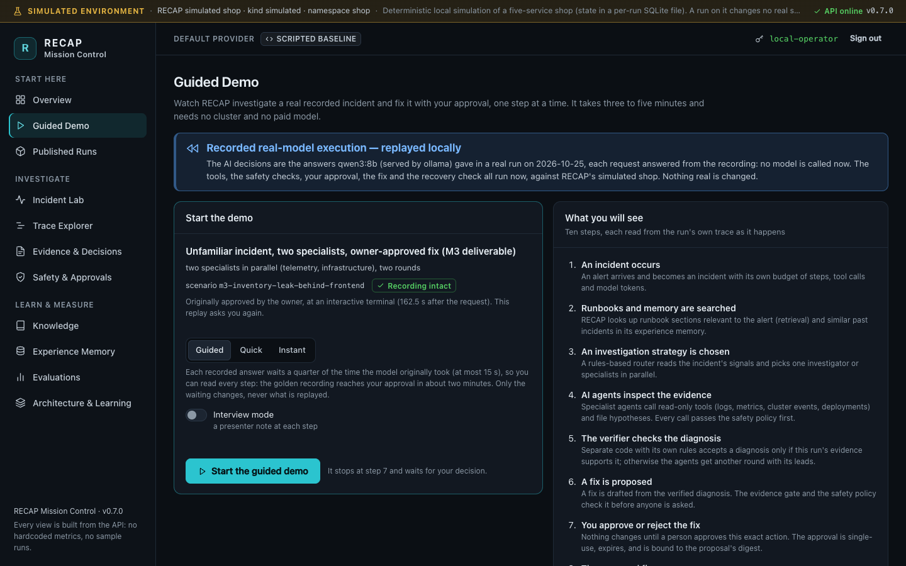
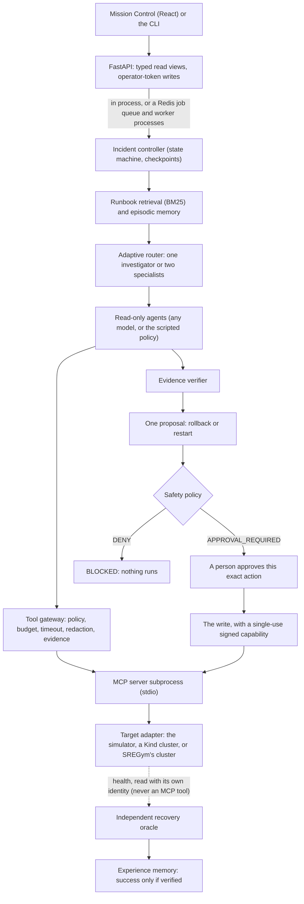

# RECAP: an incident-response agent that investigates, asks before it acts, and proves the fix

**Version 0.7.0** (milestone M6) · [Changelog](CHANGELOG.md) · [Releases](https://github.com/codeit-ronit/recap/releases) · MIT

RECAP is a prototype AI agent for on-call incident response. When an alert fires, AI agents
investigate through typed, read-only tools served over MCP (the Model Context Protocol); rules,
not the model, decide which diagnosis the recorded evidence supports; RECAP proposes **one exact
fix**; a **person approves or rejects** it; a narrowly scoped identity applies it; and an
**independent oracle** checks that the system really recovered. Only verified outcomes become
experience it may reuse. It runs against a simulated online shop by default, and since M5 also
on real Kubernetes clusters (never production).



## The problem it addresses

An agent that can change production is only useful if it can be trusted not to make things
worse. Language models invent causes, follow instructions planted in logs, and report a fix as
done when it is not. RECAP is built around that: the model proposes, trusted code decides; every
write needs a person's approval of that exact action and a single-use signed capability;
destructive actions are always refused; and "recovered" is decided by an oracle that reads the
system's health through its own channel, never from an agent's words.

## What makes its AI architecture interesting

- **Multi-agent with adaptive routing.** A rules router sends one investigator to a clear
  incident and two specialists, side by side, to a hard one, and escalates when a round is
  inconclusive. Adaptive routing kept every recovery while using 2.9 fewer tool calls per run
  than always-single (M6 W4, 8 paired runs).
- **Evidence rules settle claims, never votes.** A verifier checks each root-cause claim
  against the evidence the run recorded; an unsupported claim is never acted on. On three
  SREGym problems it had never seen, RECAP refused every unsupported claim and handed each
  incident to a person instead of acting (M6 W5).
- **One harness, any model.** The same step protocol drives a scripted policy (the default),
  `qwen3:8b` on Ollama (local, or on the owner's VM), a free hosted model, or an offline replay
  of a recorded real run; every run is labelled with what decided.
- **Retrieval and memory that know their limits.** Runbooks are retrieved with citations (BM25);
  past incidents are remembered, but a look-alike is reused only when live evidence confirms the
  same failure on the same service. Without runbooks, recoveries fell from 8 of 8 to 4 of 8
  (M6 W4: the scripted policy falls back to a restart that cannot undo a bad release).
- **Budgets and context packing.** Steps, tool calls, tokens and time are budgeted before each
  call; each agent gets a bounded, ranked context pack in which the evidence a claim cites is
  kept first.
- **Everything is a trace.** Every model request (with the tokens the server reported), tool
  call, policy decision and approval is an event you can replay in Mission Control.

## Try it (about five minutes, offline)

No model, GPU, cloud account or Kubernetes cluster is needed: the Guided Demo replays a committed
real `qwen3:8b` investigation through the whole system and waits for your approval.

```bash
git clone https://github.com/codeit-ronit/recap.git && cd recap
python3.11 -m venv .venv && .venv/bin/pip install -c constraints.txt -e ".[dev]"
.venv/bin/python scripts/seed_demo.py --data-dir ~/recap-demo     # demo runs to look at
(cd apps/dashboard && npm install && npm run build)               # Node 18+
RECAP_DATA_DIR=~/recap-demo .venv/bin/uvicorn apps.api.main:app   # then open http://127.0.0.1:8000/#/demo
```

To approve the demo's fix, sign in with the token in `~/recap-demo/operator-token` (top right).
Or run one incident in the terminal and approve it yourself:
`.venv/bin/python scripts/demo.py --scenario bad-deployment --approve ask`. More:
[getting started](#getting-started), and a click-by-click tour in
[docs/demo-walkthrough.md](docs/demo-walkthrough.md).

## What has actually been demonstrated

Counts, not rates: every sample is small, and scripted, replayed and real-model results are never
added together ([docs/evaluation.md](docs/evaluation.md)). Success means the independent oracle
verified the recovery.

| Where | What decided | Runs | Outcome |
|---|---|---|---|
| Simulated shop, regression | the scripted policy (not a model) | 32 | 24 recovered; 7 not recovered, 1 blocked by safety, each with a named reason |
| Simulated shop, offline replay | two recorded real `qwen3:8b` runs | 2 | 2 recovered |
| Simulated shop, real model | `qwen3:8b` on a laptop (M3, M4) | 12 | 6 recovered, 6 failed with named reasons |
| Real Kubernetes: RECAP's Kind demo (M5) | `qwen3:8b` on the owner's VM; the owner approved each fix | 7 | 3 recovered (one approved in Mission Control); the rest rejected, failed safely or cancelled |
| Real Kubernetes: SREGym, one development problem (M5) | the same | 5 | 1 recovered, and SREGym's own grader passed it |
| Real Kubernetes: SREGym, held out and frozen (M6 W5) | the same, on problems RECAP had never seen | 3 of 5 planned | none solved: each fault needed a change RECAP's two actions (rollback, restart) cannot make; no unsafe action |
| Backend: Docker Compose, Redis, two workers (M6 W6) | the scripted policy | 3 runs of 4, 16, 40 at once | about 1.3 incidents a second; at 40 at once, 16 refused with 429 (exact backpressure); no server error |

The real-cluster runs are published with their traces and open offline in Mission Control
(**Published Runs**, [evals/live/](evals/live/README.md)). Measured results by milestone:
[docs/status.md](docs/status.md); M5's real clusters: [docs/m5-report.md](docs/m5-report.md); the
held-out evaluation: [docs/w5-protocol.md](docs/w5-protocol.md#results); the backend under load,
faults and attacks: [docs/performance-and-reliability.md](docs/performance-and-reliability.md).

## Architecture



An incident moves through `CREATED → RETRIEVING → INVESTIGATING → PROPOSING →
AWAITING_APPROVAL → MITIGATING → VERIFYING → RESOLVED` (or `FAILED`, `BLOCKED`,
`BUDGET_EXHAUSTED`), checkpointed after every step. The full design, with trust boundaries:
[docs/architecture.md](docs/architecture.md); one incident end to end:
[docs/flow.md](docs/flow.md); every component and its status:
[docs/status.md](docs/status.md#component-status); the repository layout:
[docs/architecture.md](docs/architecture.md#16-repository-layout).

## Safety model

Safety does not depend on the model behaving well: trusted code decides, from trusted inputs.

| Risk tier | Tools | Verdict |
|---|---|---|
| read | services, health, logs, metrics, deployments, events, the rollback dry run | allowed; never accepted as a fix |
| reversible write | `execute_rollback`, `restart_service` | only with a person's approval of that exact proposal (bound to its SHA-256 digest, single use, expiring), then a single-use signed capability the target checks itself |
| destructive | `delete_namespace` | always denied, whatever any text says |

Instructions planted in logs, runbooks, memories or tool output are flagged and stay data; the
API changes nothing without the operator's token; safety cannot be switched off outside the
simulator. Every attack the tests make, and what stops it:
[docs/performance-and-reliability.md](docs/performance-and-reliability.md#security-regressions);
the threats and their limits: [docs/threat-model.md](docs/threat-model.md).

## Execution modes

| What | Options |
|---|---|
| Who decides | the scripted policy (default, $0); `qwen3:8b` on Ollama, local or on the owner's VM; `gpt-oss-120b` on Groq's free plan; an offline replay of a recorded real run. A paid model adapter exists and is disabled |
| What it acts on | the simulated shop (default); a Kind cluster with RECAP's demo app (`RECAP_TARGET=kind-demo`); SREGym's cluster and problems (`RECAP_TARGET=sregym-hotel`) |
| Who approves | a person at the terminal or in Mission Control (on a real cluster, by typing the target service's name); the simulation auto-approver on the simulator only |
| Where incidents run | inside the API process (default), or queued in Redis and run by worker processes that survive crashes (`RECAP_EXECUTION_BACKEND=redis`; packaged with Docker Compose) |

## Known limitations

- **Small samples.** Real-model results are a few runs per incident; they show the path works
  and how it fails, not how often a model is right. There is no benchmark score.
- **Two remediations.** RECAP can roll a Deployment back to an earlier image or restart it. The
  held-out SREGym faults needed other edits (storage, a probe, an init container).
- **A CPU-only model is slow.** On the owner's VM one request took about one to ten minutes;
  the held-out evaluation stopped after three problems when requests timed out.
- **One operator token.** An approval proves a token holder or a terminal and a timing, not which
  person decided. Reads are open on loopback by design.
- **Not production.** The simulator and the Kind demo app were written for RECAP; real clusters
  ran on the owner's machines; injection detection is pattern-based (the gateway is the
  protection).

More: [docs/threat-model.md](docs/threat-model.md) and [docs/status.md](docs/status.md).

## Getting started

Requirements: Python 3.11+; Node 18+ to build the dashboard, 22+ for its tests and the
browser smoke test (CI uses 24).

```bash
.venv/bin/pip install -c constraints.txt -e ".[dev]"    # or scripts/bootstrap.sh (also the dashboard)
.venv/bin/python -m pytest                              # about 6 minutes, no network or model
.venv/bin/python scripts/demo.py --list                 # the terminal demos
.venv/bin/python scripts/evaluate.py                    # the scripted evaluation (about 34 s)
```

- **The dashboard while developing:** `uvicorn apps.api.main:app --reload`, then
  `cd apps/dashboard && npm run dev` (http://localhost:5173). Starting runs, approving and
  cancelling need the operator token (printed on first start, saved to `data/operator-token`);
  reading needs none ([apps/api/README.md](apps/api/README.md)).
- **A real model at $0:** `ollama pull qwen3:8b`, then
  `python scripts/demo.py --scenario bad-deployment --provider ollama`
  ([recap/providers/README.md](recap/providers/README.md)).
- **Workers and Docker Compose:** the API, Mission Control, Redis, workers and an optional
  Prometheus ([infra/compose/README.md](infra/compose/README.md)).
- **A real cluster:** the owner's setup on an AWS VM, not a quickstart
  ([docs/m5-report.md](docs/m5-report.md#11-reproduction), [infra/kind/README.md](infra/kind/README.md),
  [infra/sregym/README.md](infra/sregym/README.md)).

## Documentation

- [docs/interview.md](docs/interview.md): a 3 to 5 minute demonstration script and a deeper technical walkthrough
- [docs/architecture.md](docs/architecture.md) and [docs/flow.md](docs/flow.md): the design, and one incident end to end
- [docs/status.md](docs/status.md): every component's status and the measured results, milestone by milestone
- [docs/evaluation.md](docs/evaluation.md): evaluation modes, records, failure categories, comparisons and the published batches
- [docs/w5-protocol.md](docs/w5-protocol.md): the held-out SREGym evaluation, frozen protocol and results
- [docs/performance-and-reliability.md](docs/performance-and-reliability.md): the backend under load, and every fault and attack the tests inject
- [docs/threat-model.md](docs/threat-model.md): what can go wrong and what stops it
- [docs/demo-walkthrough.md](docs/demo-walkthrough.md): Mission Control, click by click
- [docs/m5-report.md](docs/m5-report.md) and [docs/m6-report.md](docs/m6-report.md): the real-cluster milestone and the final one
- [docs/learning-notes.md](docs/learning-notes.md): the concepts behind RECAP, explained simply
- [docs/decisions/](docs/decisions/): the architecture decision records
- [CHANGELOG.md](CHANGELOG.md): what each version changed
- Module READMEs: [API](apps/api/README.md) · [dashboard](apps/dashboard/README.md) · [harness](recap/harness/README.md) · [environments](recap/environments/README.md) · [tools](recap/tools/README.md) · [safety](recap/safety/README.md) · [knowledge](recap/knowledge/README.md) · [memory](recap/memory/README.md) · [context](recap/context/README.md) · [routing](recap/routing/README.md) · [agents](recap/agents/README.md) · [verification](recap/verification/README.md) · [providers](recap/providers/README.md) · [telemetry](recap/telemetry/README.md) · [SREGym adapter](integrations/sregym/README.md) · [infra](infra/README.md)

## Tests and CI

`python -m pytest`: **2485 passed, 15 skipped** in about 6 minutes (Python 3.11; the skips need
a live Kind cluster, a real Redis or the optional OpenTelemetry SDK). No test calls a real model
or a hosted API: fake model servers and committed recordings of real `qwen3:8b` runs stand in.
The dashboard: **710** tests (`npm test`), and a browser smoke test run by hand against a seeded
demo server: **133 of 133** checks for 0.7.0 (every page at 1440 and 390 px, the published runs,
the Guided Demo and the replay-and-approve flow; [apps/dashboard/e2e/smoke.mjs](apps/dashboard/e2e/smoke.mjs)).

CI ([.github/workflows/ci.yml](.github/workflows/ci.yml)) runs on every push: ruff, mypy, the
secret scan of the files and the git history, the recordings manifest check, the full test
suite, the smoke test, and the dashboard's tests and strict build. It needs no secrets, no model
and no network service.

## Roadmap

| Item | Why |
|---|---|
| Remediations beyond a rollback and a restart | The held-out SREGym problems all needed an edit of a Deployment's spec; a typed, approved change of one field, with its own rules, dry run, read-back and oracle check, would make them reachable |
| Per-person approvals | One operator token proves a token holder, not which person decided |
| More runs per scenario, and a faster model server | Success rates need repeated runs; a GPU would show how much the model itself limits the results |
| A learned router | Spend parallel compute only where verified outcomes say it pays off |

## License and author

MIT ([LICENSE](LICENSE)). Built by codeit-ronit as a portfolio project.
