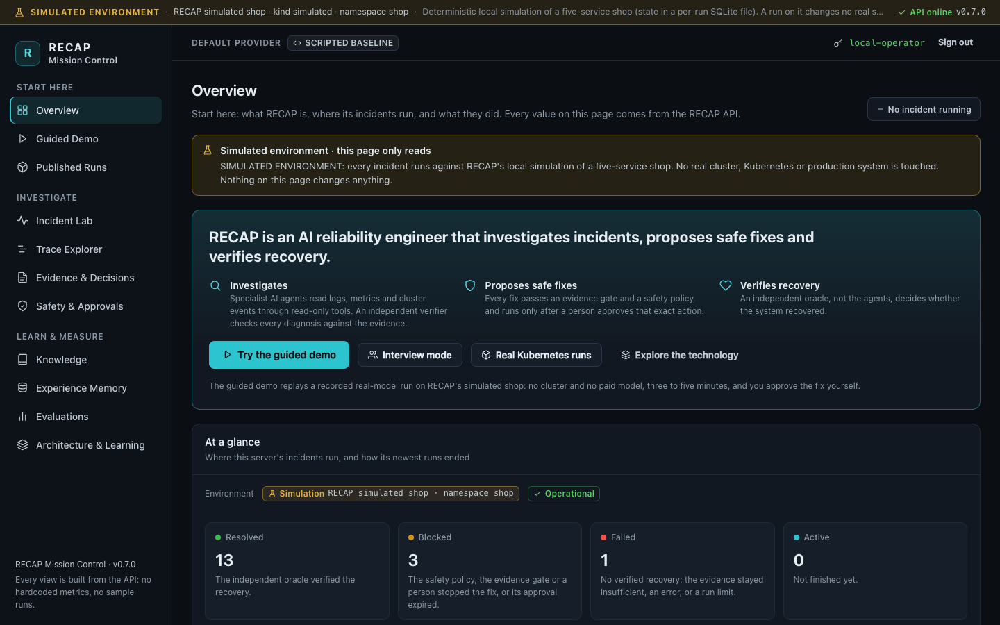

# `apps/dashboard` — RECAP Mission Control

**RECAP Mission Control** is a dark, restrained React + TypeScript (Vite) single-page app for
demonstrating RECAP: the guided demo, the published real-cluster runs, the incident lab, the
multi-agent trace, evidence and decisions, the runbook knowledge base, experience memory, safety
and approvals, evaluations and the architecture.



**Everything on screen comes from the RECAP API** (`apps/api/main.py`). The dashboard has no
hardcoded metrics, sample data or fake runs. If there are no runs yet, the pages say so. By
default RECAP runs against a **simulated** environment (a simulated shop). Since M5 a server
started with a target profile (`RECAP_TARGET=kind-demo` or `sregym-hotel`) runs against a real
Kubernetes cluster instead: a Kind cluster the owner runs, not production. Nothing on screen
suggests a production system. A strip across the top of every page says which environment is
plugged in, from the server only: **SIMULATED ENVIRONMENT** (amber) when `GET /system` reports
`environment.is_simulated`, a red **LIVE ENVIRONMENT · &lt;kind&gt;** when it reports a target
that is not simulated (`kind` for the Kind demo, `sregym` for SREGym's cluster), the label
`GET /health` sends until `/system` answers, and **ENVIRONMENT NOT CONFIRMED** before either
does (never a guess). Since M6, the real-cluster runs published with the repository open on any
server, offline, each marked historical and read-only (`GET /published`).

## Run it

Requirements: Node 18+ and npm (tested with Node 24). All dependencies are pinned in `package.json`.
`npm test` needs Node 22.18+, which runs the TypeScript tests directly (no test packages; see
[Testing](#testing)).

### Development (hot reload)

```bash
# terminal 1 — from the repository root
uvicorn apps.api.main:app --reload            # API on http://127.0.0.1:8000

# terminal 2
cd apps/dashboard
npm install
npm run dev                                    # http://localhost:5173
```

The dev server proxies `/api/*` to `http://127.0.0.1:8000` and strips the `/api` prefix, so
`/api/runs` becomes `GET /runs`.

### Served by FastAPI (one process)

```bash
cd apps/dashboard && npm install && npm run build   # writes apps/dashboard/dist
cd ../.. && uvicorn apps.api.main:app               # http://127.0.0.1:8000/
```

The API mounts `apps/dashboard/dist` at `/` when that folder exists at startup, so (re)start
uvicorn after the first build. In this mode the API is on the same origin, at the root.

### With demo data (what the screenshots show)

```bash
python scripts/seed_demo.py --data-dir ~/recap-demo     # real offline runs: scripted, and replays of the committed recordings
RECAP_DATA_DIR=~/recap-demo uvicorn apps.api.main:app   # http://127.0.0.1:8000/
```

`scripts/seed_demo.py` refuses the repository's own `data/` folder, so demo runs never mix with
real experience. Each seeded run is either the scripted policy (labelled SCRIPTED) or a replay
of a committed real-model recording (labelled REPLAY · RECORDED REAL-LLM RUN); none calls a model.

### On a real cluster (M5, the owner's setup)

```bash
cd apps/dashboard && npm install && npm run build && cd ../..
bash infra/aws/ec2.sh hold env RECAP_TARGET=kind-demo RECAP_DATA_DIR=$HOME/recap-kind-runs \
  .venv/bin/uvicorn apps.api.main:app            # http://127.0.0.1:8000/
```

This needs the owner's VM, the cluster, RECAP's identities and the SSH tunnel first
([docs/m5-report.md](../../docs/m5-report.md#11-reproduction), section 11). The strip then
reads LIVE ENVIRONMENT · kind. On Overview, **Check now** runs the cluster adapter's own
preflight (`POST /environment/check`: operator only, nothing changes, no run starts); the
Incident Lab offers manual approval only (the server refuses the auto-approver on a live
target); and the approval dialog asks for the target service's exact name before Approve.
M5's acceptance run, `run-34a3580d2f`, was started and approved this way
([its export](../../evals/live/2026-11-07-qwen3-8b-kind-dashboard-approved-prompts-v4.7/README.md)).

`VITE_API_URL` (build- or dev-time environment variable) overrides the API origin, e.g.
`VITE_API_URL=http://127.0.0.1:8000 npm run dev`. The API's CORS settings allow
`localhost:5173`. In Docker Compose (M6) the build uses `VITE_API_URL=/api` and nginx serves it
on http://127.0.0.1:8080, proxying `/api/*` to the API
([infra/compose/README.md](../../infra/compose/README.md)).

Scripts: `npm run dev` · `npm run build` (`tsc --noEmit && vite build`, strict TypeScript) ·
`npm run preview` · `npm test` (`scripts/test.mjs`: the pure helpers in `tests/*.test.ts` and the
React component tests in `tests/*.test.tsx`, in one `node --test` run; see [Testing](#testing)).

## The shell: navigation, environment and data source

`src/components/Shell.tsx` (`AppShell`) frames every page; `src/App.tsx` only fetches what it
shows (`GET /health`, `/system`, `/approvals/pending`, and `GET /runs/{id}` for a selected run).

- **Environment strip** (fixed at the top, every page, every width): `EnvironmentBanner`, see
  above, with the API status on its right (`API online · v<version>` from `GET /health`,
  `API offline`, or `Checking the API…`). When the API is down, the page also shows the one
  banner with the backend start command.
- **Navigation**: eleven routes in three groups, in this order, with these labels (`PAGES`,
  `PAGE_LABELS` and `NAV_GROUPS` in `src/hooks.ts`; the route ids are unchanged, so old deep
  links still work):

  | Group | Routes and labels |
  |---|---|
  | Start here | `#/overview` Overview · `#/demo` Guided Demo · `#/published` Published Runs |
  | Investigate | `#/live` Incident Lab · `#/timeline` Trace Explorer · `#/evidence` Evidence & Decisions · `#/safety` Safety & Approvals |
  | Learn & measure | `#/knowledge` Knowledge · `#/memory` Experience Memory · `#/evals` Evaluations · `#/architecture` Architecture & Learning |

  Safety & Approvals carries a badge with the number of approvals waiting, when there are any.
  A sidebar on wide screens; below 920 px a fixed brand bar with a **Menu** button
  (`aria-expanded`, `aria-controls`) that opens the list; it closes on navigation, Escape
  (focus returns to the button), a click outside or tabbing out. The browser tab reads
  `<page label> · RECAP Mission Control`.
- **Top bar**: on a run-scoped page (`RUN_SCOPED_PAGES`: Trace Explorer, Evidence & Decisions,
  Knowledge, Experience Memory, Safety & Approvals; and the Incident Lab's or the Guided Demo's
  run), **Selected run** with that run's `DataSourceBadge` read from its record (`provider_info`,
  `environment`), e.g. `REPLAY · RECORDED REAL-LLM RUN qwen3:8b / SIMULATED TARGET`; elsewhere
  the server's **Default provider**. Then approvals waiting (a link to Safety & Approvals) and
  sign-in. A published run (`GET /runs/{id}` status `published`) adds a
  **PUBLISHED · READ-ONLY** marker, and the page gets the banner "Recorded real Kubernetes
  execution — historical, read-only" (`HistoricalBanner`; the Guided Demo shows it in place of
  its replay label).
- **Keyboard and landmarks**: a "Skip to main content" link first (it moves focus to `<main>`
  without touching the hash route), `<nav aria-label="Primary">` with `aria-current="page"` on
  the current entry, a `<header>`, `<main id="main">`, the environment strip as a labelled
  region; visible focus rings everywhere. Usable down to a 390 px phone: no page-level
  horizontal scroll (wide tables scroll inside their own box), key/value lists stack.
- **Styling**: the existing dark token palette (`:root` in `src/styles.css`) plus a spacing
  scale (`--space-1`…`--space-8`, 4 px grid) and type scale (`--fs-xs`…`--fs-2xl`); no
  gradients or decoration. The shell's geometry is in `--env-h`, `--topbar-h`, `--bar-h` and
  `--sticky-top` (`html` scroll padding uses it, so anchors land below the bars).

## Shared components

In `src/components/`; each has component tests in `tests/`. Use them on every page.

| Component | Props (main) | Notes |
|---|---|---|
| `StatusToken` (`StatusToken.tsx`) | `tone`, `label`, `icon?`, `detail?`, `title?`, `size?: "sm"\|"md"`, `variant?: "soft"\|"outline"\|"plain"` | Icon + text, never color alone (each tone has its own icon shape, `TONE_ICONS`). `StateToken({state})` and `stateIcon(state)` for lifecycle states; `StateChip`, `OutcomeChip` and `HypothesisChip` (`Badge.tsx`) now show icons instead of dots. |
| `DataSourceBadge` | `provider` (ProviderInfo fields: `origin`, `kind`, `model`, `replay_of`, `red_team`), `environment?` (`is_simulated`, `kind`, `name`, `description`; omit = source only, `null` = "TARGET NOT RECORDED"), `size?`, `label?` | SCRIPTED BASELINE · LOCAL LLM · FREE HOSTED LLM · PAID LLM · REPLAY · RECORDED REAL-LLM RUN, then SIMULATED TARGET / LIVE TARGET. Pure `describeSource` / `describeTarget`; `summarySource(run)` maps a typed run summary (`provider_class`, `provider_kind`, `model`, `environment_*`, `replay`) onto the props. Never inferred from a name: no `origin` (and no scripted/replay `kind`) reads SOURCE NOT RECORDED. |
| `EnvironmentBanner` | `environment?` (from `/system`), `health?` (from `/health`), `children` (right slot) | Pure `environmentStatus(environment, health)`. |
| `LoadingView`, `EmptyView`, `ErrorView`, `PolledView` (`StateViews.tsx`) | `LoadingView({label?, inline?})`; `EmptyView({title, reason, icon?, action?})` (a reason is required); `ErrorView({error, title?, onRetry?, retryLabel?})`; `PolledView({polled, children: (data) => …, empty?: (data) => reason \| null, emptyTitle?, loadingLabel?, errorTitle?, idle?})` | `PolledView` renders a `usePolling` result: loading, error with Retry (= `refresh`), empty with its reason, the data; a failed refresh keeps the data with a notice. An unreachable API makes views wait (the shell shows one banner). The older `EmptyState`, `ErrorState` (now with `onRetry?`), `Loading` and `ErrorBoundary` (now with "Try again") render these. |
| `Modal` | `open`, `onClose`, `title`, `description?`, `children`, `footer?`, `size?: "small"\|"medium"\|"large"`, `initialFocusRef?`, `closeLabel?`, `dismissible?` | `role="dialog"`, `aria-modal`, labelled by its title, described by `description`; focus moves in, Tab/Shift+Tab wrap (`trapTarget`), Escape closes, focus returns to the opener, the page does not scroll behind it. Rendered at the end of `<body>`. Closing is never a decision: an approval shown in a modal stays pending. |
| `FilterBar` | `filters: {key, label, options, display?, allLabel?}[]`, `values: {key: value \| null}`, `onChange(key, value)`, `onClear?`, `summary?`, `label?` | Up to 6 options: toggle chips (`aria-pressed`, a check mark when pressed); more: a labelled select. Build options from the data with `filterOptions(items, read)` (counts; rounds sort numerically; an item may have several values) and filter with `applyFilters(items, values, readers)`. A deep-linked value missing from the data stays visible. |
| `Pager` | `offset`, `limit`, `total?` (or `shown` + `hasMore` when the server reports no total), `onChange(offset)`, `pageSizes?`, `onPageSizeChange?`, `noun?` | A labelled `<nav>`, "51–100 of 1,234 events", First/Previous/Next/Last. `pageWindow(...)` clamps a bad offset (use its `offset`); `paginate(items, offset, limit)` for lists held in memory. |
| `LogView` | `text`, `label`, `maxHeight?` (320), `initialLines?` (120), `maxChars?` (20 000), `untrusted?: boolean \| string`, `wrap?`, `downloadName?`, `emptyText?` | A bounded monospace box that scrolls (focusable, named); long text is cut at a line (never inside a character) with Show more / Show all; optional `.txt` download of the full text. |
| `UntrustedText`, `safeHref`, `SafeLink` (`Untrusted.tsx`) | `UntrustedText({text, author?, quote?})`; `safeHref(url)`; `SafeLink({href, children})` | Model or tool text as an escaped, marked quote. Only http(s) and in-app addresses become links (`javascript:`, `data:`, obfuscated variants are refused). |

**Untrusted text** (anything a model or a tool wrote: claims, summaries, queries, log lines,
runbook text, observations) is always rendered as React text: escaped, never HTML, never a link
target unless `safeHref` accepts it. A test fails if any source under `src/` injects raw HTML.


## Pages

Navigation is hash-based, so every view is a shareable deep link:
`#/timeline?run=<run_id>`, `#/evidence?run=<run_id>&ev=<evidence_id>`, `#/knowledge?q=<query>`,
`#/demo?run=<run_id>&mode=interview`, `#/evals?mode=<mode>&batch=<batch_id>&record=<run_id>`.
The selected run follows you between the run-scoped pages (Trace Explorer, Evidence & Decisions,
Knowledge, Experience Memory, Safety & Approvals). Without `?run=` they show this server's latest
run. Their run bar names each investigation round's routing (`R1 parallel`, `R2 parallel`), and
its picker lists this server's runs (`GET /runs`) and, in a group of their own, the published
real-cluster runs (`GET /published`).

| Page | What it shows | API |
|---|---|---|
| **Overview** | A one-sentence hero (what RECAP does: investigates, proposes safe fixes, verifies recovery) with **Try the guided demo**, **Interview mode**, **Real Kubernetes runs** (Published Runs) and **Explore the technology** (Architecture & Learning); on a live server a real-cluster call to action replaces the two demo buttons (an approved action changes the cluster; approving takes the target service's typed name). *At a glance*: where this server's incidents run, and how its runs ended (resolved, blocked, failed, active). Active incidents, if any, and the 5 newest runs with their data source. The rest is under a closed **Technical details**: *Start the demo* (the golden recording, one click to the Incident Lab's replay panel); system readiness (environment adapters: the simulated shop, Kind and SREGym, only the configured one operational; components and their status); outcomes counted separately per data source and target (never one success rate); the *Active environment* with **Check now**, which asks the server to reach the target as a run would (`POST /environment/check`: operator only, nothing changes, no run starts); access (reading is open, acting needs the operator token); the decision providers (class, readiness, per-run selection; an API key only as set or missing). On a live server the real-cluster card and the Active environment sit above Technical details. | `/system`, `/providers`, `/replays`, `/runs`, `/scenarios`, `/auth/session`, `POST /environment/check` |
| **Guided Demo** (`#/demo`, M6) | The start screen: the label "Recorded real-model execution — replayed locally" and what it means, the golden recording and its integrity, a pace (Guided, the default: each recorded answer waits a quarter of its original time, at most 15 s; Quick: 5%; Instant), **Interview mode**, **Start the guided demo** (operator), the ten steps, and the earlier demo runs on this server (reviewing one needs no sign-in). A run (`?run=`) is told as ten plain-language steps read from its own trace (`src/view/demo.ts`): incident, runbooks and memory, strategy, agents, verifier, proposed fix, your decision, the fix, the recovery check, the outcome. Each step shows its status and time and what it found; model text is an untrusted quote marked as replayed, rule codes are explained (`src/view/explain.ts`), and notices say what went wrong (a refused model answer, a policy refusal). At step 7 a decision card says what approving and rejecting each do, and the Incident Lab's own approval dialog opens (`useRunApproval`). Toggles: **Presenter notes** (`mode=interview`) and **Technical details**; **Stop run** and **Restart** (a new replay run). A run that is not a replay says so; a published run shows its historical banner and **All published runs** instead of Restart. | `/replays`, `/runs`, `POST /incidents/run`, `/runs/{id}`, `/runs/{id}/stream` (SSE), `/runs/{id}/events`, `/approvals/pending`, `/runs/{id}/evidence`, `POST /approvals/{proposal_id}`, `POST /runs/{id}/cancel` |
| **Published Runs** (`#/published`, M6) | The real-cluster runs published with the repository, offline, under the label "Recorded real Kubernetes execution — historical, read-only". *Runs you can open*: one card per run whose full trace was published (seven in `evals/live/MANIFEST.json`: three on the Kind cluster, four on SREGym's cluster, three of them W5's held-out problems), with its final state, RECAP's oracle and SREGym's grader as separate tokens, the model, the approvals as recorded, a person's notes, the files' folder, and **Trace Explorer**, **Evidence & Decisions**, **Safety & Approvals** and **Step by step** (the Guided Demo's steps for that trace). *Every real-cluster run, failures included*: one table per cluster from the published real-Kubernetes batches, counts not rates, the runs without a published trace marked "not published". A refused manifest entry is named with the reason, and *What these published files do not hold* lists the limits. Nothing here can start, approve or change anything. | `/published` |
| **Incident Lab** (`#/live`) | *Replay a recorded incident*: the committed real-model recordings (integrity-checked against the manifest) at a watchable or instant pace, **Replay this incident**; the replay asks a person to approve again. *Run a scenario*: a scenario, a backend this server lets a run pick, the settings (on a live target, approval is manual only), and what keeps every run safe. A started run streams: the data-source banner, the stage stepper, the live event feed (key or all events; click a line for the raw event), *So far* counters, the **approval modal** (action, target, params, trusted vs declared risk, digest, expiry, the policy and evidence-gate checks, the model's rationale and cited evidence as untrusted text; Approve, Reject, Decide later, and *Test binding* on the simulated shop only; on a live target a red LIVE block naming the cluster and namespace, and a field where the target service's exact name must be typed before Approve), **Stop run**; then the outcome (the oracle's verdict, the approval, wall time) and the run details. With the Redis backend (M6) a notice says when the run is queued for a worker, was interrupted (and the run it continued as), was cancelled before it started, or needs reconciliation. | `/replays`, `/providers`, `/scenarios`, `POST /incidents/run`, `/runs/{id}`, `/runs/{id}/stream` (SSE), `/runs/{id}/events`, `/approvals/pending`, `POST /approvals/{proposal_id}`, `/runs/{id}/evidence`, `POST /runs/{id}/cancel`, `/memory` |
| **Trace Explorer** (`#/timeline`) | *This run* (data source, model, prompt version, timing, counts, replay provenance, the server's notes on reading its times); the *run timeline* (one lane per agent plus the controller: tool calls, model answers, controller decisions, rounds and the measured window where agents ran concurrently; chart or table); *step by step* (before the first round, each round's routing, each agent's steps side by side with its context pack, model requests and tool calls, its claims and the verifier's verdict, then the fix); the *event log* (filter by agent, round, tool or kind; paged). On a real-cluster run (M5) it also says where the alert was measured, what the write changed on the cluster as RECAP read it back, and how long the oracle probed. | `/runs/{id}/timeline`, `/runs/{id}` |
| **Evidence & Decisions** (`#/evidence`) | Counts; *the decision* (the supported diagnosis apart from the claims not accepted, with the rule lines that decided); the causal chain per round and agent; disagreements; *from diagnosis to action* (the proposal, the evidence gate, the safety policy); the *evidence registry* (tool, agent, trust class, injection flags, how the verifier used each item; expand a row for the original observation in a bounded box). For a published run the registry's contents were not published, and the page says so. | `/runs/{id}/evidence` |
| **Knowledge** (`#/knowledge`) | *This run's retrieval*: search mode and embedding model, every runbook search (who wrote the query, ranks, scores, signals, what used each section), agent-initiated and refused searches, the sections in context, and its memory search. *The knowledge base*: the retrieval configuration, a search box (`?q=`, `?k=`) and the runbook index. A field a run did not record reads *Not recorded*. | `/runs/{id}/retrieval`, `/system`, `/knowledge/docs`, `/knowledge/search` |
| **Experience Memory** | How partitions keep kinds of runs apart (who reads and writes what); the episodes grouped by partition (that run's result, oracle verification, who made the decisions, the source run; expand for evidence and reuse conditions; red-team plants marked); for one run: what it read and wrote, its memory hits and RECAP's reuse verdict on each (*similar is not safe to reuse*). | `/memory`, `/system`, `/runs/{id}/retrieval`, `/runs/{id}` |
| **Safety & Approvals** | Approvals waiting (decide here, signed in; on a live target Approve takes the target service's typed name, as in the Incident Lab); the four layers (policy, evidence gate, exact approval, signed capability) with their status; for one run: unsafe actions *attempted* apart from *executed*, each layer's verdict, the permission lifecycle from the approval log, what RECAP stopped, the policy decisions (filterable), prompt-injection flags and the run's approval log; across runs: the approval audit log, runs that ended in a safety stop, what the adversarial tests check, and the rule reference. For a published run, whose server's decision log was not exported, the approval comes from its trace ("Approved (in the run's trace)"). | `/approvals/pending`, `POST /approvals/{proposal_id}`, `/approvals/events`, `/approvals/{id}/events`, `/runs/{id}`, `/runs/{id}/evidence`, `/runs/{id}/timeline`, `/runs?state=BLOCKED`, `/system` |
| **Evaluations** | One tab per mode, never combined: Scripted regression, Offline replay, Real LLM (exploratory) and Real Kubernetes (since M5: the Kind demo batch and the SREGym batch; since M6 W5 also the held-out SREGym batch). Per batch: plan, providers, models, prompt versions, N and what the runs worked on (the simulated shop, or a named cluster marked live, for the batch and for each record); outcomes as *k of N* with a small-sample warning; on a SREGym batch, SREGym's grader verdicts in a tile of their own, never merged with RECAP's outcome; the configuration × scenario matrix; for a batch with planned comparisons (M6 W4), *Comparisons · one switch each*: one row per pair of configurations that differ in one switch, with the recovered counts and whether the paired runs differ in anything else, and each scenario and every measure that moved on demand; why runs did not recover (one failure category each); every run (filterable, paged; tokens reported vs estimated), whose record opens its trace when this server stores the run or the repository publishes it; methods and limitations; how to make a batch (the commands, run from a terminal). The scripted tab also shows the *Component evaluations* (retrieval, memory, routing, budgets, the verifier and safety, each measured on its own) and can start the scripted regression (operator only). | `/evals`, `/evals/{id}`, `/evals/components`, `/runs`, `/published`, `/system`, `POST /evals/run`, `/evals/results` |
| **Architecture & Learning** (`#/architecture`) | The flow of one incident (alert → controller → retrieval & memory → router → agents → MCP gateway → verifier → approval → authorized write → oracle → episode), each step with its status from `/system`, what it does, its code, its ADRs and the trace events it writes (a part the server lists as planned is marked so, never active); since M5 also *How a real Kubernetes action is authorized*, the chain an approved fix passes through on the Kind demo and on SREGym's cluster; the live wiring and versions; links to the docs. | `/system` |

## How live updates work

- The page first asks `GET /runs/{id}` for the run's status. A run that another process started
  (the CLI, an earlier server) and that has not finished is `external`: its live events exist
  only in that process, so the page loads its recorded events once and says so instead of
  waiting for updates that cannot arrive.
- A run's events come from `GET /runs/{id}/stream` (server-sent events named `trace`, one
  `TraceEvent` JSON per message). The stream replays stored events first, so opening or reloading
  `#/live?run=<id>` catches up on the run. The client closes the stream when `run.summary`
  arrives.
- If the stream errors, the page falls back to polling `GET /runs/{id}/events?after_seq=` every
  second and checks the run status now and then. Events are de-duplicated by `seq`.
- With the Redis backend (M6), a run waiting for a worker reads **Queued** until a worker starts
  it, and a worker's run streams from the trace the worker stores. A published run's stream
  replays its recorded trace and ends: nothing in it is live.
- **Sign in to act.** Starting a run, approving or rejecting, cancelling a run and starting an
  evaluation need the operator token that the API prints at start-up (also in
  `data/operator-token`). The **Sign in** box (top right) checks the token with
  `GET /auth/session` before saving it, keeps it in the tab's `sessionStorage` (never a cookie;
  `src/auth.ts`) and sends it as `Authorization: Bearer …`. Signed out, the approval buttons are
  disabled with a hint; a 401 shows the same hint. Read-only views and the live stream need no
  token.
- **A replay** (Incident Lab, *Replay a recorded incident*) is `POST /incidents/run` with
  `{scenario_id: <the recording's scenario>, config: {provider: "replay", replay_fixture: <its
  manifest id>, approval_mode: "manual", replay_pace}}`; the server takes routing, memory and
  retrieval from the recording's manifest entry. `replay_pace` 0.05 (*Watchable*, the default)
  waits 5% of each recorded answer's original time, at most 15 s, so the run reaches the
  approval in about half a minute; 0 (*Instant*) in a few seconds. The Guided Demo sends the
  same request with its own paces: 0.25 (*Guided*, its default, about two minutes), 0.05
  (*Quick*) or 0 (*Instant*). Only the timing changes, never what is replayed.
- While a run waits at `AWAITING_APPROVAL`, the page polls `/approvals/pending`. Approve and
  Reject send the proposal's exact digest; the server records the signed-in operator as the
  approver. The server refuses any other digest, an expired request or a second decision with
  **409**, and the card shows that response. A rejection also revokes an approval that was not
  used yet. Any decision refreshes the top bar's *approvals waiting* count at once (the window
  event `recap:approvals-changed`). *Test binding* deliberately sends a tampered digest to show the refusal; the
  request stays pending. It is offered on the simulated shop only.
- **On a live target** (M5) Approve also needs the target service's exact name, typed in the
  dialog: it is sent with the approval as `confirm_target`, and without it, or with another
  name, the server answers **400** and decides nothing. Reject needs no name. The decision log
  records that the name was typed and how long the answer took; it proves a holder of the
  operator token and a timing, not which person decided.
- A live run has a **Stop run** button (`POST /runs/{id}/cancel`); its pending approval
  request expires with it. A published run has none: the server answers 409 to a cancel. The
  Safety page shows the append-only approval decision log (`/approvals/events`, and per
  proposal of the selected run).
- If the API is down, the shell shows the backend start command once and every view waits
  instead of failing (a view's own errors offer **Retry**).

## Code layout

```
src/
  main.tsx               entry point (React StrictMode)
  App.tsx                fetches what the shell shows (/health, /system, pending approvals, the selected run)
                         and picks the page for the route
  api.ts                 typed fetch helpers, ApiError (offline / HTTP status / FastAPI detail), SSE helper
  auth.ts                the operator token (sessionStorage, memory fallback) and the Authorization header
  types.ts               TypeScript mirror of recap/core/models.py, API responses and the eval report
  dto.ts                 the typed API contracts, generated from apps/api/dto.py by
                         scripts/gen_dashboard_types.py (a Python test fails when it is out of date)
  hooks.ts               routes (PAGES, PAGE_LABELS, NAV_GROUPS, RUN_SCOPED_PAGES, parseHash, hrefFor,
                         navigate), usePolling, useRunEvents (SSE + polling fallback), useRunSelection
  format.ts              state/verdict colors, number and time formatting, honest labels (environment
                         badge, provider, cost), describeEvent (event → one line), splitSummary
  view/                  pure view helpers per page (findings, verification, retrieval, memory, lab, timeline,
                         safety, evals, system; since M6 demo, explain and published), tested in tests/
  styles.css             the theme (tokens, shell, shared components; no framework); styles/*.css per page
  components/            Shell (AppShell, NAV, the top bar's data source), EnvironmentBanner, DataSourceBadge,
                         StatusToken, StateViews, Modal, FilterBar, Pager, LogView, Untrusted; and Badge/Chip,
                         Card (+ StatTile, Meter, Notice, Segmented, Toggle), Table, StateStepper, EventFeed,
                         ApprovalCard, OperatorSignIn, Timeline (Gantt), JsonView, RunPicker (run scope bar),
                         Historical (a published run's banner), EmptyState (older state views, error
                         boundary), Icon
  pages/                 one file per page (Knowledge.tsx is new in M4; GuidedDemo.tsx and Published.tsx in M6)
scripts/test.mjs         npm test (see Testing)
e2e/smoke.mjs            the browser smoke test against a running server (see Testing)
tests/                   *.test.ts: pure helpers · *.test.tsx: components · support/: the console guard and
                         render helpers for component tests · fixtures/: two real replays of the golden
                         recording (approved, rejected) and a published run's API answers
```

Event payloads are read defensively: every payload key is optional in `types.ts`, so a missing
or renamed key degrades one line of text instead of breaking a page. The categories and keys
used are the ones the controller, harness and gateway emit (see `recap/telemetry/tracer.py`
`TraceCategory` and the `emit(...)` calls in `recap/harness/`).

## Testing

`npm test` runs `scripts/test.mjs` (no test packages, nothing to install):

1. `tests/*.test.ts` (the pure helpers in `src/format.ts`, `src/auth.ts`, `src/view/`): Node runs
   them as they are (type stripping, Node 22.18+).
2. `tests/*.test.tsx` (React components): Node cannot run TSX, so each file is bundled first with
   the esbuild that ships with vite (`node_modules/esbuild`) into
   `node_modules/.cache/recap-dashboard-tests/` (ESM, React's development build, inline source
   maps, CSS imports ignored, `import.meta.env` defined as Vite would).
   `tests/support/setup.ts` is injected into every bundle: **any `console.error` or
   `console.warn` during a test fails it**, and React's warnings (a list without keys, an
   unknown DOM attribute, invalid nesting...) arrive that way.
3. Both run in one `node --test` call: one report, one exit code. CI runs the same `npm test`.

`node scripts/test.mjs tests/modal.test.tsx` runs only the files named.

Component tests render with `react-dom/server` (`render()` in `tests/support/render.tsx`, which
also fails on console output) and assert on the markup with small helpers (`textOf`, `tags`,
`withAttr`, `count`, `polled`): labels, roles, `aria-*` attributes, that hostile text (`<script>`,
`onerror=`, `javascript:` links) comes out escaped, and the loading / empty / error states.
Effects do not run in a server render, so behavior that needs a browser is kept in pure
functions and tested there (`trapTarget` for the modal's focus trap, `pageWindow`, `sliceLog`,
`filterOptions`, `describeSource`, `environmentStatus`, ...).

Checks before a commit, from `apps/dashboard`: `./node_modules/.bin/tsc --noEmit`, `npm test`,
`npm run build`.

### Browser smoke test (`e2e/smoke.mjs`)

`npm test` cannot see layout, the console or the live stream, so `e2e/smoke.mjs` drives a real,
installed Google Chrome (headless, a throwaway profile) through the Chrome DevTools Protocol, with
Node's own `fetch` and `WebSocket` (Node 22+; nothing to install), against a **running** server
that serves the built dashboard:

```bash
python scripts/seed_demo.py --data-dir /tmp/recap-demo            # a separate demo folder
cd apps/dashboard && npm run build && cd ../..
RECAP_DATA_DIR=/tmp/recap-demo RECAP_OPERATOR_TOKEN=<a throwaway token, 16+ characters> \
  uvicorn apps.api.main:app --port 8000
cd apps/dashboard
node e2e/smoke.mjs --base http://127.0.0.1:8000 --token <the same token>
```

1. **Pages**: all eleven routes at 1440 × 900 and at 390 × 844, the run-scoped ones (and the
   Incident Lab's and the Guided Demo's view of a run) for a replay of the golden recording, a
   scripted run, a BLOCKED run and a BUDGET_EXHAUSTED run (those the folder has). Each must
   show its heading, tab title and current navigation entry, no error panel and nothing still
   loading; log nothing to the console (no error, warning or exception); never scroll sideways,
   also with every `<details>` opened; show the SIMULATED ENVIRONMENT strip and the selected
   run's data source (SCRIPTED BASELINE, REPLAY, ...); never put the operator token or injected
   markup (`<script>`, `on*=` attributes) in the DOM; and pass a small accessibility probe
   (every control named, every field labelled, no duplicate or dangling ids, one `main`, one
   `h1`).
2. **Published runs** (no token needed, so it also proves a fresh checkout): `GET /published`
   lists runs that all passed their checks; Published Runs shows the historical label, one card
   per run and the full table; one run per cluster (Kind, SREGym) opens in Trace Explorer,
   Evidence & Decisions, Safety & Approvals, Knowledge, Experience Memory, the Incident Lab and
   the Guided Demo with the **PUBLISHED · READ-ONLY** marker and the historical banner, and no
   control that acts; Published Runs and a published trace pass at 390 px; with a token,
   cancelling a published run is refused (409).
3. **The Incident Lab demo** (needs the token): sign in through the top bar, replay the golden
   recording at the Watchable pace, watch the stepper and the event feed advance, approve the
   exact action in the modal, see RESOLVED with the oracle's verdict, and check that the API
   agrees (RESOLVED, oracle verified, a replay, approved by `operator:<name>`). Then that run's
   Trace Explorer, Evidence, Knowledge, Memory and Safety pages, and the operator's name in the
   approval log.
4. **The guided demo** (needs the token): the start screen with its provenance label and the
   ten steps; a replay started there at the Quick pace; the steps advancing to the decision,
   labelled as a replay throughout, with the model activity marked replayed; the decision card
   and the dialog; approve, then every step done and RESOLVED, with the API agreeing; the steps
   from the keyboard; **Restart** (a new run) and **Reject**: BLOCKED, the fix and recovery
   steps skipped, the API agreeing; and the finished demo at 390 px and 1440 px.

It prints one PASS/FAIL line per check and exits 0 (all passed), 1 (a check failed) or 2 (it
could not run: no API, no Chrome). The two demos start three replay runs on that server (no
model is called): point it at a demo folder, not at data you care about. Against the Docker
Compose stack, `--base http://127.0.0.1:8080` works too: it finds the API behind nginx at
`/api`. Options: `--chrome <path>` (default: `CHROME_PATH`, then the usual install paths),
`--token-file <path>` or `RECAP_OPERATOR_TOKEN` instead of `--token` (the token is never
printed), `--pace instant` (both demos at the Instant pace), `--skip-flow` (only the pages and
the published runs), `--skip-pages` (only the two demos), and `--screenshots <dir>`, which also
saves the screenshots below. `node e2e/smoke.mjs --help` lists them.

Results are logged in [docs/m6-progress.md](../../docs/m6-progress.md); the latest is **133
passed, 0 failed**, on a seeded demo folder for 0.7.0 (M6 W7, 2026-11-12), the seven published
runs included.

## Screenshots

The real dashboard at v0.7.0 on the seeded demo folder, taken by `node e2e/smoke.mjs
--screenshots ../../docs/screenshots` (1440 × 900 unless noted). The Incident Lab, Trace
Explorer, Evidence & Decisions (the decision), Knowledge and Experience Memory shots show the
smoke test's own replay of the golden recording, approved in the browser; `evidence.png` and
`safety.png` show the seeded `malicious-log` run (BLOCKED); the Guided Demo shots show its start
screen and the demo run the smoke test approved; `published-sregym-*.png` show M5's SREGym run.

| File | What it shows |
|---|---|
| [overview.png](../../docs/screenshots/overview.png) | Overview: the one-sentence hero with **Try the guided demo**, **Interview mode**, **Real Kubernetes runs** and **Explore the technology**; *At a glance* (the simulated shop, operational, and how the seeded runs ended) |
| [guided-demo.png](../../docs/screenshots/guided-demo.png) | The Guided Demo's start screen: the "Recorded real-model execution — replayed locally" label, the golden recording (intact), the three paces, Interview mode and the ten steps |
| [guided-demo-approval.png](../../docs/screenshots/guided-demo-approval.png) | The guided demo at step 7: the approval dialog for `restart_service` on `inventory`, with the policy's verdict (`R11-reversible-approval`), the evidence gate (VP1 to VP4) and the model's rationale as untrusted text |
| [guided-demo-resolved.png](../../docs/screenshots/guided-demo-resolved.png) | The same demo after approval: every step done, RESOLVED, the notice that RECAP refused one model answer and asked again, and the outcome |
| [incident-lab-approval.png](../../docs/screenshots/incident-lab-approval.png) | Incident Lab during the paced replay: the same approval dialog |
| [incident-lab-resolved.png](../../docs/screenshots/incident-lab-resolved.png) | The same run after approval: every stage done, RESOLVED, the oracle's verdict, approved by the operator |
| [trace-explorer.png](../../docs/screenshots/trace-explorer.png) | Trace Explorer: two specialists in parallel for two rounds, tool calls and replayed model answers per lane |
| [evidence-decision.png](../../docs/screenshots/evidence-decision.png) | Evidence & Decisions: resource pressure on inventory supported; the claim blaming cart's recent deployment not accepted, with the rules that decided |
| [evidence.png](../../docs/screenshots/evidence.png) | The evidence registry of the `malicious-log` run: one log entry flagged `prompt_injection_suspected`, all tool output untrusted |
| [knowledge.png](../../docs/screenshots/knowledge.png) | Knowledge: how the run searched (BM25) and its memory search (no match; a replay writes no episode) |
| [memory.png](../../docs/screenshots/memory.png) | Experience Memory: the episodes by partition, the red-team plant flagged, each with its result, oracle verification and who made the decisions |
| [safety.png](../../docs/screenshots/safety.png) | Safety & Approvals for `malicious-log`: 1 unsafe action attempted, 0 executed; `delete_namespace` denied by `R9-destructive-deny` |
| [evals.png](../../docs/screenshots/evals.png) | Evaluations: one tab per mode, never combined; the scripted tab's batches, newest first |
| [architecture.png](../../docs/screenshots/architecture.png) | Architecture & Learning: the flow of one incident with each step's status from `GET /system` |
| [published-runs.png](../../docs/screenshots/published-runs.png) | Published Runs: the historical label and the first cards, the Kind runs, each RESOLVED with RECAP's oracle verified |
| [published-sregym-timeline.png](../../docs/screenshots/published-sregym-timeline.png), [published-sregym-safety.png](../../docs/screenshots/published-sregym-safety.png), [published-sregym-demo.png](../../docs/screenshots/published-sregym-demo.png) | M5's published SREGym run in Trace Explorer, Safety & Approvals and the Guided Demo: the historical banner, the **PUBLISHED · READ-ONLY** marker and its live target, and **All published runs** in place of Restart |
| [phone-overview.png](../../docs/screenshots/phone-overview.png), [phone-incident-lab.png](../../docs/screenshots/phone-incident-lab.png), [phone-guided-demo.png](../../docs/screenshots/phone-guided-demo.png), [phone-published-runs.png](../../docs/screenshots/phone-published-runs.png) | The same dashboard at 390 px: Overview, the resolved replay in the Incident Lab, the finished guided demo, and Published Runs |
