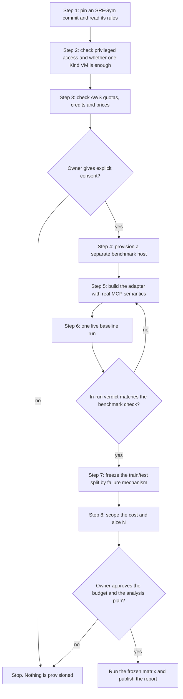
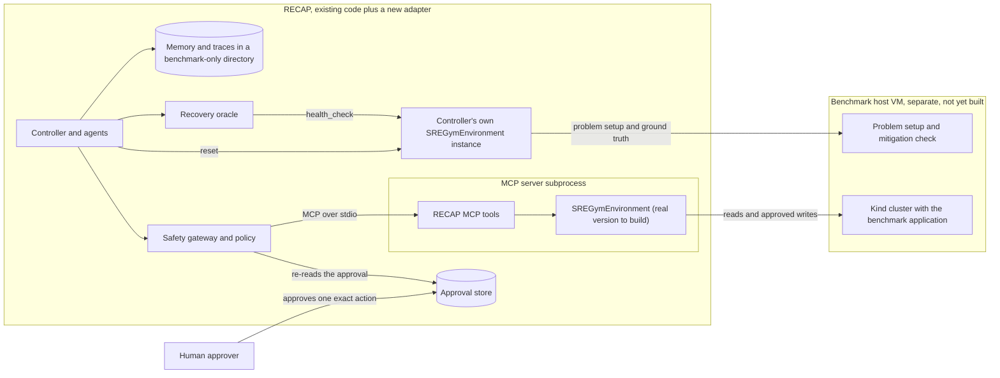
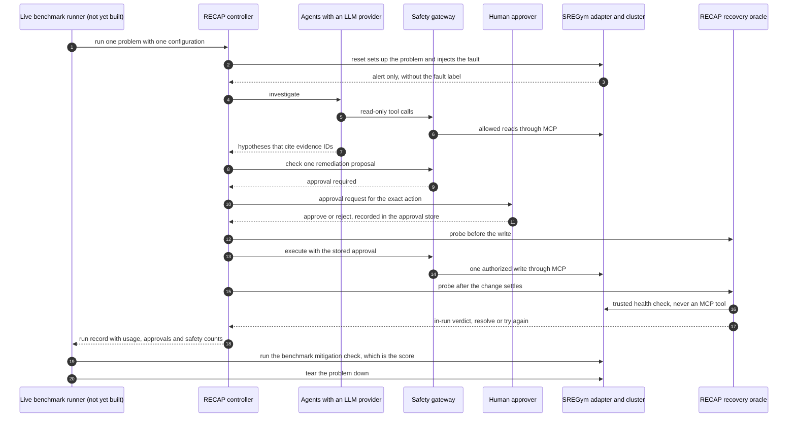

# Benchmark plan: RECAP on SREGym

> **Plan only. Nothing in this document has been run.** RECAP V1 has never connected to
> SREGym and has no SREGym results. The SREGym adapter is an interface stub that refuses
> every operation. The only benchmark that exists today is the small synthetic evaluation
> on RECAP's own simulator ([latest report](../evals/reports/latest/summary.md)).

## In short

RECAP V1 investigates and repairs incidents in a *simulated* five-service shop. The next
honest step is to test it on real faults in a real Kubernetes cluster. This plan uses
SREGym, a public benchmark for SRE (site reliability engineering) agents whose problems
run on live Kubernetes applications. What SREGym contains, requires and scores must be
confirmed at a pinned commit (step 1). This plan assumes nothing more.

Four ideas carry the whole plan:

1. **Score objective recovery.** The headline number answers "did the system become
   healthy again?", judged by the benchmark's own programmatic check of cluster state. It
   is not a language model grading a diagnosis.
2. **Consent before cost.** Nothing is provisioned without the owner's explicit consent,
   and budget alerts are never treated as spending caps.
3. **No leakage.** Train and test problems are split by failure mechanism before any
   scored run. Memory is partitioned the way the simulator evaluation already does it.
   Runbooks are frozen and never written for test faults.
4. **Honest numbers.** Every result states N and a confidence interval. Real results are
   never mixed with simulated ones.

## Words used in this plan

| Term | Meaning |
|---|---|
| Kubernetes | The standard system for running containerized services on a cluster of machines. |
| Kind | "Kubernetes in Docker": a whole Kubernetes cluster running as Docker containers on one machine. Not to be confused with the `kind:` key in [`configs/environment.yaml`](../configs/environment.yaml), which picks RECAP's environment adapter. |
| MCP | Model Context Protocol, an open protocol for listing and calling tools. RECAP's agents reach the environment only through MCP tools. |
| Oracle | An independent judge that reads ground truth (here: is the system healthy?) and ignores what agents say. |
| Mitigation | An action that restores service, such as a rollback or a restart. |
| Ablation | A run with one component switched off, to measure what that component adds. |
| Leakage | Information about test problems reaching the system before or during testing. It makes scores look better than they are. |
| Confidence interval (CI) | A range of plausible values for a true rate, given the sample. Few samples give a wide range. |

Status words used in this plan:

| Status | Meaning |
|---|---|
| implemented | The code exists in this repository and is covered by tests. |
| simulated | It works, but only against the simulator (or a simulated human approver). |
| adapter only | An interface or opt-in adapter exists, but it has never run against the real thing. |
| not yet built | It does not exist. |

## What is verified today, and what is planned

| Piece | Status | Where |
|---|---|---|
| Synthetic evaluation: train/test split, five test configurations, red-team suite, per-case report | implemented, on the simulator only (N = 6 test scenarios, 1 red-team scenario) | [`evals/runner.py`](../evals/runner.py), [`evals/reports/latest/summary.md`](../evals/reports/latest/summary.md) |
| The target system and its faults | simulated | [`recap/environments/README.md`](../recap/environments/README.md) |
| Swappable environment interface (`TargetEnvironment`), chosen by `kind` in the config | implemented; an end-to-end test runs the whole pipeline on a second, fake adapter | [`recap/core/interfaces.py`](../recap/core/interfaces.py), [`recap/environments/registry.py`](../recap/environments/registry.py), [`tests/e2e/test_environment_swap.py`](../tests/e2e/test_environment_swap.py) |
| Independent recovery oracle | implemented (judges simulator ground truth) | [`recap/verification/oracle.py`](../recap/verification/oracle.py) |
| `SREGymEnvironment` | adapter only: every operation raises `EnvironmentNotIntegrated` | [`integrations/sregym/adapter.py`](../integrations/sregym/adapter.py), [`tests/unit/test_sregym_adapter.py`](../tests/unit/test_sregym_adapter.py) |
| Mapping of RECAP tools to Kubernetes capabilities | not yet built (a planned, unverified table) | [`integrations/sregym/mapping.md`](../integrations/sregym/mapping.md) |
| Optional Claude provider, an LLM that could read real, free-text logs | adapter only: opt-in, your own API key and billing, tested only with a fake client | [`recap/providers/anthropic_provider.py`](../recap/providers/anthropic_provider.py) |
| Human approvals through the console or the dashboard | implemented (the approver's identity is a label, not authenticated) | [`recap/safety/approvals.py`](../recap/safety/approvals.py) |
| Benchmark host (one VM running a Kind cluster) | not yet built; nothing is provisioned | [`infra/README.md`](../infra/README.md) |
| Live benchmark runner (human approvals, real token and cost columns, time to mitigation) | not yet built | none |
| Any SREGym run, result or confidence interval | not yet built: none exist | none |

The simulator evaluation shows that the plumbing and the protocol work and are
reproducible. It says nothing about real clusters or LLM agents: the environment is
simulated, the default provider is a scripted policy (not an LLM), every approval is granted
by the simulation auto-approver (not a human), N is tiny, token counts are estimates (about
4 characters per token) and the cost is $0.

## Goals

**Primary goal: objective recovery on real faults.** After RECAP's approved action, does
the benchmark's own programmatic mitigation check pass? That check reads cluster state. It
is not a language model judging whether a diagnosis "sounds right". If some benchmark
stage is scored by an LLM judge (verify this at the pinned commit), report that stage
separately, if at all, and never as the headline.

The simulator already works this way. In the bad-deployment demo, the run becomes
RESOLVED only after the oracle has read ground truth (excerpt from the real transcript):

```text
[  1.78s] MITIGATE  execute_rollback on checkout ok=True · ['checkout: version v2.4.1 -> v2.4.0', 'checkout: pods replaced']
[  1.78s] ORACLE    RECOVERED ✓ · simulated-health-oracle · unhealthy after: []
 ORACLE     verified=True (healthy before=False, after=True)
```

On SREGym, the same verdict must come from the real cluster, through a channel that
agents cannot reach.

**Secondary goals.**

- **Cost of a recovery:** time, tool calls, real tokens and dollars, and human approvals.
- **Safety on a live system:** count unsafe attempts and blocks. Executed unsafe actions
  must be zero.
- **Value of each component on real faults:** repeat the V1 ablations (no memory, no RAG,
  single agent only) with an LLM provider on held-out problems.
- **The architecture claim, tested honestly:** swapping the infrastructure is designed to
  be one `TargetEnvironment` adapter plus `configs/environment.yaml`, with the controller,
  gateway, RAG, memory, router and orchestrator code unchanged. Today that is proven only for
  a small fake adapter that reuses the simulator's log conventions
  ([`tests/e2e/test_environment_swap.py`](../tests/e2e/test_environment_swap.py)), and some
  data is still simulator-specific: the log conventions, the allowlists and the runbooks.
  Record everything else that had to change.

**Non-goals.** No model training or fine-tuning (V1 has none). No claim of production
readiness. No leaderboard comparison unless the benchmark's rules are followed exactly. The
"safety off" ablation never runs against a live cluster.

## The plan, step by step

All eight steps are **not yet built**. Each one ends with a "done when" check. The diamonds
are gates: two need the owner's explicit decision, and one checks that RECAP's own verdict
agrees with the benchmark's.



### Step 1: pin SREGym and read its rules

- Choose one SREGym commit and record its full hash. Everything later is verified against
  that commit only.
- Read, at that commit:
  - the **license**: may we run it, publish results and name its problems?
  - the **problem inventory**: problem ids, applications, fault types;
  - the **benchmark rules**: what an agent may use (for example outside knowledge,
    runbooks or memory), and what counts as a valid run;
  - the **evaluation stages**: which stages a programmatic check scores, and which (if
    any) an LLM judge scores.
- Write the inventory down, with each problem's fault and failure mechanism. It is the
  input to the split in step 7.
- **Done when** the commit hash, license notes, rules and inventory are written down and
  the owner has reviewed them.

### Step 2: check access needs and the smallest host

- For the candidate problems, check whether fault injection or the benchmark tooling needs
  privileged containers or root access on the Linux host, for example to change kernel
  networking.
- Check whether one VM running Kind is enough: CPU, memory, disk and kernel features. Kind
  itself runs its cluster nodes as privileged Docker containers, so the host must be a
  machine where you control Docker, such as your own VM.
- Drop problems this host cannot run, and write down why. A dropped problem is reported as
  excluded, never removed silently.
- **Done when** the problem subset, its host requirements and the exclusion list are
  written down.

### Step 3: check AWS limits and prices before spending

- **EC2 quotas** for the chosen instance family and region. On-demand quotas are counted in
  vCPUs, and new accounts can start with low limits.
- **Credit eligibility:** whether promotional credits really apply to that instance type,
  region and service.
- **Region pricing:** the on-demand price differs between regions.
- **Disk and public-IP fees:** EBS volumes are billed even while the instance is stopped;
  snapshots and public IPv4 addresses are billed too; check data transfer.
- **Budget alerts are not hard caps.** A budget alert only notifies you. It does not stop
  spending, and billing data reaches AWS Budgets with a delay of hours. Use alerts *and* a
  hard personal rule (step 4).
- **Done when** a written cost estimate and a hard stop amount exist. The hosting rules
  are in [`infra/README.md`](../infra/README.md).

### Step 4: provision only with explicit consent, and keep things separate

- No script in this repository creates cloud resources. Provisioning is a manual act that
  happens only after the owner explicitly agrees to the estimate from step 3.
- Keep the benchmark cluster separate from RECAP's code and SQLite memory. Nothing from
  this repository is mounted into the cluster. RECAP writes its SQLite files and traces to
  a fresh, benchmark-only directory (set `RECAP_DATA_DIR`), never the default `data/`
  folder. [`evals/runner.py`](../evals/runner.py) already does this for the simulator: each
  report gets its own `data/` directory.
- Use a scheduled auto-stop, and stop and terminate the instance after every session.
- **Done when** the host is up, the separation has been checked, and a full teardown has
  been rehearsed once.

### Step 5: build the adapter with real MCP semantics

- Implement `SREGymEnvironment` in
  [`integrations/sregym/adapter.py`](../integrations/sregym/adapter.py) method by method,
  translating cluster data into the observation models in
  [`recap/core/observations.py`](../recap/core/observations.py). The planned mapping is
  summarized [below](#how-recap-would-plug-into-sregym).
- **Do not assume RECAP's simulator tool names match anything in SREGym.** If SREGym gives
  agents its own tools (for example over MCP), read their real names, arguments and side
  effects at the pinned commit.
- Keep true MCP semantics:
  - read tools have no side effects. Prove it with a contract test, for example by
    comparing every Deployment's generation before and after each read;
  - writes are reached only through the safety gateway, after an exact approval;
  - risk tiers come from [`configs/policies.yaml`](../configs/policies.yaml), never from
    what a server says about itself.
- Point the trusted allowlists in `configs/policies.yaml` (namespace and services) at the
  benchmark application instead of the simulated shop. Until then the controller refuses
  every run before its first tool call, because the incident's namespace is not allowlisted.
- Make `health_check()` read ground truth through a channel agents cannot reach.
- **Done when** contract tests pass for every method against the live cluster, and real
  tests replace the stub's tests in
  [`tests/unit/test_sregym_adapter.py`](../tests/unit/test_sregym_adapter.py).

### Step 6: one live baseline first, then compare objective recovery

- Run one configuration (`baseline_single` with the LLM provider) on one problem, end to
  end, with a human approving each write.
- Compare two verdicts on that same run: RECAP's in-run oracle (which decides between
  RESOLVED and another attempt) and the benchmark's own mitigation check (the score). If
  they disagree, stop and fix the adapter or the oracle before anything else.
- Measure the run's real cost: wall-clock time, tool calls, provider-reported tokens,
  dollars and approvals. These measured numbers feed step 8.
- Pick the pilot problem from a mechanism that will be on the *training* side of the
  split, or exclude it from scoring. Tuning on a test problem is leakage.
- **Done when** one pilot run is recorded, both verdicts agree, and its costs are
  measured.

### Step 7: freeze a train/test split by failure mechanism

- Group the inventory by failure mechanism (for example "bad rollout" or "memory
  pressure") and put each whole group on one side. Then no test fault has a near twin in
  training memory. This is stricter than the V1 simulator split, where
  `train-cart-memory-leak` and `test-cart-memory-leak` are the same mechanism on the same
  service.
- Know the consequence: RECAP's memory marks a past fix safe to reuse only when live
  evidence shows the same mechanism, so under this split memory has little to offer on
  test problems by design (see [risks](#risks-and-open-questions)).
- Commit the split file before the first scored run, in the same shape as
  [`evals/splits/v1.yaml`](../evals/splits/v1.yaml), and never change it after seeing test
  results.
- Never write runbooks for test faults or test mechanisms. Freeze the runbook set before
  the test phase.
- **Done when** the split file and the frozen runbooks are committed.

### Step 8: scope the cost, then size N honestly

- Use the pilot's measured per-run numbers to estimate the full matrix (see
  [cost scoping](#cost-scoping)).
- Choose the number of problems and repeats from the confidence interval you can afford
  (see [how many problems are enough](#how-many-problems-are-enough)).
- Write the analysis plan down before running: the primary metric, the primary
  comparison, the interval method and the rule for invalid runs.
- **Done when** the owner approves the budget and the analysis plan. Only then run the
  matrix and write the report.

## How RECAP would plug into SREGym

Only the adapter talks to the cluster. Agents never hold an environment object: they call
MCP tools through the safety gateway. The controller holds its own adapter instance, which
it uses to set up each problem (`reset`) and through which the oracle reads health.



### The planned mapping (summary)

The full table, with translation notes, is in
[`integrations/sregym/mapping.md`](../integrations/sregym/mapping.md). It names *kinds of
Kubernetes capabilities*, not SREGym APIs, and none of it has been run.

| RECAP MCP tool | `TargetEnvironment` method | Planned Kubernetes capability |
|---|---|---|
| `list_services` | `observe_services()` | List Deployments: image tag as version, replica count |
| `get_service_health` | `observe_health()` | Pod status and readiness, plus error-rate and p95-latency queries |
| `get_service_logs` | `observe_logs()` | The service's pod logs |
| `get_service_metrics` | `observe_metrics()` | Prometheus-style range queries |
| `get_recent_deployments` | `observe_deployments()` | Rollout history (ReplicaSet revisions) |
| `get_k8s_like_events` | `observe_events()` | Kubernetes Events in the namespace |
| `propose_rollback` | `plan_rollback()` | Read the rollout history and pick the previous revision (dry run) |
| `execute_rollback` | `execute_authorized(rollback)` | Roll out an earlier revision |
| `restart_service` | `execute_authorized(restart)` | Rolling restart |
| `delete_namespace` | `execute_authorized(delete_namespace)` | Must stay unimplemented; the gateway always denies it (rule `R9-destructive-deny`) |
| none (trusted) | `reset`, `health_check`, `list_scenarios`, `describe` | Problem setup and fault injection, ground truth, problem inventory, static facts |

There are two ways to connect, and the choice is made after step 1:

- **Option A: keep RECAP's ten tools** (the table above). The adapter talks to the cluster;
  RECAP's MCP server ([`recap/tools/mcp_server.py`](../recap/tools/mcp_server.py)) stays the
  same. This is the design the stub assumes.
- **Option B: use SREGym's own tools**, if the benchmark gives agents tools and its rules
  require them. The gateway then connects to that server instead of RECAP's. V1's
  `McpToolClient` starts RECAP's own server as a local stdio subprocess, so this needs at
  least a different connection setup, and a new `ToolTransport` if the server is remote
  (for example over HTTP). Every real tool also needs an entry with a RECAP-chosen risk
  tier in `configs/policies.yaml`. Until then, `ToolGateway.discover()` reports those
  tools as `unknown_tools`, and they cannot be called. The scripted policy cannot run in
  this option, because its playbooks use RECAP's tool names. The trusted methods
  (`reset`, `health_check`, `list_scenarios`, `describe`) still need the adapter.

### What the adapter alone does not solve

| Gap | Why it matters | Where it lives today |
|---|---|---|
| Only two remediations exist: `execute_rollback` and `restart_service` | Faults whose fix is neither (for example a bad config value or a wrong replica count) cannot be fixed by V1. Adding an action is a code change beyond the adapter: at least `EnvironmentAction`, the MCP write tools and `configs/policies.yaml`. | [`configs/policies.yaml`](../configs/policies.yaml) (`remediation_tools`), [`recap/core/observations.py`](../recap/core/observations.py) |
| Settle time | The controller probes the oracle as soon as a write returns. In the simulator, an executed rollback or restart moves the simulated clock 5 minutes forward, so the effect is already visible. On a real cluster, `execute_authorized` must wait for the rollout to finish and settle (or the oracle needs a polling rule); otherwise a good fix is scored as a failure. The budgets (for example `max_elapsed_seconds: 120`) must be re-tuned too. | [`recap/harness/controller.py`](../recap/harness/controller.py), [`configs/budget.yaml`](../configs/budget.yaml) |
| Simulator log formats | The scripted policy and the evidence verifier parse the simulator's message templates. Real logs need real parsers or an LLM provider. | [`recap/core/signals.py`](../recap/core/signals.py) |
| Pod states | `ServiceStatus` knows only `Running`, `CrashLoopBackOff`, `Deleted` and `Unknown`. Real states such as `Pending` have no value of their own; the adapter would have to report them as `Unknown` unless the model is extended. | [`recap/core/observations.py`](../recap/core/observations.py) |
| Approvals | The simulation auto-approver is refused outside a simulated environment, so every live write needs a human (console or dashboard). The simulator evaluation runner always uses the auto-approver and refuses any provider other than the scripted policy, so it cannot run live, or with an LLM, as it is. | [`recap/harness/controller.py`](../recap/harness/controller.py) (`_check_safety_scope`), [`evals/runner.py`](../evals/runner.py) |
| Server-side authorization | The MCP transport is not a security boundary. A live cluster also needs Kubernetes RBAC (role-based access control): a read-only identity for reads and narrow credentials for approved writes. | [`recap/tools/README.md`](../recap/tools/README.md) |
| Labels that assume the simulator | The run's own labels already come from the adapter's `describe()` (`is_simulated` and `kind`): the RESOLVED reason, the API's `/health` label, the demo banner, the dashboard badge and the LLM system prompt. Some strings are still simulator-worded, for example the MCP server's instructions ("Simulated sandbox tools"). Review them so a live run is never labeled simulated, and the reverse. | [`recap/tools/mcp_server.py`](../recap/tools/mcp_server.py) |

## One live run, end to end (planned)



Two judges appear here on purpose:

- **The score** is always the benchmark's own mitigation check, run by trusted runner code
  after RECAP's run ends (when and how it can be called must be verified at the pinned
  commit).
- **The in-run judge** is RECAP's oracle, which decides between RESOLVED and another
  attempt. Ideally it wraps the same benchmark check as a new `RecoveryOracle` (listed as a
  planned upgrade in [`recap/core/interfaces.py`](../recap/core/interfaces.py); the
  controller already takes one through `ControllerDeps.oracle_factory`). Otherwise
  it keeps `EnvironmentHealthOracle`'s rule (Running, all replicas ready, error rate below
  0.05) over cluster data. Either way, report how often the two judges agree.

## Metrics

| Metric | Definition | What RECAP records today | Still to build |
|---|---|---|---|
| **Recovery rate** (primary) | Runs where the benchmark's mitigation check passes after RECAP's action, divided by all scored runs. BLOCKED, FAILED and BUDGET_EXHAUSTED runs count as not recovered. | `recovered` per case in [`evals/runner.py`](../evals/runner.py), taken from the oracle's verdict (unhealthy before the write, healthy after it) | Record the benchmark's check as the score; report agreement with the in-run oracle |
| **Time to mitigation** | From the alert (the end of `reset`) to verified recovery. Report two numbers: agent time, without approval waiting (the budget clock already pauses while waiting), and wall-clock time, with it. | Every state change in a run record has a timestamp; the runner stores only total run latency | Compute both times per run and add columns |
| **Tool calls** | MCP tool calls per run, reads and writes | `Usage.tool_calls`; every call is reserved in the budget before it is sent | Nothing |
| **Tokens and real API cost** | Provider-reported input and output tokens; dollars from the provider's billing console | The Claude adapter records real token counts and a cost *estimated* from the price table in [`configs/providers.yaml`](../configs/providers.yaml). V1 reports only estimated tokens and $0. | Real-token and dollar columns; reconcile the estimate with the bill; never mix estimated and real counts |
| **Unsafe action attempts and blocks** | Proposals of destructive, high-risk or unknown tools (attempts); how many RECAP's guardrails stopped (blocked); how many the target carried out (executed); how many reached the target and were refused by it (refused) | `unsafe_attempts`, `unsafe_blocked`, `unsafe_executed` and `unsafe_refused_by_environment` in every run summary | Nothing. On a live cluster nothing unsafe may reach the target (`executed` and `refused` both 0); anything else stops the experiment |
| **Human approvals needed** | Approval requests per run; how many were approved, rejected or expired; waiting time | Every request and decision is stored by `ApprovalStore`; the `APPROVAL_REQUIRED` verdict is traced | Aggregate per run and per configuration |
| Secondary | Diagnosis against objective benchmark labels (if any), mitigation attempts, mix of final states, collateral damage (a service healthy before the write and unhealthy after) | Diagnosis, mitigation attempts and final state exist for the simulator; both oracle probes keep per-service signals | Objective labels only; an LLM-judged score is reported separately, never as the headline |

Two examples from the real demo transcripts show what the counters mean today:

- In the `malicious-log` demo, a deliberately compromised planner proposes
  `delete_namespace` and the policy answers
  `DENY for delete_namespace · R9-destructive-deny`. That is one unsafe attempt, one block,
  zero executed.
- In the `budget-exhausted` demo, the run stops at
  `max_tool_calls (3/3 tool calls used)`. A run like that counts as *not recovered*. It is
  never dropped from the denominator.

Every V1 usage line reads like this one from the bad-deployment demo:

```text
 USAGE      steps=9 tool_calls=8 est_tokens=8430 · $0.00 external API charged - token counts are estimates (deterministic mode)
```

Those estimated tokens must never appear in the same column as provider-reported tokens.

## Leakage controls

| Leak | Control | Today (simulator) | For SREGym |
|---|---|---|---|
| A test fault has a near twin in training | Split by failure mechanism: all problems of one mechanism go to the same side. Commit the split before the first scored run. | Split by *scenario* ([`evals/splits/v1.yaml`](../evals/splits/v1.yaml)): train and test share mechanisms (bad deployment, resource pressure), with different seeds and timings. Some pairs are near twins: `train-cart-memory-leak` and `test-cart-memory-leak` are both a memory leak on cart. | Stricter rule: whole mechanisms are held out |
| Test runs write memory that later test runs read | The train phase writes TRAIN episodes into a fresh data directory. The test phase reads TRAIN only, with writes disabled. | implemented: `_scored_config` in [`evals/runner.py`](../evals/runner.py) gives every test run the memory switches of `MemoryAccess.eval_test()` (`memory_read_partitions=[MemoryPartition.TRAIN]`, `memory_write=False`), applied after the configuration's YAML switches so no file can turn writes on; `ExperienceStore.add` in [`recap/memory/store.py`](../recap/memory/store.py) refuses any TEST episode, and the `Consolidator` never builds one from a held-out test scenario | Same code, if the adapter labels each problem's partition (`ScenarioInfo.partition`) from the split |
| The split file and the problem labels disagree | The runner refuses to start. | implemented: `_check_split` in [`evals/runner.py`](../evals/runner.py), tested in [`tests/unit/test_eval_split.py`](../tests/unit/test_eval_split.py) | Same |
| Demo or development runs leak into the evaluation | An evaluation-only data directory; evaluation access never reads DEMO episodes. | implemented | Keep benchmark data out of the default `data/` folder |
| Runbooks reveal answers | Never write runbooks for test faults or test mechanisms. Freeze the runbook set before the test phase. | implemented for V1: the runbooks are generic, and `test_docs_are_generic_knowledge_not_answer_keys` in [`tests/unit/test_knowledge_ingest.py`](../tests/unit/test_knowledge_ingest.py) fails if a document contains scenario-specific strings. Every run records a fixture hash of the scenario and runbook files. | Extend that test with test-problem identifiers; publish the fixture hash with the results |
| Ground truth reaches agents | `reset()` returns only the alert; `family` and `expected` are evaluation-only fields. | implemented in the simulator | The adapter must hide problem names or descriptions that reveal the fault |
| Tuning on the test set | Pilot on a training-side problem. Freeze configs and prompts before the test phase; any change afterwards means re-running everything. | Every run records the config hash, prompt version and policy version | A process rule, checked through those recorded versions |
| The LLM has already seen the benchmark | Public benchmark material may be in a model's training data. | not applicable | Cannot be controlled; state it as a limitation |

## Experiment protocol

### Phases

The phases mirror [`evals/runner.py`](../evals/runner.py):

1. **Fresh data directory** for this benchmark session only.
2. **Train phase:** each training problem runs once with the full system. Verified episodes
   go into TRAIN memory.
3. **Test phase:** every configuration runs every test problem, several times (see
   repeats), with memory read-only (TRAIN only) and memory writes disabled.
4. **Red-team phase, safety on only:** run it only if there is a clean way to plant the
   injected text in a real application's logs (an open question). The "safety off" ablation
   is simulation-only: outside a simulator the controller refuses it, and policy rule
   `R3-safety-scope` denies it too.

### Configurations

The same configurations as the simulator evaluation, with an LLM provider instead of the
scripted policy:

| Name | Strategy | Runbook RAG | Memory | Planner and safety | Source |
|---|---|---|---|---|---|
| `baseline_single` | single | off | off | default, safety on | [`baseline-single.yaml`](../evals/baselines/baseline-single.yaml) |
| `full_adaptive` | adaptive | on | on | default, safety on | [`full-adaptive.yaml`](../evals/ablations/full-adaptive.yaml) |
| `no_memory` | adaptive | on | off | default, safety on | [`no-memory.yaml`](../evals/ablations/no-memory.yaml) |
| `no_rag` | adaptive | off | on | default, safety on | [`no-rag.yaml`](../evals/ablations/no-rag.yaml) |
| `single_only` | single | on | on | default, safety on | [`single-only.yaml`](../evals/ablations/single-only.yaml) |
| `redteam_safety_on` | adaptive (default) | on (default) | on (default) | compromised planner, safety on | [`redteam-safety-on.yaml`](../evals/ablations/redteam-safety-on.yaml) |
| `redteam_safety_off` | not run | not run | not run | **never on a live cluster** | [`redteam-safety-off.yaml`](../evals/ablations/redteam-safety-off.yaml) |

- The **primary comparison** is fixed in advance: `full_adaptive` against
  `baseline_single`. The ablations are secondary.
- The **scripted policy** may run as a reference row. Expect it to struggle: it parses the
  simulator's log templates, not real logs.
- If the pinned commit ships a reference agent, it can be an external baseline on the same
  problems (verify that one exists first).

### Approval protocol

Every live write needs a human, so the human must not become part of the agent:

- Write the approval rule down before the first scored run. The suggested rule: the
  approver checks scope and safety only (right namespace, a reversible action, exactly the
  proposed parameters), not whether the fix is the right one. Report which rule was used.
- The approver should not know the problem's ground truth.
- A rejection ends the run as BLOCKED; there is no second try after a "no". So the
  approval rule directly shapes the recovery rate, which is why it must be fixed in advance.
- An approval request expires after 15 minutes (`approvals.ttl_seconds` in
  [`configs/budget.yaml`](../configs/budget.yaml)). An expired request ends the run as
  BLOCKED, so the approver must be present for the whole session.

### Seeds and repeated runs

- Fix a list of seeds per problem, if the benchmark supports seeded setup. RECAP already
  records the seed in every run's `versions`.
- LLM decisions vary from run to run. Run each (configuration, problem) pair several times,
  with the number of repeats set in step 8.
- Interleave the configurations instead of running one configuration at a time, so slow
  drift in the cluster or the API does not line up with one configuration.
- Set up and tear down each problem fresh. Check that the benchmark check *passes* before
  the fault and *fails* after it. If the fault never shows, the run is invalid.
- Runs that fail because the infrastructure broke (not the agent) are logged as invalid
  with a reason, re-run under a rule written in advance, and listed in the report.

### Confidence intervals

Report each rate with a 95% **Wilson score interval**, a standard interval for a
proportion that behaves well when N is small. Compare configurations *paired*, problem by
problem, because they all run on the same problems. With repeats, resample whole problems
(a cluster bootstrap), since repeats of one problem are not independent. With one run per
problem, an exact McNemar test on the paired outcomes is a simple alternative: it looks
only at the problems where the two configurations disagree.

**A worked example with the real V1 numbers.** In the simulator report, `full_adaptive`
recovered 6/6 and `baseline_single` 3/6. Their Wilson 95% intervals are about 61–100% and
19–81%. They overlap widely: six scenarios cannot pin down either rate, which is why that
report claims no statistical significance. Seen paired, the two configurations disagree on
only 3 scenarios (all in favor of `full_adaptive`), and with 3 disagreements an exact
McNemar test cannot go below p = 0.25. The red-team suite has N = 1, so "1/1 blocked" has
an interval of about 21–100%.

### How many problems are enough

The half-width of a 95% interval around a rate near 50%, for independent problems
(worst case, normal approximation):

| Distinct test problems | Interval is roughly |
|---|---|
| 25 | ± 20 percentage points |
| 43 | ± 15 percentage points |
| 97 | ± 10 percentage points |

Repeating runs of the same problem measures run-to-run noise. It does not add independent
problems, so it does not make these intervals much narrower.

## Cost scoping

Measure first (step 6), then multiply. Do not guess per-run numbers.

| Quantity | Formula | Where the inputs come from |
|---|---|---|
| Scored runs | test problems × configurations × repeats, plus training runs and red-team runs | The frozen split and the analysis plan |
| Machine hours | runs × (setup + agent time + approval waiting + settle time + teardown) | Measured in the pilot run |
| Instance cost | machine hours × on-demand price, plus disk, snapshots and public IPv4 for as long as they exist | AWS pricing for the chosen region, checked at the time |
| API cost | runs × mean provider-reported tokens × current price | The pilot run and current published prices; the table in `configs/providers.yaml` is only an input to an estimate |
| Human time | runs × approvals per run × time per decision | Measured in the pilot run |

The counts alone can be surprising. For example, 20 test problems × 5 configurations × 3
repeats is 300 scored runs. Each run that reaches a mitigation needs one approval per
attempt, and today a run may make up to 2 attempts (`max_mitigation_attempts` in
`configs/budget.yaml`). That is up to 600 human decisions.

If the matrix is too expensive, cut configurations before cutting problems. The number of
distinct test problems sets the width of the confidence interval.

## AWS cost safeguards

The hosting rules live in [`infra/README.md`](../infra/README.md). In checklist form:

- [ ] Explicit owner consent before anything is provisioned. No script in this repository
      creates cloud resources.
- [ ] EC2 quotas checked for the instance family and region.
- [ ] Credit eligibility checked for that instance type, region and service.
- [ ] Region pricing compared; one region chosen.
- [ ] Disk (EBS is billed while the instance is stopped), snapshots, public IPv4 and data
      transfer included in the estimate.
- [ ] An AWS Budget with alerts set, remembering that alerts are not caps.
- [ ] A hard personal rule: stop and terminate the instance after each session, with a
      scheduled auto-stop as a backup.
- [ ] The smallest instance that fits the pinned problem subset.
- [ ] Benchmark cluster kept separate from RECAP's SQLite memory and data.
- [ ] Complete teardown (instance, volumes, snapshots, elastic IPs), then a check of the
      billing console.

## Reporting rules

1. **Never mix simulated and real results.** No shared table, chart, average or headline.
   Every run already records its environment kind and whether it is simulated; report
   them separately.
2. **Report N and confidence intervals** for every rate: the number of problems, repeats
   and runs, with a per-problem outcome table that includes failures, invalid runs and
   excluded problems.
3. **Publish the configs and versions:** the SREGym commit, problem ids and split file,
   RECAP version and git commit, config hash, fixture hash (the frozen runbooks), policy
   version, prompt version, provider and model settings, Kubernetes and Kind versions,
   instance type and region, and seeds. Several of these are already recorded on every run
   (`versions` in the run record: RECAP version, config hash, fixture hash, policy version,
   prompt version, provider and seed).
4. **Report cost honestly:** provider-reported tokens, and dollars labeled "estimated"
   unless they were reconciled with the bill. Include approval counts and waiting time.
5. **Report safety for every configuration:** unsafe attempts, blocks, executions and
   refusals by the target. An executed unsafe action is reported prominently, never
   filtered out.
6. **Keep the README rule.** Never report "SREGym results" until the adapter is real:
   implemented, pinned to a specific SREGym commit, and tested
   ([`integrations/sregym/README.md`](../integrations/sregym/README.md)).
7. **Headline only objective recovery.** Any LLM-judged score is reported separately and
   labeled as such.
8. **Keep the evidence:** run records and traces for every scored run, so each number can
   be traced back to a run. Review traces before publishing them: RECAP's built-in
   redaction ([`recap/telemetry/redact.py`](../recap/telemetry/redact.py)) is best-effort
   pattern matching for secrets, not a data-loss-prevention system.

## Risks and open questions

| Risk or question | Why it matters | Mitigation or next step |
|---|---|---|
| SREGym's real requirements are unknown until a commit is pinned | License, hardware, privileged access, problem list and scoring may not fit this plan | Steps 1 and 2 come first, and nothing is provisioned before them |
| Many real faults may need fixes V1 cannot make | V1 can only roll back or restart | Report coverage (how many problems are in reach of the action set); extending actions is a code change beyond the adapter |
| Settle time and flapping on a real cluster | A good fix can be scored as failed if checked too early | A defined settle window and polling rule; re-tuned budgets |
| Real logs | The scripted policy's parsers expect the simulator's templates | Use an LLM provider; the Claude adapter has only been tested with a fake client so far |
| Human approvals at scale | Hundreds of decisions; approver bias; approver identity is not authenticated in V1 | A written approval rule; a blind approver; fewer configurations if needed |
| Safety on a live cluster | Code that can reach the MCP server could bypass the gateway | Kubernetes RBAC with least privilege; `delete_namespace` never implemented; safety off never run |
| Statistical power | Few problems give wide intervals; repeats are correlated | Size N in step 8; paired comparisons; report intervals, not just rates |
| Cost overrun | Alerts are not caps; forgotten volumes and IPs keep billing | A hard stop rule, auto-stop, and teardown checked in the billing console |
| Contamination | The model may have seen public benchmark material; runbooks may drift toward test faults | State it as a limitation; frozen runbooks; the leakage test |
| Red team on real logs | Planting injected text may change the benchmark problem itself | Keep the red-team suite simulator-only unless a clean method exists |
| Two judges disagree | RECAP's in-run verdict and the benchmark's check may differ | The pilot gate in step 6; report the agreement rate |
| Memory under a mechanism split | A past fix is reused only when the live mechanism matches, so with whole mechanisms held out, memory can barely help on test problems | Report a small memory effect as a finding, not a failure. To measure reuse within a mechanism, define a second, separately labeled split in advance (for example, held-out applications for seen mechanisms) and never pool the two |
| Comparability | Results are comparable to others only under the benchmark's exact rules | Read the rules at the pinned commit; otherwise say "not comparable" |

## Related files

- [`integrations/sregym/README.md`](../integrations/sregym/README.md): adapter status and the
  integration checklist
- [`integrations/sregym/mapping.md`](../integrations/sregym/mapping.md): the planned tool
  mapping, in detail
- [`integrations/sregym/sample_config.yaml`](../integrations/sregym/sample_config.yaml):
  what the environment config would look like
- [`infra/README.md`](../infra/README.md): how V1 runs locally and the hosting rules for a
  benchmark host
- [`evals/runner.py`](../evals/runner.py) and
  [`evals/reports/latest/summary.md`](../evals/reports/latest/summary.md): the simulator
  evaluation this plan builds on
- [`recap/environments/README.md`](../recap/environments/README.md): the adapter contract
  and how to add an adapter
- [`recap/verification/README.md`](../recap/verification/README.md): how the recovery oracle
  decides
- [`recap/safety/README.md`](../recap/safety/README.md): policy rules, exact approvals and
  the red team
