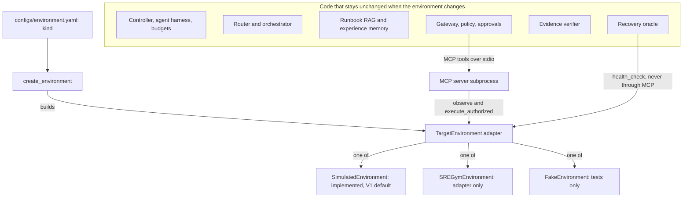

# ADR 0007: Make the target environment a replaceable adapter

**In one sentence:** everything that knows what the infrastructure is lives behind one
interface, `TargetEnvironment`, chosen by one line of config, so SREGym or Kubernetes can
replace the simulator while the code of the controller, gateway, RAG, memory, router and
orchestrator stays unchanged; a test proves the wiring by running the whole pipeline on a
different adapter.

## Status

Accepted. This is the owner's decision for V1.

## Context

V1 runs on a simulator ([ADR 0006](0006-simulated-environment-for-v1.md)), but the goal is
to run against real infrastructure later, starting with the SREGym benchmark on Kubernetes.
If agents, tools or the controller talked to the simulator directly, that move would mean
rewriting most of the system, and the V1 work on retrieval, memory, routing, orchestration,
the safety gateway and the harness would not carry over.

The owner wanted the swap to be "write one adapter, change one config line", and wanted it
proven by a test rather than just claimed. An **adapter** is a class that translates one
outside system into the shapes the rest of the program expects.

## Decision

**One interface.** `TargetEnvironment` in
[recap/core/interfaces.py](../../recap/core/interfaces.py). Its methods are split by who may
call them, and that split is also a trust boundary:

| Method | Who calls it | Exposed as an MCP tool |
|---|---|---|
| `reset(scenario_id, seed)` | the controller | no |
| `describe()`, `list_scenarios()` | the controller, the API, the evaluation runner (the result also tells the policy whether this is a simulation) | no |
| `observe_services`, `observe_health`, `observe_logs`, `observe_metrics`, `observe_deployments`, `observe_events`, `plan_rollback` | agents, only through the MCP server | yes: the seven read tools |
| `execute_authorized(action)` | the MCP server's write tools, only after the gateway allowed that exact action | yes: the three write tools |
| `health_check()` | the recovery oracle only | never |

**One data contract.** An adapter returns the observation models in
[recap/core/observations.py](../../recap/core/observations.py) (`HealthSnapshot`,
`LogQueryResult`, `MetricSeries`, `DeploymentList`, `EventList`, and so on). Agents, the
evidence verifier and the oracle only ever see these models.

**One selector.** The `kind` field in [configs/environment.yaml](../../configs/environment.yaml)
is read by `create_environment` in
[recap/environments/registry.py](../../recap/environments/registry.py):

| `kind` | Adapter | Status |
|---|---|---|
| `simulated` | `SimulatedEnvironment` in [recap/environments/simulated/engine.py](../../recap/environments/simulated/engine.py) | implemented (V1 default) |
| `sregym` | `SREGymEnvironment` in [integrations/sregym/adapter.py](../../integrations/sregym/adapter.py) | adapter only: it describes itself as not integrated (`is_simulated=False`) and raises `EnvironmentNotIntegrated` for every operation |
| `package.module:ClassName` | any `TargetEnvironment` subclass, for example `tests.fakes:FakeEnvironment` | used by the tests |

`register_environment` can add more named kinds.

**Only two code paths build an environment, both through `create_environment`.** The
controller builds one with the factory that the composition root (`Runtime` in
[recap/runtime.py](../../recap/runtime.py)) hands it, for `reset`, `describe` and the
oracle's own instance. The MCP server process
([recap/tools/mcp_server.py](../../recap/tools/mcp_server.py)) builds one for the tools.
Both use the same config and run ID, so they see the same world. Agents never import an
environment. You can check this yourself:

```bash
grep -rln "from recap.environments" recap apps evals integrations scripts
```

The only results are files inside `recap/environments/`, plus `recap/runtime.py` and
`recap/tools/mcp_server.py`.

**Safety follows the adapter.** Whether the auto-approver and the safety-off ablation are
allowed depends on the adapter's own `describe().is_simulated`
([ADR 0005](0005-central-safety-gateway-and-executor.md)). A real adapter therefore switches
them off automatically.



## How the swap is proven

[tests/e2e/test_environment_swap.py](../../tests/e2e/test_environment_swap.py) contains one
test, `test_full_pipeline_runs_on_a_different_environment`. It:

1. copies the normal settings and changes **only** the environment config, to
   `kind="tests.fakes:FakeEnvironment"`. `FakeEnvironment` in
   [tests/fakes.py](../../tests/fakes.py) is a second, independent adapter: two services, one
   bad release, and its state in a small JSON file instead of SQLite;
2. builds an ordinary `Runtime` and runs the scenario `fake-bad-release` with
   `approval_mode="auto"` (allowed because the fake adapter says it is simulated);
3. checks that the run ends `RESOLVED`, that the environment kind is `fake`, that the
   transport is `mcp-stdio` (a real MCP server subprocess, which built its own
   `FakeEnvironment` from the config), that the fix was `execute_rollback`, and that recovery
   was judged by `fake-health-oracle`.

The controller, router, agents, scripted policy, runbook retrieval, MCP server and client,
gateway, policy, approvals, verifier, memory and oracle all ran unchanged. No production
code imports `FakeEnvironment`; it is reached only through the config value.

Supporting tests:

- `tests/integration/test_mcp_stdio.py::test_rollback_through_the_mcp_subprocess_changes_the_shared_state`:
  the server subprocess builds the fake adapter from config, and a fresh adapter object in
  the test process (the oracle's channel) sees the repair.
- `tests/unit/test_oracle.py::test_the_oracle_works_with_another_adapter`.
- [tests/unit/test_environment_registry.py](../../tests/unit/test_environment_registry.py):
  import-path kinds work, and unknown kinds or classes that are not a `TargetEnvironment`
  are refused.
- [tests/unit/test_sregym_adapter.py](../../tests/unit/test_sregym_adapter.py): the stub is
  honest. Every operation raises, and the oracle refuses instead of inventing health.

```bash
.venv/bin/python -m pytest tests/e2e/test_environment_swap.py tests/unit/test_environment_registry.py tests/unit/test_sregym_adapter.py
```

## Consequences

### Good

- New infrastructure means one adapter class plus `configs/environment.yaml`. The code of
  the controller, gateway, RAG, memory, router and orchestrator stays as it is. What must
  still be adapted is data, not code: the log conventions, the allowlists and the runbooks
  (see below).
- The SREGym stub fails loudly, so no result can be attributed to SREGym by accident.
- The claim is tested end to end, through a real MCP subprocess.
- Safety follows the adapter: auto-approval and safety-off are refused as soon as
  `is_simulated` is false.

### Bad, and the limits of the claim

- **The swap test proves the plumbing, not diagnosis quality on real data.** `FakeEnvironment`
  writes its errors with the simulator's own template (`RELEASE_ERROR_TEMPLATE` from
  [recap/core/signals.py](../../recap/core/signals.py)) so that the scripted policy can read
  them. Real logs need real parsers, or an LLM provider that reads free text.
- The interface reflects what the simulator can do: one namespace and three actions
  (`rollback`, `restart` and `delete_namespace` in `EnvironmentAction`). A fault that needs
  another kind of fix means changing the observation model, the MCP write tools, the
  registry and the policy, not only the adapter.
- The policy must be changed on purpose. The allowlists in
  [configs/policies.yaml](../../configs/policies.yaml) name the simulated shop (namespace
  `shop`, five services). The controller refuses an incident in another namespace before any
  tool call (CREATED → BLOCKED), and rules R4 and R5 deny every call for another namespace or
  service until someone reviews and updates the policy.
- The runbooks describe the simulated shop. RAG only supplies remediation knowledge for a
  real system once that system has its own runbooks (content, not code).
- Both processes must see the same state. The simulator shares one SQLite file per run; a
  real adapter would use the real system as the source of truth.
- Real changes take time. The controller probes the oracle as soon as a write returns. The
  simulator moves its clock forward instantly, but a real rollout needs a rule for waiting
  until it settles.
- `kind: package.module:ClassName` imports whatever code the config names, so the config
  file must be trusted.
- SREGym is not integrated, and there are no SREGym results.
  [integrations/sregym/README.md](../../integrations/sregym/README.md) lists what integration
  needs, and [integrations/sregym/mapping.md](../../integrations/sregym/mapping.md) has the
  planned, unverified tool mapping.

## Alternatives considered

- **Hard-code the simulator into the tools and agents.** Fastest for V1, but moving to real
  infrastructure would become a rewrite.
- **Let agents call Kubernetes directly** (for example through `kubectl`). That ties reasoning
  to one platform, cannot run offline or in CI, and bypasses the safety gateway.
- **Make the MCP server the only boundary, with no Python interface.** Agents do reach the
  environment only through MCP, but the controller still needs trusted operations that
  agents must never reach (`reset`, `describe` and the oracle's `health_check`). A Python
  interface also lets the tests run the same code in one process.
