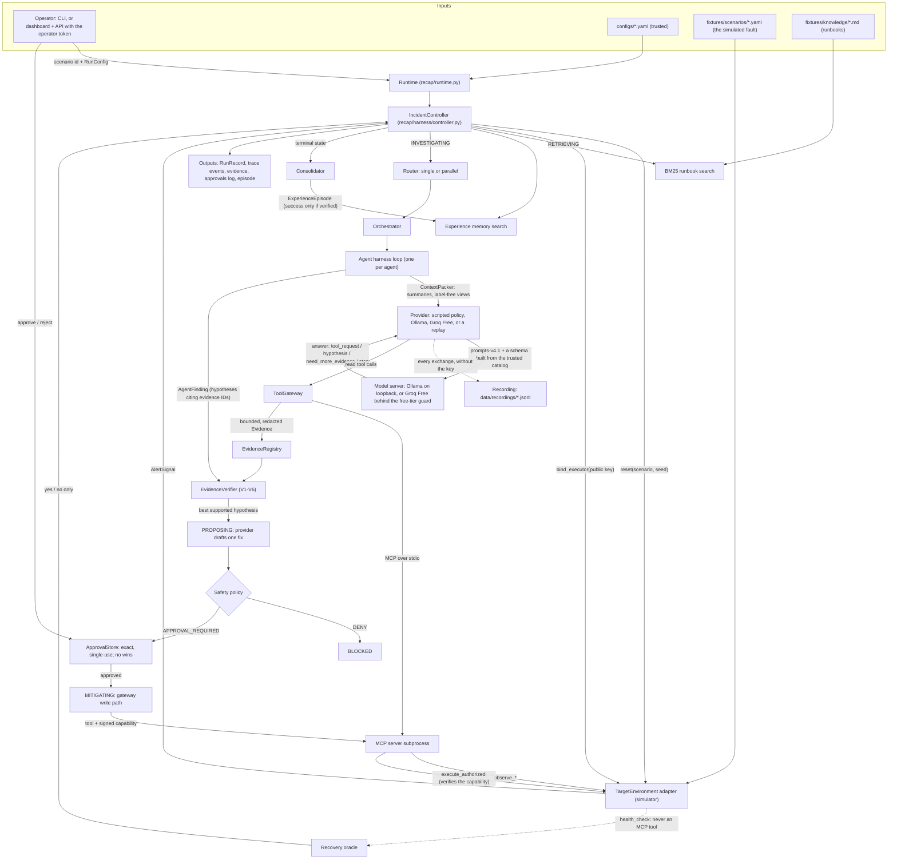
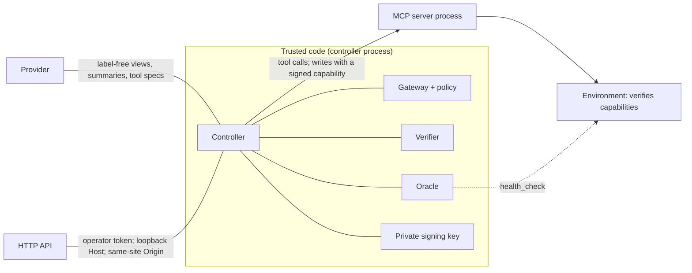

# RECAP end-to-end flow: what goes in, what links to what, what comes out

This page follows one incident from the moment it starts to the moment it is remembered.
For every step it says **what comes in**, **which code handles it**, **what comes out**, and
**where that output goes next**. It describes the code as of milestone M2 (real model
providers at $0). The decisions can come from the scripted policy (the default), a local
model (Ollama), a free hosted model (Groq Free), or a replay of a recorded model run; section
3b follows one model decision in detail. The numbers in the example (section 6) come from a
real run of the `bad-deployment` scenario with the scripted policy (an operator approved the
fix): 67 trace events, 8 tool calls, 9 provider decisions, RESOLVED.

Companion pages: [architecture.md](architecture.md) (the components in depth),
[threat-model.md](threat-model.md) (who may do what), [status.md](status.md) (measured
results), and [decisions/](decisions/README.md) (why it is built this way).

---

## 1. The whole flow on one page



Read it top to bottom: an operator starts a run; the controller resets the target and turns
its alert into an incident; it looks up runbooks and past incidents; agents investigate with
read-only tools; the verifier decides which root cause the evidence supports; one fix is
proposed, judged and (when required) approved by a human; the gateway executes it with a
signed, single-use capability; the oracle checks recovery on its own channel; the run is
remembered.

---

## 2. Where data comes in, and how far it is trusted

| Input | Enters at | Trusted? | What protects the rest of the system |
|---|---|---|---|
| `configs/*.yaml` (budgets, agents, policies, providers, environment) | `load_settings` ([recap/core/config.py](../recap/core/config.py)) | **yes**: RECAP's own configuration | it is the source of truth for tool risk tiers, allowlists and limits |
| A scenario file (`fixtures/scenarios/*.yaml`) | `SimulatedEnvironment.reset` | the fault is trusted; its `family` and `expected` fields are **evaluation labels** | labels never leave the evaluation code: providers get label-free views (section 4) |
| The alert (service, symptoms) | `AlertSignal` from `reset` | **no**: alert text is data | wrapped as untrusted data in prompts |
| Tool output (logs, metrics, events, health, ...) | `ToolGateway._record` | **no**: a log line can say anything | redacted, bounded, flagged for injection text, stored as `UNTRUSTED` evidence; the verifier lets platform signals outrank log text (V6) |
| Runbook chunks | `BM25Retriever.search` | **no** (text) | wrapped as untrusted data; their action hints only suggest, the policy decides |
| Past episodes | `ExperienceStore.search` | partly: outcome and verification are RECAP's own | "similar" is not "safe to reuse" (`assess_reuse`); providers see label-free views |
| A model's answer (Ollama, Groq) | `protocol.parse_*` in [recap/providers/protocol.py](../recap/providers/protocol.py) | **no**: model text, possibly steered by injected data | the per-request schema (enums of listed tools, services and visible evidence IDs), then the parser drops anything unlisted, repeated or unknown; one corrective retry, never a scripted stand-in |
| Provider decisions (tool calls, hypotheses, fix drafts) | `AgentHarness`, `IncidentController._propose` | **no** (an LLM may be manipulated) | the gateway's policy, the verifier and the approval decide; declared risk is ignored |
| A hosted model's API key | environment variable only (`GROQ_API_KEY`) | secret | read at send time and put only in the request header; never in traces, recordings, run records, errors or `GET /providers` |
| The owner's free-plan confirmation | `RECAP_GROQ_FREE_PLAN_CONFIRMED_ON` (a date) | yes: the owner's word, at most 7 days old | plus a tripwire on every response's rate-limit header (ADR 0017) |
| A human decision | `ApprovalStore.decide` (CLI console, or `POST /approvals/{id}`) | yes, once authenticated | API: operator bearer token, identity from the token; "no" wins until the approval is used |
| Recovery oracle output | `EnvironmentHealthOracle.probe` | yes, but **private** | only its yes/no verdict reaches the controller's decisions; its findings never reach a provider |

---

## 3. Stage by stage

Each stage lists its **input → code → output → next**. Trace event categories are in
`code font`; every one is stored in `data/recap.db` (`events`) and `data/traces/<run_id>.jsonl`
and streamed live to the dashboard.

### Stage 0. Start a run

- **Input:** a scenario ID and a `RunConfig` (strategy, RAG/memory switches, approval mode,
  budget), from `scripts/demo.py`, `POST /incidents/run` (operator token required) or the
  evaluation runner.
- **Code:** `Runtime.run_incident` ([recap/runtime.py](../recap/runtime.py)) builds the
  per-run `IncidentController` from long-lived dependencies (`ControllerDeps`).
- **Output:** a run ID (`run-…`). The API returns it at once (202) and runs the incident as
  a background task (`RunManager` in [apps/api/service.py](../apps/api/service.py)).
- **Next:** stage 1.

### Stage 1. Reset the target and open the incident (CREATED)

- **Input:** the scenario ID and its seed.
- **Code:** `IncidentController.run`.
  1. `environment.reset(scenario, seed)` injects the fault into a fresh world
     (`data/sandbox/<run_id>.db` for the simulator) and returns an `AlertSignal`.
  2. The alert becomes an `Incident` (`incident_id`, service, symptoms, time, budget). Its
     `scenario_id` stays in trusted code only.
  3. A fresh Ed25519 key pair is made for this run (`CapabilityIssuer`,
     [recap/safety/capabilities.py](../recap/safety/capabilities.py)). Only the public half
     goes to the environment: `environment.bind_executor(public_key)`.
  4. A `BudgetTracker` starts the run's clock and counters; a `RunRecord` checkpoint is
     saved; the tracer opens the run's trace.
  5. If the alert's namespace is not allowlisted, the run goes straight to BLOCKED.
- **Output:** `state.transition` (to CREATED, with the incident and environment), the
  first checkpoint in `runs`.
- **Next:** the MCP transport starts (stage 2).

### Stage 2. Start the MCP tool server and compare its catalog

- **Input:** the environment config and run ID.
- **Code:** `McpToolClient.stdio` starts `python -m recap.tools.mcp_server --env-config … --run-id …`
  ([recap/tools/mcp_server.py](../recap/tools/mcp_server.py)). The subprocess builds its own
  environment object for the same run, so it shares the sandbox state file. The gateway
  asks for the tool list and compares it with the trusted registry
  ([recap/tools/registry.py](../recap/tools/registry.py)).
- **Output:** `tool.discovery` (advertised, usable, unknown and mismatched tools). What the
  server says decides nothing.
- **Next:** stage 3.

### Stage 3. Look things up (RETRIEVING)

- **Input:** the incident's service and symptoms.
- **Code:** `_retrieve`: BM25 search over the runbooks
  ([recap/knowledge/](../recap/knowledge/)) and a similarity search over remembered
  episodes the run may read ([recap/memory/store.py](../recap/memory/store.py)).
- **Output:** `RetrievedChunk`s and `MemoryHit`s on the run record; `retrieval.docs` and
  `memory.search` events.
- **Next:** both are handed to the agent harness for stage 4.

### Stage 4. Investigate (INVESTIGATING)

- **Input:** routing signals (services affected, memory hits, budget left, prior failures).
- **Code:**
  1. `RulesRouter.decide` ([recap/routing/router.py](../recap/routing/router.py)) picks one
     generalist or two specialists in parallel → `routing.decision`, `investigation.round`.
  2. The `Orchestrator` runs the agents (concurrently in parallel mode), each with a
     deadline: its own limit or the time left on the run, whichever is shorter.
  3. Each agent runs the harness loop ([recap/harness/loop.py](../recap/harness/loop.py)),
     one **step** at a time:
     - **observe:** `ContextPacker.build` ([recap/context/packer.py](../recap/context/packer.py))
       turns the run's evidence into structured summaries
       ([recap/context/summaries.py](../recap/context/summaries.py)), adds runbook chunks
       and label-free memory views, ranks and fits them into the token budget →
       `context.pack`;
     - **reason:** the provider receives an `InvestigationRequest` (label-free
       `AgentIncident`, the pack, the tools it may call, its history) and returns an
       `InvestigationDecision` → `agent.decision`;
     - **act:** each requested read goes through `ToolGateway.call_read`
       ([recap/tools/gateway.py](../recap/tools/gateway.py)): policy (`policy.decision`),
       budget reservation, `tool.call`, the MCP call with a hard timeout, then the result is
       redacted, bounded (keeping the head and the tail), flagged and stored as `Evidence`
       → `tool.result`.
  4. When the provider finishes, it returns hypotheses that cite evidence IDs →
     `agent.finish`; the orchestrator emits `orchestration.summary` (with the measured
     overlap of parallel agents).
  5. With a real model, every request behind a decision is also traced as `llm.call`
     (model, exact tokens, time, what it chose), right before the `agent.decision` it
     produced. Section 3b follows one such decision.
- **Output:** one `AgentFinding` per agent; evidence records in `data/recap.db` (`evidence`).
- **Next:** stage 5.

In the example run the investigator made 7 reads: health, logs, the error-rate metric,
deployments, events, the memory metric, and a rollback dry run (`propose_rollback`).

### Stage 4b. Inside one model decision (Ollama, Groq, or a replay)

- **Input:** the same `InvestigationRequest` the scripted policy gets (label-free incident,
  context pack, the agent's tools, its history, the step number).
- **Code:** `HttpLLMProvider.next_action` ([recap/providers/http_llm.py](../recap/providers/http_llm.py)):
  1. **render** ([recap/providers/protocol.py](../recap/providers/protocol.py),
     prompts-v4.1): a static system prompt (rules, and RECAP's failure mechanisms in generic
     terms), then one user message: role, incident, focus, tools, previous calls, what any
     agent already observed, the context pack (every item inside `<untrusted_data>`), what
     to return, and "step N of M" last;
  2. **constrain**: in `json` mode a JSON schema built for this request (tool names,
     services, metrics and mechanisms as enums; evidence IDs as an enum of the IDs this
     agent can see; at most 2 calls); in `tools` mode the read tools as native functions
     plus `submit_findings`, the same definitions every step (the parser checks the
     evidence IDs); on the last step only finishing is offered;
  3. **check before sending**: Ollama: loopback only (proxy settings ignored), the model
     installed, not served from a remote host and able to call tools, the prompt fits
     `num_ctx`. Groq: the free-tier guard
     ([recap/providers/quota.py](../recap/providers/quota.py)): opt-in, allowlist, key,
     the owner's dated confirmation, no stop on its host, RECAP's caps in the user's ledger
     (a full minute cap waits, a full day cap defers);
  4. **send** through the transport ([recap/providers/transport.py](../recap/providers/transport.py)):
     one HTTP request, recorded to `data/recordings/` without the key (a replay answers from
     a recording instead, offline);
  5. **check after**: the answering model must be the requested one; on every Groq
     response that carries it, whatever its status, `x-ratelimit-limit-requests` must equal
     the free plan's (else the host is stopped for every RECAP process of this user); a
     429 is retried once if short, otherwise the run is deferred (QUOTA_EXHAUSTED);
  6. **parse** the answer: `tool_request` → up to 2 read calls (unlisted tools, foreign
     arguments and repeats dropped with a note); `hypothesis` → hypotheses with allowlisted
     targets, typed `version`/`dependency` and only known evidence IDs; `need_more_evidence`
     or `stop` → finish without a diagnosis;
  7. **unusable?** send the reason back once (a corrective retry); still unusable → the
     agent finishes with no decision. Never a scripted stand-in.
- **Output:** an `InvestigationDecision` with exact `Usage` (input and output tokens as the
  server reported them, `model_requests`) and its `ModelCall`s → one `llm.call` event per
  HTTP request, including a retried 429 or 5xx. If the decision fails after requests went
  out, those requests travel with the error and are recorded before it goes on.
  Proposals (stage 6) follow the same path with a proposal schema (`final_proposal` or
  `stop`): the action must be in the catalog, on the diagnosed service, cite real evidence
  and not repeat a fix that failed.
- **Next:** the harness runs the requested reads (stage 4, step 3), or the verifier judges
  the finding (stage 5).

Measured on 2026-10-21 (bad-deployment, simulated): `qwen3:8b` locally resolved it with 8
model requests (21,489 input / 771 output tokens, prompts-v4.1) in about 2.5 minutes, in
one round; a `gpt-oss-120b` run on Groq Free resolved it with 8 requests, every response's
free-plan header checked. Details in [status.md](status.md).

### Stage 5. Verify the evidence

- **Input:** the findings of this epoch, every piece of evidence of the run, the incident,
  and `remediated` (the time of each fix already executed in this run).
- **Code:** `EvidenceVerifier.verify` ([recap/agents/verifier.py](../recap/agents/verifier.py))
  applies rules V1 to V6: structure, deploy timing, upstream dominance, resource pressure,
  dependency failure, remembered claims, and conflict resolution (platform signals outrank
  log text). After a fix, the fixed service's older state observations no longer count.
- **Output:** a `VerificationReport`: every hypothesis supported, contradicted or
  insufficient (never "proven"), the best actionable one, and where to look next →
  `verification.evidence`. Memory hits are re-assessed against it (`memory.assessment`).
- **Next:** a supported best hypothesis goes to stage 6; otherwise another round of stage 4
  (bounded by `max_investigation_rounds`), then FAILED.

### Stage 6. Propose one fix (PROPOSING)

- **Input:** the best hypothesis and the verification report.
- **Code:** `_propose`.
  1. Agentic RAG: a remediation runbook is fetched if none for this mechanism is loaded.
  2. A proposal pack is built; the evidence the diagnosis rests on gets priority, and the
     runbook chunks for the diagnosed mechanism are **pinned** so they can never be crowded
     out → `context.pack` (stage `proposal`).
  3. The provider receives a `ProposalRequest` and returns one `MitigationDraft`, within
     the run's deadline.
  4. The draft becomes a `MitigationProposal` with an ID and a digest (a SHA-256
     fingerprint of incident, action, target and params) → `mitigation.proposed`.
  5. The safety policy judges it from trusted inputs only → `policy.decision`
     ([recap/safety/policy.py](../recap/safety/policy.py)). DENY ends the run BLOCKED.
  6. The verifier checks the proposal cites real evidence and targets the diagnosis →
     `verification.evidence`.
- **Output:** a proposal that needs approval (or, only in the simulation-only safety-off
  ablation, is allowed directly).
- **Next:** stage 7.

### Stage 7. Get an exact approval (AWAITING_APPROVAL)

- **Input:** the proposal.
- **Code:** `_authorize` and the `ApprovalStore`
  ([recap/safety/approvals.py](../recap/safety/approvals.py)).
  1. A request is opened for that exact proposal and digest, with an expiry →
     `approval.requested`, and a `requested` entry in the append-only decision log.
  2. A channel asks for a decision: the console (`y`/`N`), the dashboard through
     `POST /approvals/{id}` (operator token; the approver recorded is `operator:<name>`), or
     the simulation-only auto-approver. The run's clock is paused while a human decides.
  3. The store's rules: approve only a pending request; reject a pending request **or**
     revoke an approval that was not used yet; nothing after a rejection; every change is a
     compare-and-swap in one SQLite transaction; every attempt is logged.
- **Output:** an `Approval` (approved or rejected) → `approval.decided`.
- **Next:** approved → stage 8; rejected or expired → BLOCKED.

### Stage 8. Execute through the gateway (MITIGATING)

- **Input:** the proposal and its approval.
- **Code:** `ToolGateway.execute_mitigation`.
  1. The oracle takes a "before" probe.
  2. The approval is **re-read** from the store; the policy judges the call again with it →
     `policy.decision`.
  3. A lock on the target, a budget reservation, then the approval is **consumed** (single
     use, in the same transaction that checks it is still approved).
  4. The gateway signs a **capability** for exactly this environment action (run, action,
     target, params, approval, digest, a nonce, 60 s expiry).
  5. Write-ahead: `mitigation.started` is traced **before** the write is sent, so the
     trace shows a sent write even if this process dies before the answer comes back.
  6. The MCP write tool passes the capability to `execute_authorized`; the environment
     verifies the signature against the bound public key, the exact action, the expiry and
     the nonce, and records the nonce in the same transaction as the change. Anything else
     is refused: the world does not change, and the attempt goes to a bounded audit list.
  7. If the run is cancelled while the write is in flight, the gateway still waits for its
     outcome (a sent write cannot be called back), records it, and only then lets the
     cancellation through; the controller records the fix as `error`, "recovery not
     verified", with its used approval.
- **Output:** an `ActionOutcome` (stored as evidence) → `mitigation.executed`. The
  capability itself is never traced or stored.
- **Next:** stage 9.

### Stage 9. Check recovery (VERIFYING)

- **Input:** the "before" probe.
- **Code:** `_await_recovery`: the oracle
  ([recap/verification/oracle.py](../recap/verification/oracle.py)) calls `health_check()`
  on the controller's own environment object (never an MCP tool). A simulated target is
  judged at once, and so is a write the target refused (nothing changed). A live target is
  probed every `stabilization_poll_seconds` until it is healthy or its
  `stabilization_timeout_seconds` are over. If the run's own time runs out first, the run
  stops as BUDGET_EXHAUSTED and the fix is recorded as sent but unverified.
- **Output:** a `RecoveryResult` → `verification.recovery` (with the number of probes and
  the time waited).
- **Next:** verified → RESOLVED. Not verified → a new **epoch**: the next round's focus is
  the failed fix's target plus the verifier's own focus services (never the oracle's list),
  the fixed service's pre-fix state stops counting (the boundary is the time of the oracle's
  "before" probe, never a time the tool reported), and the run returns to stage 4, at most
  `max_mitigation_attempts` fixes in total.

### Stage 10. Remember and summarize (terminal state)

- **Input:** the final run record and its evidence.
- **Code:** `_consolidate` and `Consolidator.build_episode`
  ([recap/memory/consolidation.py](../recap/memory/consolidation.py)).
- **Output:** an `ExperienceEpisode` in `data/memory.db` (outcome `success` only if the
  oracle verified recovery; never for a held-out test scenario) → `memory.consolidated`;
  then `run.summary` (state, attempts, unsafe actions, budget, cost label) and the final
  checkpoint. A run that crashed, was cancelled or was **deferred** (`QUOTA_EXHAUSTED`: a
  free model's quota ran out) writes no episode: it says nothing about the incident.

---

## 4. The boundaries, and what is allowed to cross them



| Boundary | What may cross | What may not | Enforced in |
|---|---|---|---|
| Controller → provider | the alert as `AgentIncident`, packed evidence summaries, runbook chunks, `AgentMemoryHit`s, trusted tool descriptions, failed actions | `scenario_id`, `failure_family`, `partition`, provenance, anything from the oracle | `models.py` (views and validators), `loop.py`, `_propose`, `_retry_focus` |
| Gateway → MCP server → environment | validated read calls; writes that carry a capability for exactly that action | unknown tools or arguments; a write without a valid, unused, unexpired capability | `gateway.py`, `mcp_server.py` (`StrictToolServer`), `capabilities.py`, the adapter's `execute_authorized` |
| Environment → oracle → controller | a yes/no verdict and its signals for the run record and trace | the oracle's findings as hints for agents | `controller.py` |
| Browser / HTTP client → API | reads; state-changing calls with the operator token from a loopback Host and a same-site Origin | anonymous writes, a client-chosen approver identity, foreign hosts (DNS rebinding) and origins | `apps/api/auth.py`, `apps/api/main.py` |

---

## 5. Where every output ends up

| Output | Stored in | Served at | Shown on the dashboard |
|---|---|---|---|
| Run checkpoint (`RunRecord`) | `data/recap.db` → `runs` | `GET /runs`, `GET /runs/{id}` | Overview, Live Incident Run, every run page |
| Trace events | `data/recap.db` → `events`; `data/traces/<run_id>.jsonl` | `GET /runs/{id}/events`, `GET /runs/{id}/stream` (SSE) | Live event feed, Agent Timeline |
| Evidence (raw record + structured data) | `data/recap.db` → `evidence` | inside `GET /runs/{id}` | Evidence & RAG |
| Approval requests, decisions, decision log | `data/recap.db` → `approval_requests`, `approvals`, `approval_events` (append-only) | `GET /approvals/pending`, `GET /approvals/{id}/events`, `GET /approvals/events` | Safety & Approvals, Live Incident Run |
| The simulated world, its action log and used capability nonces | `data/sandbox/<run_id>.db` | not served (oracle and MCP server only) | indirectly, through tool results |
| Experience episodes | `data/memory.db` → `episodes` | `GET /memory` | Experience Memory |
| Model exchanges (prompts and answers, no keys) | `data/recordings/<id>.jsonl`; committed replay fixtures in `fixtures/recordings/` | not served; path in the run's `versions.recording` | the `llm.call` events show each request (excerpts) |
| LLM usage ledger and provider stops | per user, outside every data folder: `~/.local/state/recap/llm-usage.db` (or `RECAP_USAGE_LEDGER`) → `llm_requests`, `llm_stops`, keyed by host | `GET /providers`, `scripts/providers.py usage` | Architecture → Decision providers |
| Operator token | `data/operator-token` (mode 0600) or `RECAP_OPERATOR_TOKEN` | never | typed once into the sign-in box (kept in the tab's sessionStorage) |
| Evaluation reports | `evals/reports/<id>/` and `evals/reports/latest/` | `GET /evals/results` | Evaluations |

---

## 6. The example run, event by event

`bad-deployment`, manual approval approved by the operator, scripted provider, simulated
environment. One line per event (consecutive repeats of a pattern are grouped):

| Stage | Events | What happened |
|---|---|---|
| CREATED | `state.transition`, `tool.discovery` | incident opened; key bound; MCP server started, 10 tools advertised and matched |
| RETRIEVING | `state.transition`, `retrieval.docs`, `memory.search` | 4 runbook chunks; memory searched |
| INVESTIGATING | `state.transition`, `routing.decision`, `investigation.round`, `agent.start` | one investigator (single mode) |
| | 7 × (`context.pack`, `agent.decision`, `policy.decision`, `tool.call`, `tool.result`) | health, logs, error rate, deployments, events, memory, rollback dry run |
| | `context.pack`, `agent.decision`, `agent.finish`, `orchestration.summary` | hypotheses for the verifier |
| | `verification.evidence` | "bad deployment on checkout" supported |
| PROPOSING | `state.transition`, `retrieval.docs`, `context.pack`, `mitigation.proposed`, `policy.decision`, `verification.evidence` | rollback of checkout to v2.4.0, from the runbook; APPROVAL_REQUIRED |
| AWAITING_APPROVAL | `state.transition`, `approval.requested`, `approval.decided` | the operator approved the exact digest |
| MITIGATING | `state.transition`, `policy.decision`, `mitigation.started`, `mitigation.executed` | approval consumed, capability signed, write-ahead event, capability verified, rollback applied |
| VERIFYING | `state.transition`, `verification.recovery` | oracle: unhealthy before, healthy after (1 probe: simulated) |
| RESOLVED | `state.transition`, `memory.consolidated`, `run.summary` | a verified success episode written |

Reproduce it:

```bash
.venv/bin/python scripts/demo.py --scenario bad-deployment --approve ask   # approve with y
```

---

## 7. Which file to open for each step

| Step | File |
|---|---|
| Composition root (what implements each interface) | [recap/runtime.py](../recap/runtime.py) |
| Lifecycle, retries, epochs, stabilization, deadlines | [recap/harness/controller.py](../recap/harness/controller.py), [recap/core/lifecycle.py](../recap/core/lifecycle.py) |
| Agent loop | [recap/harness/loop.py](../recap/harness/loop.py) |
| Budgets | [recap/harness/budget.py](../recap/harness/budget.py) |
| Routing and concurrency | [recap/routing/router.py](../recap/routing/router.py), [recap/routing/orchestrator.py](../recap/routing/orchestrator.py) |
| What a provider sees | [recap/core/models.py](../recap/core/models.py) (views), [recap/context/packer.py](../recap/context/packer.py), [recap/context/summaries.py](../recap/context/summaries.py), [recap/providers/prompts.py](../recap/providers/prompts.py) |
| The scripted provider | [recap/providers/deterministic.py](../recap/providers/deterministic.py), [playbooks.py](../recap/providers/playbooks.py), [heuristics.py](../recap/providers/heuristics.py) |
| Real model providers | [recap/providers/protocol.py](../recap/providers/protocol.py) (prompts-v4.1, schemas, parsing), [http_llm.py](../recap/providers/http_llm.py) (the shared loop), [ollama_provider.py](../recap/providers/ollama_provider.py), [openai_compatible.py](../recap/providers/openai_compatible.py), [factory.py](../recap/providers/factory.py) |
| Free-tier guard, recordings, replay | [recap/providers/quota.py](../recap/providers/quota.py), [transport.py](../recap/providers/transport.py), [catalog.py](../recap/providers/catalog.py) (`GET /providers`) |
| Tool boundary | [recap/tools/gateway.py](../recap/tools/gateway.py), [registry.py](../recap/tools/registry.py), [actions.py](../recap/tools/actions.py), [mcp_client.py](../recap/tools/mcp_client.py), [mcp_server.py](../recap/tools/mcp_server.py) |
| Safety | [recap/safety/policy.py](../recap/safety/policy.py), [approvals.py](../recap/safety/approvals.py), [capabilities.py](../recap/safety/capabilities.py) |
| Evidence rules | [recap/agents/verifier.py](../recap/agents/verifier.py) |
| Target environment | [recap/core/interfaces.py](../recap/core/interfaces.py), [recap/environments/simulated/](../recap/environments/simulated/) |
| Recovery oracle | [recap/verification/oracle.py](../recap/verification/oracle.py) |
| Memory | [recap/memory/](../recap/memory/) |
| API and dashboard | [apps/api/](../apps/api/), [apps/dashboard/src/](../apps/dashboard/src/) |
