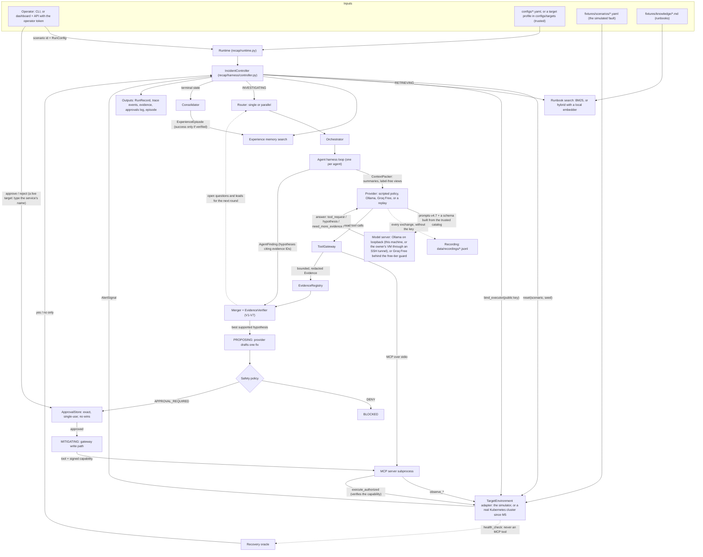
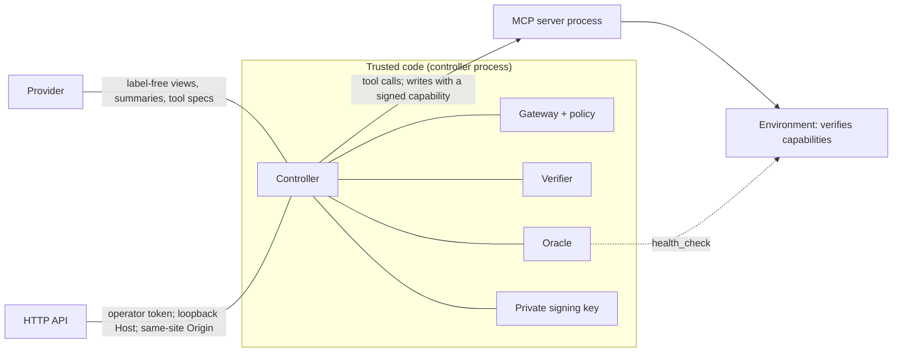
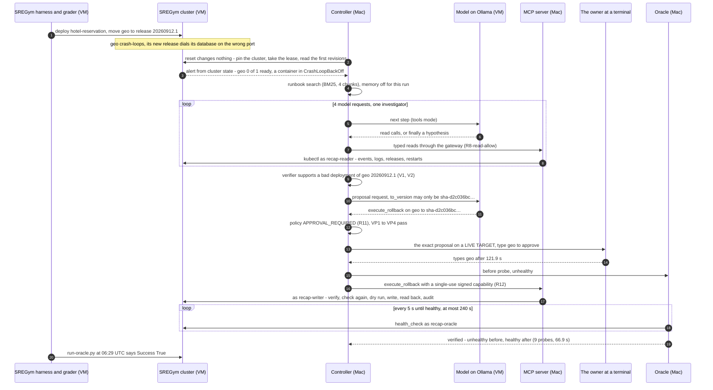

# RECAP end-to-end flow: what goes in, what links to what, what comes out

This page follows one incident from the moment it starts to the moment it is remembered.
For every step it says **what comes in**, **which code handles it**, **what comes out**, and
**where that output goes next**. It describes the code as of milestone M5 (M2 brought
real model providers at $0, M3 two independent specialists, M4 the typed API, the Mission
Control dashboard and the evaluation records, and section 8 covers what M4 added after a run;
M5 brought real Kubernetes targets, and section 9 follows one real run on SREGym's cluster).
The decisions can come from the scripted policy (the default), a local model (Ollama), the
same model on the owner's VM (M5), a free hosted model (Groq Free), or a replay of a recorded
model run; stage 4b follows one model decision in detail. The numbers in the example
(section 6) come from a real run of the `bad-deployment` scenario with the scripted policy
against the simulator (an operator approved the fix): 67 trace events, 8 tool calls, 9
provider decisions, RESOLVED.

Companion pages: [architecture.md](architecture.md) (the components in depth),
[threat-model.md](threat-model.md) (who may do what), [status.md](status.md) (measured
results), and [decisions/](decisions/README.md) (why it is built this way).

---

## 1. The whole flow on one page



Read it top to bottom: an operator starts a run; the controller resets the target and turns
its alert into an incident; it looks up runbooks and past incidents; agents investigate with
read-only tools; the verifier decides which root cause the evidence supports; one fix is
proposed, judged and (when required) approved by a human; the gateway executes it with a
signed, single-use capability; the oracle checks recovery on its own channel; the run is
remembered.

On a real cluster (M5) the picture is the same. The adapter reads and writes the cluster through
typed `kubectl` operations with one least-privilege identity per role, the fault comes from the
target (RECAP's own scenario steps on the Kind demo, SREGym's harness on SREGym's cluster), and
on a live target the person approves by typing the target service's name. Section 9 follows one
such run.

---

## 2. Where data comes in, and how far it is trusted

| Input | Enters at | Trusted? | What protects the rest of the system |
|---|---|---|---|
| `configs/*.yaml` (budgets, agents, policies, providers, environment) | `load_settings` ([recap/core/config.py](../recap/core/config.py)) | **yes**: RECAP's own configuration | it is the source of truth for tool risk tiers, allowlists and limits |
| A target profile (`configs/targets/<name>/`, chosen with `RECAP_TARGET`; M5) | `load_settings` | **yes**: RECAP's own configuration | replaces the environment, policies and budget for one real cluster and adds a runbook overlay; holds paths to credentials, never a token |
| A scenario file (`fixtures/scenarios/*.yaml`) | `SimulatedEnvironment.reset` | the fault is trusted; its `family` and `expected` fields are **evaluation labels** | labels never leave the evaluation code: providers get label-free views (section 4) |
| The alert (service, symptoms) | `AlertSignal` from `reset` | **no**: alert text is data | wrapped as untrusted data in prompts. On a real cluster (M5) the alert is measured from the cluster (probe error rates, unready replicas, crash loops); no fault name or label leaves `reset` |
| Tool output (logs, metrics, events, health, ...) | `ToolGateway._record` | **no**: a log line can say anything | redacted, bounded, flagged for injection text, stored as `UNTRUSTED` evidence; the verifier lets platform signals outrank log text (V6). On a real cluster (M5) it is read by typed `kubectl` operations as `recap-reader` |
| RECAP's cluster identities (M5) | kubeconfig files outside git, mode 600, under `~/.config/recap/` | secret | each holds a short-lived ServiceAccount token for one role; options carry only the paths; redaction and the secret scan cover ServiceAccount tokens and kubeconfig keys |
| Runbook chunks | `BM25Retriever.search` | **no** (text) | wrapped as untrusted data; their action hints only suggest, the policy decides |
| Past episodes | `ExperienceStore.search` | partly: outcome and verification are RECAP's own | "similar" is not "safe to reuse" (`assess_reuse`); providers see label-free views |
| A model's answer (Ollama, Groq) | `protocol.parse_*` in [recap/providers/protocol.py](../recap/providers/protocol.py) | **no**: model text, possibly steered by injected data | the per-request schema (enums of listed tools, services and visible evidence IDs), then the parser drops anything unlisted, repeated or unknown; one corrective retry, never a scripted stand-in |
| Provider decisions (tool calls, hypotheses, fix drafts) | `AgentHarness`, `IncidentController._propose` | **no** (an LLM may be manipulated) | the gateway's policy, the verifier and the approval decide; declared risk is ignored |
| A hosted model's API key | environment variable only (`GROQ_API_KEY`) | secret | read at send time and put only in the request header; never in traces, recordings, run records, errors or `GET /providers` |
| The owner's free-plan confirmation | `RECAP_GROQ_FREE_PLAN_CONFIRMED_ON` (a date) | yes: the owner's word, at most 7 days old | plus a tripwire on every response's rate-limit header (ADR 0017) |
| A human decision | `ApprovalStore.decide` (CLI console, or `POST /approvals/{id}`) | yes, once authenticated | API: operator bearer token, identity from the token; "no" wins until the approval is used. On a live target (M5) only the target service's exact name approves, typed at the console or sent as `confirm_target` |
| Recovery oracle output | `EnvironmentHealthOracle.probe` | yes, but **private** | only its yes/no verdict reaches the controller's decisions; its findings never reach a provider |
| A benchmark grader's verdict (M5: SREGym's `run-oracle.py`) | recorded by hand in a batch (`scripts/live_eval.py --benchmark-verdict`) | the benchmark's own word | kept next to RECAP's oracle verdict, never merged with it, and never a RECAP success |

---

## 3. Stage by stage

Each stage lists its **input → code → output → next**. Trace event categories are in
`code font`; every one is stored in `data/recap.db` (`events`) and `data/traces/<run_id>.jsonl`
and streamed live to the dashboard.

### Stage 0. Start a run

- **Input:** a scenario ID and a `RunConfig` (strategy, RAG/memory switches, approval mode,
  budget), from `scripts/demo.py`, `POST /incidents/run` (operator token required) or the
  evaluation runner. Since M4 a client may also name the run's provider, but only from an
  allowlist (`RunManager.check_run_request`): the server's default, the scripted baseline, a
  provider the owner marked `api_selectable`, or `replay` with `replay_fixture`, the id of a
  committed recording in `fixtures/recordings/MANIFEST.json` (the dashboard's **Replay**
  button). For a replay the scenario, routing, memory and retrieval come from the manifest,
  `recordings.fixture_path` checks the file's SHA-256 before any answer is given, and
  `replay_pace` (0 to 1) only slows the answers down so people can watch.
- **Code:** `Runtime.run_incident` ([recap/runtime.py](../recap/runtime.py)) builds the
  per-run `IncidentController` from long-lived dependencies (`ControllerDeps`).
- **Output:** a run ID (`run-…`). The API returns it at once (202) and runs the incident as
  a background task (`RunManager` in [apps/api/service.py](../apps/api/service.py)).
- **Next:** stage 1.

### Stage 1. Reset the target and open the incident (CREATED)

- **Input:** the scenario ID and its seed.
- **Code:** `IncidentController.run`.
  1. `environment.reset(scenario, seed)` injects the fault into a fresh world
     (`data/sandbox/<run_id>.db` for the simulator) and returns an `AlertSignal`.
  2. The alert becomes an `Incident` (`incident_id`, service, symptoms, time, budget). Its
     `scenario_id` stays in trusted code only.
  3. A fresh Ed25519 key pair is made for this run (`CapabilityIssuer`,
     [recap/safety/capabilities.py](../recap/safety/capabilities.py)). Only the public half
     goes to the environment: `environment.bind_executor(public_key)`.
  4. A `BudgetTracker` starts the run's clock and counters; a `RunRecord` checkpoint is
     saved; the tracer opens the run's trace.
  5. If the alert's namespace is not allowlisted, the run goes straight to BLOCKED.
- **On a real cluster (M5):** before `reset` the controller refuses what a live target must
  never get: the simulation auto-approver, safety off, a replay, a paid model, and a free hosted
  plan unless the owner sets `RECAP_ALLOW_HOSTED_MODEL_ON_LIVE_TARGET=1`. `reset` then proves
  the cluster is the pinned one (loopback API server, CA fingerprint, ServiceAccount tokens,
  version skew) and takes a namespace lease. On the Kind demo it restores the baseline and
  applies the scenario's typed fault steps as `recap-scenario`; on SREGym it changes nothing.
  Both wait for an alert measured from the cluster. The public key goes to the adapter's local
  state file, never to the cluster. Section 9 follows one such reset.
- **Output:** `state.transition` (to CREATED, with the incident and environment), the
  first checkpoint in `runs`.
- **Next:** the MCP transport starts (stage 2).

### Stage 2. Start the MCP tool server and compare its catalog

- **Input:** the environment config and run ID.
- **Code:** `McpToolClient.stdio` starts `python -m recap.tools.mcp_server --env-config … --run-id …`
  ([recap/tools/mcp_server.py](../recap/tools/mcp_server.py)). The subprocess builds its own
  environment object for the same run, so it shares the sandbox state file. The gateway
  asks for the tool list and compares it with the trusted registry
  ([recap/tools/registry.py](../recap/tools/registry.py)).
- **Output:** `tool.discovery` (advertised, usable, unknown and mismatched tools). What the
  server says decides nothing.
- **Next:** stage 3.

### Stage 3. Look things up (RETRIEVING)

- **Input:** the incident's service and symptoms.
- **Code:** `_retrieve`: a runbook search ([recap/knowledge/](../recap/knowledge/)) and a
  similarity search over remembered episodes the run may read
  ([recap/memory/store.py](../recap/memory/store.py)). The search is BM25 by default; with
  `retrieval: hybrid` the controller first embeds the query with the run's local
  `nomic-embed-text` embedder (recorded with the model's exchanges, so a replay needs no
  model) and the retriever fuses BM25 with a cosine ranking over the stored chunk vectors
  (ADR 0022). Stored vectors made by another model, dimensions, prefix or weights stop the
  run with a pointer to `scripts/build_vector_index.py`. Each result carries its ranking
  signals.
- **Memory:** hits from the partitions this kind of run may read, found by word overlap (and,
  in hybrid mode, up to k more close matches by an embedding of the alert, listed after the
  word-overlap hits). A replay reads memory as of its recording's start, so it never finds
  the episode its own original run wrote. Every hit starts "not yet checked": after each
  verification `assess_reuse` marks it safe only when live evidence confirms the same
  mechanism on the same service and the fix still fits (a rollback must restore a version
  today's evidence names), then re-ranks the hits (`memory.assessment`).
- **Output:** `RetrievedChunk`s and `MemoryHit`s on the run record, and `RunRecord.retrieval`
  (mode, embedder, embedding requests and tokens); `retrieval.docs` events (each names the
  retriever that search used) and a `memory.search` event (for a replay, with
  `created_before`).
- **Next:** both are handed to the agent harness for stage 4.

### Stage 4. Investigate (INVESTIGATING)

- **Input:** routing signals (services affected, memory hits, budget left, prior failures).
- **Code:**
  1. `RulesRouter.decide` ([recap/routing/router.py](../recap/routing/router.py)) picks one
     generalist or two specialists in parallel → `routing.decision`, `investigation.round`
     (with the verifier's open questions and leads from the previous round, if any).
  2. The `Orchestrator` runs the agents (concurrently in parallel mode), each with a
     deadline: its own limit or the time left on the run, whichever is shorter (in a
     parallel round at most 70% of the time left). The two specialists have disjoint tools
     and a role contract ([configs/agents.yaml](../configs/agents.yaml)): telemetry reads
     logs and metrics and may not claim a bad release; infrastructure reads releases,
     events, health and topology (ADR 0020). A recorded run writes each cut and each budget
     refusal into its recording at the agent's own count of checks; a replay has no clock,
     never refuses on its own, and stops there instead (ADR 0026).
  3. Each agent runs the harness loop ([recap/harness/loop.py](../recap/harness/loop.py)),
     one **step** at a time:
     - **observe:** in a parallel round an agent sees the evidence from before the round
       plus its own, never the other specialist's in-flight results (`AgentHarness.visible`;
       evidence IDs like `ev-3f9a2c-r2t01` are per agent, so timing cannot change them).
       `ContextPacker.build` ([recap/context/packer.py](../recap/context/packer.py))
       turns that evidence into structured summaries
       ([recap/context/summaries.py](../recap/context/summaries.py)), adds runbook chunks
       and label-free memory views, ranks and fits them into the token budget →
       `context.pack`;
     - **reason:** the provider receives an `InvestigationRequest` (label-free
       `AgentIncident`, the pack, the tools it may call, its history) and returns an
       `InvestigationDecision` → `agent.decision`;
     - **act:** each requested read goes through `ToolGateway.call_read`
       ([recap/tools/gateway.py](../recap/tools/gateway.py)): policy (`policy.decision`),
       budget reservation, `tool.call`, the MCP call with a hard timeout, then the result is
       redacted, bounded (keeping the head and the tail; a long log list keeps its first
       error, its newest errors and warnings, then its newest lines, ADR 0024), flagged
       and stored as `Evidence` → `tool.result`. One read tool is answered by RECAP itself: `search_runbooks` takes
       the same path, then the controller searches the runbooks (`retrieval.docs`, stage
       `agent`). Its receipt is DOC evidence (never proof), it has its own budget, and the
       sections it found join only this agent's context.
  4. When the provider finishes, it returns hypotheses that cite evidence IDs →
     `agent.finish` (with how the agent ended, and any claim dropped because the role may
     not make it); the orchestrator emits `orchestration.summary` (with the measured
     overlap of parallel agents).
  5. With a real model, every request behind a decision is also traced as `llm.call`
     (model, exact tokens, time, what it chose), right before the `agent.decision` it
     produced. Stage 4b follows one such decision.
- **Output:** one `AgentFinding` per agent; evidence records in `data/recap.db` (`evidence`).
- **Next:** stage 5.

In the example run the investigator made 7 reads: health, logs, the error-rate metric,
deployments, events, the memory metric, and a rollback dry run (`propose_rollback`).

### Stage 4b. Inside one model decision (Ollama, Groq, or a replay)

- **Input:** the same `InvestigationRequest` the scripted policy gets (label-free incident,
  context pack, the agent's tools, its history, the step number).
- **Code:** `HttpLLMProvider.next_action` ([recap/providers/http_llm.py](../recap/providers/http_llm.py)):
  1. **render** ([recap/providers/protocol.py](../recap/providers/protocol.py),
     prompts-v4.7): a static system prompt (rules, and RECAP's failure mechanisms in generic
     terms), then one user message: role (goal, responsibilities, the mechanisms it may
     conclude), incident, focus (allowlisted services only), the verifier's open questions
     and leads, tools, previous calls (a call with a free-text argument, such as a search
     query, is shown as data), what this agent may count as already observed, the context
     pack (every item inside `<untrusted_data>`), what to return, and "step N of M" last;
  2. **constrain**: in `json` mode a JSON schema built for this request (tool names,
     services, metrics and mechanisms as enums; evidence IDs as an enum of the IDs this
     agent can see; at most 2 calls); in `tools` mode the read tools as native functions
     plus `submit_findings`, the same definitions every step (the parser checks the
     evidence IDs); on the last step only finishing is offered;
  3. **check before sending**: the run's model-token budget (the estimated prompt plus
     `max_output_tokens` is reserved against `max_model_tokens` and settled with the
     server's own counts after the answer, or with at least the prompt's estimate when the
     request is cut off while it is out, ADR 0024; running out stops the run before the
     request goes out; a replay never refuses on its own, ADR 0026). Ollama: loopback only
     (proxy settings ignored), the model installed, not served from a remote host and able
     to call tools, the prompt fits `num_ctx`. Groq: the free-tier guard
     ([recap/providers/quota.py](../recap/providers/quota.py)): opt-in, allowlist, key,
     the owner's dated confirmation, no stop on its host, RECAP's caps in the user's ledger
     (a full minute cap waits, a full day cap defers);
  4. **send** through the transport ([recap/providers/transport.py](../recap/providers/transport.py)):
     one HTTP request, recorded to `data/recordings/` without the key, also when it got no
     answer (a replay answers from a recording instead, offline, and fails such a request
     the same way);
  5. **check after**: the answering model must be the requested one; on every Groq
     response that carries it, whatever its status, `x-ratelimit-limit-requests` must equal
     the free plan's (else the host is stopped for every RECAP process of this user); a
     429 is retried once if short, otherwise the run is deferred (QUOTA_EXHAUSTED);
  6. **parse** the answer: `tool_request` → up to 2 read calls (unlisted tools, foreign
     arguments and repeats dropped with a note); `hypothesis` → hypotheses with allowlisted
     targets, typed `version`/`dependency` and only known evidence IDs; `need_more_evidence`
     or `stop` → finish without a diagnosis;
  7. **unusable?** send the reason back once (a corrective retry); still unusable → the
     agent finishes with no decision. Never a scripted stand-in. When every call in a
     request repeats one already observed, the reason names those calls by their refs and
     asks for a different tool, another service, or a finish (prompts-v4.6: in an early real
     `qwen3:8b` parallel run, one agent repeated checkout calls it had already made until
     it ran out of steps).
- **Output:** an `InvestigationDecision` with exact `Usage` (input and output tokens as the
  server reported them, `model_requests`) and its `ModelCall`s → one `llm.call` event per
  HTTP request, including a retried 429 or 5xx. If the decision fails after requests went
  out (a corrective retry the token budget refuses included), those requests travel with
  the error and are recorded before it goes on.
  Proposals (stage 6) follow the same path with a proposal schema (`final_proposal` or
  `stop`): the action must be in the catalog, on the diagnosed service, cite real evidence
  and not repeat a fix that failed. Since M5, where a rollback's target is an image tag, the
  schema offers it only among the restore points the evidence names (VP4 still checks it).
- **Next:** the harness runs the requested reads (stage 4, step 3), or the verifier judges
  the finding (stage 5).

Measured on 2026-10-21 (bad-deployment, simulated): `qwen3:8b` locally resolved it with 8
model requests (21,489 input / 771 output tokens, prompts-v4.1) in about 2.5 minutes, in
one round; a `gpt-oss-120b` run on Groq Free resolved it with 8 requests, every response's
free-plan header checked. Details in [status.md](status.md).

### Stage 5. Verify the evidence

- **Input:** the findings of this epoch, every piece of evidence of the run, the incident,
  and `remediated` (the time of each fix already executed in this run).
- **Code:** `EvidenceVerifier.verify` ([recap/agents/verifier.py](../recap/agents/verifier.py)).
  1. The merger ([recap/agents/merger.py](../recap/agents/merger.py)) pools the agents'
     claims: the same claim (mechanism, target, release version or dependency; a version
     written without its "v" or in another case is the observed release) from two agents
     becomes one, listing both as proposers → `verification.merge`.
  2. The rules judge each claim: V1 structure and grounding (it must cite evidence its rules
     used), V2 deploy timing and upstream dominance, V3 resource pressure, V4 dependency
     failure, V5 remembered claims, V6 platform signals outrank log text (and a target the
     platform shows healthy is no root cause). After a fix, the fixed service's older state
     observations no longer count.
  3. V7 picks the deepest supported root cause. How much a claim cites, or how many agents
     agree, decides nothing; two different root causes at the same depth stay an open
     conflict (ADR 0021).
- **Output:** a `VerificationReport`: every hypothesis supported, contradicted or
  insufficient (never "proven") with its proposers and basis, the best actionable one,
  where to look next, every disagreement between agents with the rule(s) that settled it,
  and leads for the next round (a failing dependency nothing explains yet)
  → `verification.evidence`. Memory hits are re-assessed against it (`memory.assessment`).
  Leads came from the first real `qwen3:8b` parallel runs (prompts-v4.5). Both ended
  FAILED: the specialists confirmed in round 1 that checkout's calls to payment (in one
  run) and frontend's calls to cart (in the other) fail, but in round 2 did not examine the
  dependency itself. Measured since (prompts-v4.6 and v4.7): in all 7 recorded runs with a
  round-2 lead, a round-2 agent examined the lead's service; 3 of the 7 resolved. Since M4.5
  an unsupported claim on a victim service also gives a lead to the dependency its own errors
  blame (ADR 0021, decision 10), and leads name only allowlisted services.
- **Next:** a supported best hypothesis goes to stage 6; otherwise another round of stage 4
  (bounded by `max_investigation_rounds`). The open questions and the leads go to that
  round's agents. Only an open question can route it by `RT3-disagreement` (level
  supported root causes, or claims naming different bad releases); a lead never does. If a
  question is still open at the end, the run is FAILED and a person decides, told what is
  open ("supported root causes still conflict", or "claims still disagree on which release
  is bad"). Otherwise FAILED with "evidence stayed insufficient".

### Stage 6. Propose one fix (PROPOSING)

- **Input:** the best hypothesis and the verification report.
- **Code:** `_propose`.
  1. Agentic RAG: a remediation runbook is fetched if none for this mechanism is loaded.
  2. A proposal pack is built; the evidence the diagnosis rests on gets priority, and the
     runbook chunks for the diagnosed mechanism are **pinned** so they can never be crowded
     out → `context.pack` (stage `proposal`).
  3. The provider receives a `ProposalRequest` and returns one `MitigationDraft`, within
     the run's deadline.
  4. The draft becomes a `MitigationProposal` with an ID and a digest (a SHA-256
     fingerprint of incident, action, target and params) → `mitigation.proposed`.
  5. The safety policy judges it from trusted inputs only → `policy.decision`
     ([recap/safety/policy.py](../recap/safety/policy.py)). DENY ends the run BLOCKED.
  6. The verifier checks the proposal cites real evidence, targets the diagnosis, names an
     action and, for a rollback, restores a version the evidence names (VP1 to VP4) →
     `verification.evidence`.
- **Output:** a proposal that needs approval (or, only in the simulation-only safety-off
  ablation, is allowed directly).
- **Next:** stage 7.

### Stage 7. Get an exact approval (AWAITING_APPROVAL)

- **Input:** the proposal.
- **Code:** `_authorize` and the `ApprovalStore`
  ([recap/safety/approvals.py](../recap/safety/approvals.py)).
  1. A request is opened for that exact proposal and digest, with an expiry →
     `approval.requested`, and a `requested` entry in the append-only decision log.
  2. A channel asks for a decision: the console (`y`/`N`, only from an interactive
     terminal: piped input is rejected unread, and anything typed before the prompt
     appeared is discarded; the decision log records "interactive terminal; answered after
     N s", flagged when faster than a person reads), the dashboard through
     `POST /approvals/{id}` (operator token; the approver recorded is `operator:<name>`), or
     the simulation-only auto-approver. The run's clock is paused while a human decides.
     On a live target (M5) neither channel takes a bare yes: the console shows `LIVE TARGET`,
     rings the terminal's bell and asks the person to type the target service's exact name
     (`y` rejects there, an Enter alone asks again, and the prompt gives up at the request's
     expiry); `POST /approvals/{id}` needs that name as `confirm_target`, or it decides
     nothing (400).
  3. The store's rules: approve only a pending request; reject a pending request **or**
     revoke an approval that was not used yet; nothing after a rejection; every change is a
     compare-and-swap in one SQLite transaction; every attempt is logged.
- **Output:** an `Approval` (approved or rejected) → `approval.decided`, which also carries
  the decision log's note on how the answer came.
- **Next:** approved → stage 8; rejected or expired → BLOCKED.

### Stage 8. Execute through the gateway (MITIGATING)

- **Input:** the proposal and its approval.
- **Code:** `ToolGateway.execute_mitigation`.
  1. The oracle takes a "before" probe.
  2. The approval is **re-read** from the store; the policy judges the call again with it →
     `policy.decision`.
  3. A lock on the target, a budget reservation, then the approval is **consumed** (single
     use, in the same transaction that checks it is still approved).
  4. The gateway signs a **capability** for exactly this environment action (run, action,
     target, params, approval, digest, a nonce, 60 s expiry).
  5. Write-ahead: `mitigation.started` is traced **before** the write is sent, so the
     trace shows a sent write even if this process dies before the answer comes back.
  6. The MCP write tool passes the capability to `execute_authorized`; the environment
     verifies the signature against the bound public key, the exact action, the expiry and
     the nonce, and records the nonce in the same transaction as the change. Anything else
     is refused: the world does not change, and the attempt goes to a bounded audit list.
  7. If the run is cancelled while the write is in flight, the gateway still waits for its
     outcome (a sent write cannot be called back), records it, and only then lets the
     cancellation through; the controller records the fix as `error`, "recovery not
     verified", with its used approval.
  8. On a real cluster (M5) step 6 is the adapter's write path, run in the MCP server as
     `recap-writer`: the nonce is committed before the cluster is touched (a Kubernetes
     write cannot share a transaction with a local file), the target is checked again, then a
     server-side dry run, the write and a read-back follow, and an audit row closes it, all
     within the 10 s tool limit. Section 9 shows one.
- **Output:** an `ActionOutcome` (stored as evidence) → `mitigation.executed`. The
  capability itself is never traced or stored.
- **Next:** stage 9.

### Stage 9. Check recovery (VERIFYING)

- **Input:** the "before" probe.
- **Code:** `_await_recovery`: the oracle
  ([recap/verification/oracle.py](../recap/verification/oracle.py)) calls `health_check()`
  on the controller's own environment object (never an MCP tool). A simulated target is
  judged at once, and so is a write the target refused (nothing changed). A live target is
  probed every `stabilization_poll_seconds` until it is healthy or its
  `stabilization_timeout_seconds` are over (on the M5 clusters every 5 s, for up to 180 s on
  the Kind demo and 240 s on SREGym; the oracle reads the cluster with its own identity). If
  the run's own time runs out first, the run stops as BUDGET_EXHAUSTED and the fix is
  recorded as sent but unverified.
- **Output:** a `RecoveryResult` → `verification.recovery` (with the number of probes and
  the time waited).
- **Next:** verified → RESOLVED. Not verified → a new **epoch**: the next round's focus is
  the failed fix's target plus the verifier's own focus services (never the oracle's list),
  the fixed service's pre-fix state stops counting (the boundary is the time of the oracle's
  "before" probe, never a time the tool reported), and the run returns to stage 4, at most
  `max_mitigation_attempts` fixes in total.

### Stage 10. Remember and summarize (terminal state)

- **Input:** the final run record and its evidence.
- **Code:** `_consolidate` and `Consolidator.build_episode`
  ([recap/memory/consolidation.py](../recap/memory/consolidation.py)).
- **Output:** an `ExperienceEpisode` in `data/memory.db` (outcome `success` only if the
  oracle verified recovery; never for a held-out test scenario) → `memory.consolidated`.
  It lands in the run's own partition: DEMO for the scripted policy, LIVE for a real model
  (a replay writes nothing). Since M5 only a run on the same kind of target can find it
  again. Consolidator v2 adds the trajectory, every judged claim, the rules' lines behind the
  diagnosis and the fix's preconditions, all extracted from RECAP's own records (ADR 0023);
  then `run.summary` (state, attempts, unsafe actions, budget, cost label) and the final
  checkpoint. A run that crashed, was cancelled or was **deferred** (`QUOTA_EXHAUSTED`: a
  free model's quota ran out) writes no episode: it says nothing about the incident. A run
  the budget stopped is remembered as a `budget_exhausted` caution; findings kept from its
  stopped round are marked `partial` in the record, and their claims, never verified, do
  not reach the episode's checked claims.

---

## 4. The boundaries, and what is allowed to cross them



| Boundary | What may cross | What may not | Enforced in |
|---|---|---|---|
| Controller → provider | the alert as `AgentIncident`, packed evidence summaries, runbook chunks, `AgentMemoryHit`s, trusted tool descriptions, failed actions | `scenario_id`, `failure_family`, `partition`, provenance, anything from the oracle | `models.py` (views and validators), `loop.py`, `_propose`, `_retry_focus` |
| Gateway → MCP server → environment | validated read calls; writes that carry a capability for exactly that action | unknown tools or arguments; a write without a valid, unused, unexpired capability | `gateway.py`, `mcp_server.py` (`StrictToolServer`), `capabilities.py`, the adapter's `execute_authorized` |
| Kubernetes adapter → cluster (M5) | typed operations from a closed list, each identity only the ones its role grants, to the pinned cluster only | a command string, a shell, model text as an argument, the administrator's credential, any other cluster | `kubectl.py`, `preflight.py` in [recap/environments/kubernetes/](../recap/environments/kubernetes/), the cluster's own RBAC (on the Kind demo also an admission policy) |
| Environment → oracle → controller | a yes/no verdict and its signals for the run record and trace | the oracle's findings as hints for agents | `controller.py` |
| Browser / HTTP client → API | reads; state-changing calls with the operator token from a loopback Host and a same-site Origin | anonymous writes, a client-chosen approver identity, foreign hosts (DNS rebinding) and origins | `apps/api/auth.py`, `apps/api/main.py` |

---

## 5. Where every output ends up

| Output | Stored in | Served at | Shown on the dashboard |
|---|---|---|---|
| Run checkpoint (`RunRecord`, with `versions.code_version` and, for a model run, `provider_info.server`: the server's version and the weights digest) | `data/recap.db` → `runs` | `GET /runs` (filters, paging), `GET /runs/{id}` (with a typed summary) | Overview, Incident Lab, every run page |
| Trace events | `data/recap.db` → `events`; `data/traces/<run_id>.jsonl` | `GET /runs/{id}/events`, `GET /runs/{id}/stream` (SSE, resumable), `GET /runs/{id}/timeline` (typed, cursor-paged) | Incident Lab's live feed, Trace Explorer |
| Evidence (raw record + structured data) | `data/recap.db` → `evidence` | `GET /runs/{id}/evidence` (typed: trust classes, verdicts, disagreements, leads) | Evidence & Decisions |
| Runbook and memory searches of one run | trace events (`retrieval.docs`, `knowledge.search`, `memory.search`) | `GET /runs/{id}/retrieval` | Knowledge, Experience Memory |
| Model requests and the servers' token counts | `llm.call` trace events | `GET /runs/{id}/usage` | Trace Explorer |
| Approval requests, decisions, decision log | `data/recap.db` → `approval_requests`, `approvals`, `approval_events` (append-only) | `GET /approvals/pending`, `GET /approvals/{id}/events`, `GET /approvals/events` | Safety & Approvals, Incident Lab |
| The simulated world, its action log and used capability nonces | `data/sandbox/<run_id>.db` | not served (oracle and MCP server only) | indirectly, through tool results |
| A real cluster run's local state (M5): the bound public key, used nonces, baseline, release log, and the audit of every write and every `kubectl` command | `data/sandbox/kind-<run_id>.db` (the cluster itself holds the world); the namespace lease in `data/sandbox/kind-leases.db` | not served | indirectly, through tool results |
| A cluster's readiness (M5) | not stored | `POST /environment/check` (operator token; runs the adapter's preflight, changes nothing) | the active environment and a readiness check |
| A benchmark grader's verdict (M5) | the batch's records (`benchmark_verdict`), recorded by hand | `GET /evals`, `GET /evals/{batch_id}` (counted apart from successes) | Evaluations |
| Experience episodes | `data/memory.db` → `episodes` | `GET /memory` | Experience Memory |
| Model exchanges (prompts and answers, no keys) | `data/recordings/<id>.jsonl`; committed replay fixtures in `fixtures/recordings/` | not served; path in the run's `versions.recording` | the `llm.call` events show each request (excerpts) |
| LLM usage ledger and provider stops | per user, outside every data folder: `~/.local/state/recap/llm-usage.db` (or `RECAP_USAGE_LEDGER`) → `llm_requests`, `llm_stops`, keyed by host | `GET /providers`, `scripts/providers.py usage` | Architecture → Decision providers |
| Operator token | `data/operator-token` (mode 0600) or `RECAP_OPERATOR_TOKEN` | never | typed once into the sign-in box (kept in the tab's sessionStorage) |
| Evaluation reports (the scripted protocol) | `evals/reports/<id>/` and `evals/reports/latest/` | `GET /evals/results` | Evaluations |
| Evaluation batches (one `EvalRecord` per run, one mode per batch) | published: `evals/reports/batches/<id>/`; local: `<data>/evals/batches/` | `GET /evals`, `GET /evals/{batch_id}` | Evaluations |
| Committed recordings and their SHA-256 | `fixtures/recordings/` and `MANIFEST.json` | `GET /replays` (with an integrity check) | Incident Lab's replay panel |
| A shareable copy of one run (trace, run record, model recording, README) | `evals/live/<name>/`, written by `scripts/export_run_trace.py RUN_ID evals/live/<name>`; it refuses to write secrets, key shapes, the login name or local paths | not served (committed to git) | not shown; the README is the readable account |

---

## 6. The example run, event by event

`bad-deployment`, manual approval approved by the operator, scripted provider, simulated
environment. One line per event (consecutive repeats of a pattern are grouped):

| Stage | Events | What happened |
|---|---|---|
| CREATED | `state.transition`, `tool.discovery` | incident opened; key bound; MCP server started, 10 tools advertised and matched |
| RETRIEVING | `state.transition`, `retrieval.docs`, `memory.search` | 4 runbook chunks; memory searched |
| INVESTIGATING | `state.transition`, `routing.decision`, `investigation.round`, `agent.start` | one investigator (single mode) |
| | 7 × (`context.pack`, `agent.decision`, `policy.decision`, `tool.call`, `tool.result`) | health, logs, error rate, deployments, events, memory, rollback dry run |
| | `context.pack`, `agent.decision`, `agent.finish`, `orchestration.summary` | hypotheses for the verifier |
| | `verification.evidence` | "bad deployment on checkout" supported |
| PROPOSING | `state.transition`, `retrieval.docs`, `context.pack`, `mitigation.proposed`, `policy.decision`, `verification.evidence` | rollback of checkout to v2.4.0, from the runbook; APPROVAL_REQUIRED |
| AWAITING_APPROVAL | `state.transition`, `approval.requested`, `approval.decided` | the operator approved the exact digest |
| MITIGATING | `state.transition`, `policy.decision`, `mitigation.started`, `mitigation.executed` | approval consumed, capability signed, write-ahead event, capability verified, rollback applied |
| VERIFYING | `state.transition`, `verification.recovery` | oracle: unhealthy before, healthy after (1 probe: simulated) |
| RESOLVED | `state.transition`, `memory.consolidated`, `run.summary` | a verified success episode written |

Reproduce it:

```bash
.venv/bin/python scripts/demo.py --scenario bad-deployment --approve ask   # approve with y
```

---

## 7. Which file to open for each step

| Step | File |
|---|---|
| Composition root (what implements each interface) | [recap/runtime.py](../recap/runtime.py) |
| Lifecycle, retries, epochs, stabilization, deadlines | [recap/harness/controller.py](../recap/harness/controller.py), [recap/core/lifecycle.py](../recap/core/lifecycle.py) |
| Agent loop | [recap/harness/loop.py](../recap/harness/loop.py) |
| Budgets, and where a run's stops are recorded for replays | [recap/harness/budget.py](../recap/harness/budget.py) |
| Routing and concurrency | [recap/routing/router.py](../recap/routing/router.py), [recap/routing/orchestrator.py](../recap/routing/orchestrator.py) |
| What a provider sees | [recap/core/models.py](../recap/core/models.py) (views), [recap/context/packer.py](../recap/context/packer.py), [recap/context/summaries.py](../recap/context/summaries.py), [recap/providers/prompts.py](../recap/providers/prompts.py) |
| The scripted provider | [recap/providers/deterministic.py](../recap/providers/deterministic.py), [playbooks.py](../recap/providers/playbooks.py), [heuristics.py](../recap/providers/heuristics.py) |
| Real model providers | [recap/providers/protocol.py](../recap/providers/protocol.py) (prompts-v4.7, schemas, parsing), [http_llm.py](../recap/providers/http_llm.py) (the shared loop), [ollama_provider.py](../recap/providers/ollama_provider.py), [openai_compatible.py](../recap/providers/openai_compatible.py), [factory.py](../recap/providers/factory.py) |
| Free-tier guard, recordings, replay | [recap/providers/quota.py](../recap/providers/quota.py), [transport.py](../recap/providers/transport.py), [catalog.py](../recap/providers/catalog.py) (`GET /providers`) |
| Tool boundary | [recap/tools/gateway.py](../recap/tools/gateway.py), [registry.py](../recap/tools/registry.py), [actions.py](../recap/tools/actions.py), [mcp_client.py](../recap/tools/mcp_client.py), [mcp_server.py](../recap/tools/mcp_server.py) |
| Safety | [recap/safety/policy.py](../recap/safety/policy.py), [approvals.py](../recap/safety/approvals.py), [capabilities.py](../recap/safety/capabilities.py) |
| Evidence rules | [recap/agents/verifier.py](../recap/agents/verifier.py) |
| Target environment | [recap/core/interfaces.py](../recap/core/interfaces.py), [recap/environments/simulated/](../recap/environments/simulated/), [recap/environments/kubernetes/](../recap/environments/kubernetes/) (M5), [integrations/sregym/adapter.py](../integrations/sregym/adapter.py) (M5) |
| Target profiles (M5) | [configs/targets/](../configs/targets/) (`kind-demo`, `sregym-hotel`), [fixtures/kind-scenarios/](../fixtures/kind-scenarios/), [fixtures/sregym-scenarios/](../fixtures/sregym-scenarios/) |
| The owner's VM and the clusters (M5) | [infra/aws/ec2.sh](../infra/aws/ec2.sh), [infra/kind/](../infra/kind/README.md), [infra/sregym/](../infra/sregym/README.md) |
| Recovery oracle | [recap/verification/oracle.py](../recap/verification/oracle.py) |
| Memory | [recap/memory/](../recap/memory/) |
| API and dashboard | [apps/api/](../apps/api/) (routes in `main.py`, typed views in `views.py` and `dto.py`), [apps/dashboard/src/](../apps/dashboard/src/) (types generated into `dto.ts` by [scripts/gen_dashboard_types.py](../scripts/gen_dashboard_types.py)) |
| Recordings manifest and replay by id | [recap/providers/recordings.py](../recap/providers/recordings.py), [fixtures/recordings/MANIFEST.json](../fixtures/recordings/MANIFEST.json), [scripts/recordings_manifest.py](../scripts/recordings_manifest.py) |
| Evaluation records and failure categories | [evals/records.py](../evals/records.py), [evals/categorize.py](../evals/categorize.py), [scripts/eval_replay.py](../scripts/eval_replay.py), [scripts/live_eval.py](../scripts/live_eval.py) |

---

## 8. After the run: reading it back, replaying it, scoring it (M4)

Nothing below changes a run; it reads what the stages above stored.

**A typed view of one run.**
- **Input:** `GET /runs/{id}/timeline?after_seq=…&limit=…` (or `/evidence`, `/retrieval`,
  `/usage`).
- **Code:** `RunManager` loads the checkpoint, the stored trace and the evidence
  ([apps/api/service.py](../apps/api/service.py)); a builder in
  [apps/api/views.py](../apps/api/views.py) turns them into the response model of
  [apps/api/dto.py](../apps/api/dto.py) (schema `recap-api-v1`). A fact the record does not
  hold goes into `not_recorded`; it is never computed in its place.
- **Output:** JSON with lanes per agent, rounds with their routing decision and measured
  overlap, model requests with the server's own time and how long a request waited inside
  it, and evidence links; a page of events with `next_after_seq` when there are more.
- **Next:** the dashboard renders it; its TypeScript types are generated from the same
  models (`src/dto.ts`), so a renamed field breaks the build, not the screen.

**A replay of the golden run.**
- **Input:** the operator clicks **Replay** in the Incident Lab:
  `POST /incidents/run {provider: "replay", replay_fixture: "qwen3-8b-unfamiliar-parallel",
  replay_pace: 0.05}`.
- **Code:** stage 0's allowlist; `recordings.fixture_path` (SHA-256 check); the replay is
  refused unless the environment is the simulator; `ReplayTransport` answers each request
  from the recording and waits `replay_pace` of the original time (at most 15 s); stages 1 to
  10 run unchanged (real MCP server, gateway, verifier, simulator, oracle).
- **Output:** a new run labelled REPLAY whose fix needs a fresh approval in the dashboard's
  modal; RESOLVED only if the oracle verifies the recovery again.

**An evaluation record.**
- **Input:** a finished run's record and trace, and the scenario's predeclared answer (never
  shown to a model).
- **Code:** `record_from_run` and `categorize` in
  [evals/categorize.py](../evals/categorize.py).
- **Output:** one `EvalRecord` (stages, model time, tool calls per agent, topology per round,
  supported claims, the fix and its gateway outcome, approvals, the oracle's verdict, and a
  failure category with a detail line), in a batch of exactly one mode (scripted regression,
  offline replay or real model; since M5 also a real model on a real cluster,
  `real_kubernetes`), under `evals/reports/batches/` when published. A `real_kubernetes` batch
  is built afterwards from the stored runs (`scripts/live_eval.py --from-data`); each record
  names its target (`kind` or `sregym`), and a benchmark grader's own verdict may be added by
  hand (`--benchmark-verdict`), kept apart from RECAP's.
- **Next:** `GET /evals` and the Evaluations page show it as counts ("k of N"), never a rate.

---

## 9. A run on a real cluster (M5)

Since M5 the stages above also run against real Kubernetes clusters, behind the same
`TargetEnvironment` interface
([ADR 0032](decisions/0032-a-real-kubernetes-target-behind-the-same-interface.md); the parts are
in [architecture.md, section 14](architecture.md#14-real-kubernetes-targets-m5)). This section
follows one real run end to end: `run-9d7f47104d`, on SREGym 1.1's own cluster, problem
`misconfig_app_hotel_res`, on 2026-11-07. Every number comes from its export
([README](../evals/live/2026-11-07-qwen3-8b-sregym-human-approved-prompts-v4.7/README.md),
`trace.jsonl` with 56 events, `run.json`, `recording.jsonl`) or from
[its batch](../evals/reports/batches/2026-11-03-real-kubernetes-sregym-qwen3-8b-prompts-v4.7/README.md).

**What it is, and what it is not.** A real Kind cluster on the owner's AWS VM, not production;
RECAP on the owner's Mac; `qwen3:8b` served by Ollama on the VM's CPU (provider `ollama-vm`, $0
per request), reached through an SSH tunnel; the fix approved by the owner at a terminal. It was
the fifth run of a development problem that RECAP was changed on between runs, so it is not held
out, and a person approved the fix: it is not a benchmark result and not comparable with
SREGym's leaderboard. It shows that the path works end to end, not how often a model is right.



Step by step (times in UTC):

| Stage | What happened in `run-9d7f47104d` | Code |
|---|---|---|
| Before the run (on the VM) | `sregym.sh deploy misconfig_app_hotel_res`: SREGym's harness deployed the hotel-reservation app (19 Deployments) and, at 05:07, moved geo to release `20260912.1`, which dials its database on the wrong port, so geo crash-loops. `sregym.sh grant` had given RECAP its three identities (reader, writer, oracle); RECAP never used SREGym's administrator credential or its agent tools. | [infra/sregym/](../infra/sregym/README.md) |
| Before `reset` | The target is not simulated, so the controller would have refused the auto-approver, safety off, a replay, a paid model, or a free hosted plan without the owner's permission. This run used the self-hosted model and the console (`--approve ask`). | `_check_safety_scope`, `_check_replay_scope`, `_check_provider_scope` in [controller.py](../recap/harness/controller.py) |
| `reset` | It changed nothing: SREGym owns the fault. Preflight: each of the three kubeconfigs is private, names the context `kind-kind`, points at an https API server on 127.0.0.1, matches the CA fingerprint recorded at setup and holds a ServiceAccount token; `kubectl` v1.32.1 is within one minor version of the API server; with no Prometheus, the clock goes unchecked. Then the namespace lease on `hotel-reservation`, each Deployment's first revision as the run's baseline (read as `recap-reader`), and the alert rule (read as `recap-oracle`): any allowlisted service crash-looping or unready, two rounds in a row. | [engine.py](../recap/environments/kubernetes/engine.py) (`reset`, `_external_baseline`, `_await_alert`), [preflight.py](../recap/environments/kubernetes/preflight.py) |
| CREATED, 05:44:36 (0.5 s) | Incident `inc-dcb327afa2` from what was measured: "geo: 0 of 1 replicas ready (readiness failing)" and "geo: a container is in CrashLoopBackOff (crash loop)". The problem's id and its expected answer stay in the scenario file as evaluation data. The run's public key went to the adapter's local state file, never to the cluster. The MCP server started: 10 tools advertised, 10 usable, 0 unknown. | stages 1 and 2 |
| RETRIEVING, 05:44:37 | BM25 over the shipped runbooks and the profile's Kubernetes overlay: 4 chunks, the best `runbook-memory-pressure#symptoms-1` (9.726), then `runbook-k8s-crash-loops-and-rollouts#diagnosis-crash-loop-or-image-pull-1` (9.297). Memory was off for this run (`--no-memory`), so the failed episodes of the four earlier runs of this problem could not steer it. | stage 3 |
| INVESTIGATING, 05:44:37 to 05:53:10 (513.1 s) | Rule `RT7-default`: one investigator, at most 10 steps. 4 model requests in tools mode (131.1, 99.3, 108.9 and 167.0 s). Each read was judged `ALLOW` by `R8-read-allow`, sent through the MCP server, run by the adapter as `recap-reader`, and stored as untrusted evidence: geo's events (`ev-9d7f47-001`: `CrashLoopBackOff` ×155, the first 37 min before the alert), its logs (`-002`: 19 lines, one ERROR, `no reachable servers`), its releases (`-003`: `20260912.1`, previous `sha-d2c036bc…`, deployed 37 min before the alert) and its restart count (`-004`: 12; the API keeps no history of it). The fourth answer claimed a bad deployment of geo `20260912.1`, citing `-001` and `-002`. | stage 4, [engine.py](../recap/environments/kubernetes/engine.py) (`observe_*`) |
| Verification, 05:53:10 | Supported, by V1 and V2. With no error-rate metric and no release-tagged ERROR line, V2 dated the onset from geo's own pods: "geo's pods first report CrashLoopBackOff 37 min before the alert" and "errors on geo began 0 min after 20260912.1 was deployed (allowed window -5..+30 min)"; and "0 of 1 ERROR lines of geo blame a dependency". | stage 5, [verifier.py](../recap/agents/verifier.py), [ADR 0031](decisions/0031-an-external-benchmark-harness-release-tags-and-pod-failure-onsets.md) |
| PROPOSING, 05:53:10 to 05:56:52 (222.1 s) | Agentic RAG added `runbook-bad-deployment#remediation-1`, pinned in the proposal pack, with the cited evidence first (1,300 of 3,000 estimated tokens). The proposal schema's `to_version` was an enum of one value, `sha-d2c036bc3d1138f5a0bdaffd3d87f37522c3461a`: the restore point the evidence names, never the release the diagnosis blames. The model answered in JSON mode: `execute_rollback` on geo to that tag, citing `-001` to `-003`. Proposal `prop-4e9e45f1e0`, digest `189dbaf6b019…`. The policy said `APPROVAL_REQUIRED` (`R11-reversible-approval`, 12 rules checked), and VP1 to VP4 passed. | stage 6, [protocol.py](../recap/providers/protocol.py) |
| AWAITING_APPROVAL, 05:56:52 to 05:58:54 (121.9 s) | The console showed the exact proposal, marked `LIVE TARGET: sregym`, and asked for the service's name; a `y` would have rejected it. The request would have expired at 06:11:52. The owner typed `geo`; the decision log reads "interactive terminal; typed the target service's name; answered after 121.9 s". Approval `apr-21dae2eb3e`. The run's clock was paused while it waited. | stage 7, [approvals.py](../recap/safety/approvals.py) |
| MITIGATING, 05:58:54 to 05:59:00 (5.6 s) | The oracle's "before" probe: geo `CrashLoopBackOff`, 0 of 1 ready. The gateway re-read the approval: `ALLOW` by `R12-approval-binding` (13 rules); the approval was consumed at 05:58:58; a capability was signed for exactly this rollback, and `mitigation.started` was traced before the call. In the MCP server the adapter, as `recap-writer`: rollback is one of its two actions; the write switch was off; the capability was verified and its nonce committed; geo was checked again (allowlisted, the lease is this run's, a tag-shaped release); `sha-d2c036bc…` was resolved to the revision that ran it. Then a server-side dry run of `kubectl rollout undo --to-revision`, the write, and a read-back: geo's generation went from 2 to 3, and its pod template runs `ghcr.io/sregym/hotel-reservation:sha-d2c036bc…@sha256:1c685e1c…`, digest included. An audit row closed it. The tool call took 1.87 s. | stage 8, [gateway.py](../recap/tools/gateway.py), [engine.py](../recap/environments/kubernetes/engine.py) (`execute_authorized`) |
| VERIFYING, 05:59:00 to 06:00:07 (66.9 s) | The controller probed every 5 s within the 240 s window; each probe read the cluster twice, 2 s apart, as `recap-oracle`. With no probe on this target, geo counted as healthy only once its new container had run a minute with no exit in the last five. After 9 probes: unhealthy before, healthy after, all 19 services checked. Verified. | stage 9, [oracle.py](../recap/verification/oracle.py) |
| RESOLVED, 06:00:07 | "oracle verified recovery (sregym)". Episode `ep-9da7f7f0ef` (success, verified) in partition `live`. The controller's `end_run()` released the namespace lease. | stage 10 |
| SREGym's own grade, 06:29 | `sregym.sh grade misconfig_app_hotel_res` ran on the VM, outside RECAP; it runs SREGym's `run-oracle.py`. It passes once geo no longer runs the image SREGym injected. Its output: "Deployment geo using correct image: …:sha-d2c036bc…@sha256:1c685e1c…", "Success: True". Geo's new pod had run 30 minutes without a restart. The verdict was recorded by hand in the batch (`benchmark_verdict: pass`, with `scripts/live_eval.py --from-data --benchmark … --benchmark-verdict …`), next to RECAP's verdict and never merged with it. | [infra/sregym/sregym.sh](../infra/sregym/sregym.sh), [scripts/live_eval.py](../scripts/live_eval.py) |

In all: 5 model requests (4 in tools mode, 1 proposal in JSON mode), 18,437 input tokens (7,480
of them from the server's prompt cache) and 736 output tokens as the server reported them, and
728.4 s of model time; 5 tool calls (4 reads, 1 approved write); 930 s from CREATED to RESOLVED,
of which 122 s waited for the owner; $0 per request.

**The other four runs of this problem**, all in the batch:

| Run | Ended | Why |
|---|---|---|
| `run-e08c17d46e` | BLOCKED; SREGym's grader: fail | The right diagnosis, but the model proposed rolling geo back to `20260912.1` itself, and VP4 refused it. Nothing changed, so geo still ran the injected image when SREGym graded it. Since then the proposal schema offers only the restore points the evidence names. |
| `run-6ffe22367d` | BLOCKED, approval expired | The right diagnosis and proposal; nobody approved within 15 minutes, so nothing changed. Since then the console prompt gives up at the request's expiry. |
| `run-69e580846e`, `run-cb90973e56` | FAILED, safely | The model claimed the wrong mechanism (memory pressure; then a dependency failure and memory pressure). The verifier refused the claims, so nothing was proposed and the cluster did not change. After each, RECAP's rule for what counts as a crash loop, which shapes the alert, was corrected. |

**The same path on the Kind demo.** The Kind run `run-047aac6eb0`
([its export](../evals/live/2026-11-03-qwen3-8b-kind-human-approved-prompts-v4.7/README.md)) took
the same stages; what differed:

| | SREGym, `run-9d7f47104d` | Kind demo, `run-047aac6eb0` |
|---|---|---|
| The fault | injected by SREGym's harness; RECAP's reset changed nothing | injected by RECAP's reset as `recap-scenario`: backend moved to its bad release `v1.1.0` |
| The alert | geo unready and crash-looping | the oracle's own HTTP probe: frontend's error rate 0.30 and backend's 0.20, over 10 requests each |
| The investigation | one investigator (`RT7-default`), 4 reads | two specialists in parallel (`RT2-cross-service`), 10 reads, error rates from Prometheus. Their requests overlapped in time but shared one model server on the VM's CPU, where they waited 86.2 s in all |
| Model requests | 5: 18,437 in / 736 out tokens | 8: 27,734 in / 1,204 out tokens |
| The fix | rollback of geo to the restore point `sha-d2c036bc…` | rollback of backend to `v1.0.0` |
| The approval | the owner typed `geo` after 121.9 s | the owner typed `backend` after 167.8 s |
| The write | generation 2 to 3 | generation 14 to 15 |
| The oracle | containers that stayed up: 9 probes, 66.9 s | with its HTTP probe: 2 probes, 10.9 s; backend's error rate 0.3 to 0.0 |
| A second verdict | SREGym's grader: pass | none (RECAP's own cluster) |

Reproduce it (the full order, with the VM, the tunnel, the credentials and the teardown, is in
[infra/sregym/README.md](../infra/sregym/README.md)). Approve by typing the target service's
name. Neither the cluster nor the model is deterministic, so a new run is a new sample, not a
replay:

```bash
bash infra/aws/ec2.sh ssh 'cd ~/recap && bash infra/sregym/sregym.sh deploy misconfig_app_hotel_res'
bash infra/aws/ec2.sh hold env RECAP_TARGET=sregym-hotel RECAP_DATA_DIR=$HOME/recap-sregym-runs \
  .venv/bin/python scripts/demo.py --scenario sregym-misconfig-app-hotel-res \
  --provider ollama-vm --approve ask --no-memory    # memory off, as in this run
bash infra/aws/ec2.sh ssh 'cd ~/recap && bash infra/sregym/sregym.sh grade misconfig_app_hotel_res'
```
