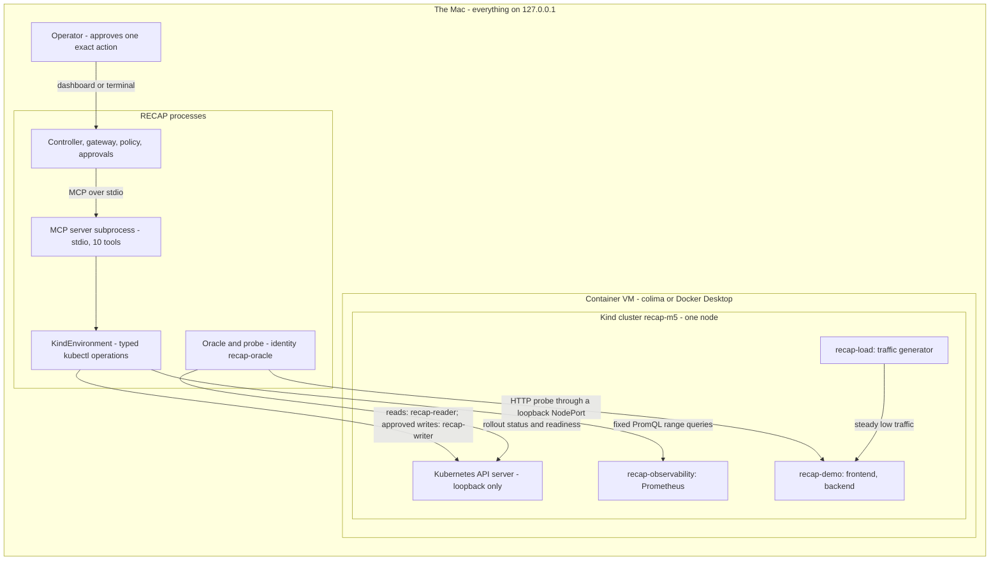

# M5 integration plan: RECAP on a real Kubernetes target

> **Plan only. Nothing in this document is built, installed, provisioned or run.** It was
> written during M4 (step 6, "readiness for M5") on 2026-10-26. RECAP still works only
> against its simulated shop and against recorded replays. No Kubernetes cluster exists for
> RECAP, `kind`, `kubectl` and Helm are not installed on the build machine, no cloud
> resource exists, and there are **no Kind or SREGym results**. Every step that installs or
> downloads something, starts a VM, creates a cluster or provisions a cloud resource waits
> for the owner's explicit "yes" (sections 7, 8 and 12).

## In short

M5 moves RECAP from a simulated shop to real Kubernetes in two targets, in this order:

1. **A small local Kind cluster that RECAP's owner controls completely.** Two demo services
   (`frontend` and `backend`), one intentionally bad release, real `kubectl` observations,
   and only two kinds of change: roll a Deployment back to a named earlier revision, or
   restart it. It runs on this Mac, costs nothing and can be deleted in one command.
2. **SREGym**, a public benchmark for SRE agents, only after a commit is pinned and its
   install, resource needs and rules are checked. Its documented local setup needs more
   memory than this 16 GB Mac can give while it also runs a local model (section 6).

Five ideas carry the plan:

- **One new adapter, no new architecture.** Everything that knows about Kubernetes goes
  into one `TargetEnvironment` adapter
  ([`recap/core/interfaces.py`](../recap/core/interfaces.py)). Agents keep the same ten MCP
  tools; the controller, gateway, policy, approvals, verifier, memory, retrieval and
  router keep their code ([ADR 0007](decisions/0007-replaceable-environment-adapter.md)).
- **No model ever writes a `kubectl` command.** Models choose among RECAP's typed tools
  with validated arguments. The adapter turns them into a closed set of typed operations
  and builds every `kubectl` argument list itself (section 3.6).
- **Writes stay exactly as gated as today**: trusted policy, then an exact, single-use
  human approval, then a signed single-use capability that the adapter verifies before one
  typed Kubernetes write ([ADR 0014](decisions/0014-signed-capabilities-at-the-write-boundary.md)).
  On top of that, Kubernetes itself limits what RECAP's credentials can do.
- **Recovery is judged from the cluster, not from what an agent says**: the rollout has
  finished, the pods are ready, and an independent HTTP probe succeeds (section 3.7).
- **Honest boundaries.** Nothing is installed or provisioned without approval, the
  credentials and cluster state stay outside git, and results from Kind are never mixed
  with simulated results or called benchmark results.

The scored benchmark protocol (splits, confidence intervals, cost scoping) stays in
[`docs/benchmark-plan.md`](benchmark-plan.md). This plan is about getting RECAP onto real
Kubernetes safely; that one is about measuring it on SREGym once it works.

## Contents

1. [Words used in this plan](#1-words-used-in-this-plan)
2. [Where RECAP starts from](#2-where-recap-starts-from)
3. [Target 1: a minimal local Kind cluster](#3-target-1-a-minimal-local-kind-cluster)
4. [Safety on a live cluster](#4-safety-on-a-live-cluster)
5. [Transport: MCP over stdio now, Streamable HTTP later](#5-transport-mcp-over-stdio-now-streamable-http-later)
6. [Target 2: SREGym, only after pinning](#6-target-2-sregym-only-after-pinning)
7. [Installation checklist](#7-installation-checklist)
8. [The AWS free-credit option](#8-the-aws-free-credit-option)
9. [Code integration plan](#9-code-integration-plan)
10. [Risks](#10-risks)
11. [The first three real-cluster acceptance tests](#11-the-first-three-real-cluster-acceptance-tests)
12. [Decisions the owner must make](#12-decisions-the-owner-must-make)
13. [Sources](#13-sources)

---

## 1. Words used in this plan

| Word | Meaning here |
|---|---|
| Kubernetes | The standard system for running containers on a cluster of machines. |
| Kind | "Kubernetes in Docker": a whole cluster running as Docker containers on one machine. Not the same thing as the `kind:` key in [`configs/environment.yaml`](../configs/environment.yaml), which picks RECAP's adapter. (The planned adapter's own kind is also called `kind`.) |
| kubectl | Kubernetes' command-line client. |
| Namespace | A named area inside a cluster. Permissions can be limited to one namespace. |
| Deployment | The object that says "run N copies (replicas) of this container image". |
| Pod | One running copy. A pod is *ready* when its readiness probe passes. |
| ReplicaSet and revision | Every change to a Deployment's pod template creates a ReplicaSet with a new revision number. Rolling back means making an older revision's template current again. |
| Rollout | The step-by-step replacement of old pods by new ones after such a change. |
| Readiness probe | A check Kubernetes runs against each pod; a pod that fails it gets no traffic. |
| ServiceAccount | An identity for a program (not a person) inside the cluster. |
| RBAC | Role-based access control: rules that say which identity may use which *verbs* (`get`, `list`, `patch`, ...) on which resources. |
| Admission policy | A rule the API server checks on every change before saving it. `ValidatingAdmissionPolicy` is stable since Kubernetes 1.30. |
| kubeconfig | A file that tells `kubectl` which cluster to reach and with which credential. A *context* names one cluster-plus-credential pair in it. |
| NodePort | A way to reach a service through a port on the cluster's node. |
| Prometheus | A metrics server that stores time series and answers range queries. |
| Oracle | RECAP's independent judge of recovery ([`recap/verification/oracle.py`](../recap/verification/oracle.py)). |

Status words follow [docs/decisions/README.md](decisions/README.md): *implemented*,
*simulated*, *adapter only*, *not yet built*. In this plan, **verified** means "read or
checked by the author on 2026-10-26, with the source named"; **assumed** means "believed
but not checked; must be checked before relying on it".

---

## 2. Where RECAP starts from

### 2.1 The code M5 builds on

All of this is implemented and tested today, against the simulator:

| Piece | What it already does | Where |
|---|---|---|
| `TargetEnvironment` | The one interface for infrastructure. Trusted methods (`reset`, `describe`, `list_scenarios`, `bind_executor`, `health_check`), read methods exposed as MCP tools (`observe_*`, `plan_rollback`) and one write path (`execute_authorized`). | [`recap/core/interfaces.py`](../recap/core/interfaces.py), [`recap/environments/README.md`](../recap/environments/README.md) |
| Observation models | The shapes every adapter must return (`HealthSnapshot`, `LogQueryResult`, `MetricSeries`, `DeploymentList`, `EventList`, `RollbackPlan`, `HealthReport`, ...). | [`recap/core/observations.py`](../recap/core/observations.py) |
| Adapter selection | `kind` in `configs/environment.yaml` picks the adapter; `package.module:ClassName` also works; both the controller and the MCP server build their own instance with `create_environment`. | [`recap/environments/registry.py`](../recap/environments/registry.py) |
| MCP tool server | Ten tools (seven reads, three writes) in a subprocess per run, over stdio. The subprocess inherits only `HOME`, `LOGNAME`, `PATH`, `SHELL`, `TERM` and `USER` (the MCP SDK's allowlist, checked in the installed SDK 2.3.0), so no other variable such as `KUBECONFIG` reaches it. Its self-description is worded from the adapter (`server_instructions`). | [`recap/tools/mcp_server.py`](../recap/tools/mcp_server.py), [`recap/tools/mcp_client.py`](../recap/tools/mcp_client.py) |
| Gateway and policy | Every call is judged from trusted config (rules R1 to R14), budgeted, time-limited (10 s per tool call), redacted and bounded; successful results become evidence. A namespace or service outside the allowlists is denied (R4, R5). Destructive actions are always denied (R9). | [`recap/tools/gateway.py`](../recap/tools/gateway.py), [`recap/safety/policy.py`](../recap/safety/policy.py), [`configs/policies.yaml`](../configs/policies.yaml) |
| Approvals | One approval allows one exact proposal once; it expires after 15 minutes; "no" wins until the approval is used; every step is in an append-only log. API decisions are recorded as `operator:<name>` from a bearer token; the console needs an interactive terminal. | [`recap/safety/approvals.py`](../recap/safety/approvals.py), [`apps/api/auth.py`](../apps/api/auth.py), [ADR 0015](decisions/0015-operator-auth-and-no-wins-approvals.md) |
| Capabilities | After an approval is consumed, the gateway signs an Ed25519 capability for exactly one action (60 s, one random nonce). The environment verifies it and records the nonce in the same transaction as the change. `verify_capability` refuses a "safety off" capability unless the adapter explicitly allows it, which only a simulation may do. | [`recap/safety/capabilities.py`](../recap/safety/capabilities.py) |
| Live-target rules already in code | When `describe().is_simulated` is false, the controller refuses the auto-approver and the safety-off ablation before anything runs (`_check_safety_scope`), and `AutoApprovalChannel` refuses to exist. The controller also refuses an incident whose namespace is not allowlisted, before the first tool call. | [`recap/harness/controller.py`](../recap/harness/controller.py) |
| Waiting for a real rollout | `EnvironmentInfo.stabilization_timeout_seconds` (default 60) and `stabilization_poll_seconds` (default 2): after a fix on a non-simulated target, the controller probes the oracle until it is healthy or the window ends, inside the run's time budget. | [`recap/core/models.py`](../recap/core/models.py), [ADR 0013](decisions/0013-stabilization-epochs-and-deadlines.md), `tests/e2e/test_audit_retry_and_stabilization.py` |
| A pluggable judge | `ControllerDeps.oracle_factory` builds each run's oracle; the default `EnvironmentHealthOracle` says healthy only when every service is `Running`, all replicas are ready and the error rate is below 0.05. | [`recap/verification/oracle.py`](../recap/verification/oracle.py) |
| Proof that the swap works | The whole pipeline runs unchanged on a second, fake adapter through a real MCP subprocess. | `tests/e2e/test_environment_swap.py`, [`tests/fakes.py`](../tests/fakes.py) |
| The SREGym slot | `SREGymEnvironment` describes itself honestly (`is_simulated=False`, no actions) and refuses every operation. | [`integrations/sregym/adapter.py`](../integrations/sregym/adapter.py) |

### 2.2 What is still simulator-specific

These are the parts the new adapter cannot hide, so M5 must handle them on purpose:

| Gap | Today | What M5 does about it |
|---|---|---|
| Allowlists | `configs/policies.yaml` allows namespace `shop` and five service names. | A separate *target profile* with its own allowlists (section 3.9). |
| Version format | Rollback targets must look like `v1.2.3` (`_VERSION_RE` in [`recap/tools/registry.py`](../recap/tools/registry.py)). | The demo images are tagged `vX.Y.Z`. SREGym's images may not be: an open question (section 6.3). |
| Actions | `EnvironmentAction` is `rollback`, `restart` or `delete_namespace`; only rollback and restart may be proposed. | Kind needs exactly these two. SREGym faults often need other fixes (section 6.2). |
| Service states | `ServiceStatus` knows `Running`, `CrashLoopBackOff`, `Deleted` and `Unknown`. | Other pod states (`Pending`, `ImagePullBackOff`, a rollout in progress) are reported as `Unknown` at first; extending the model is a later, separate decision. |
| Log conventions | The scripted policy and the verifier parse a fixed family of phrasings ([`recap/core/signals.py`](../recap/core/signals.py)). | The demo app logs in one of those phrasings (an honest compromise, section 3.3). Real third-party logs need a model provider. |
| Time | The simulator's clock jumps 5 minutes per fix; the simulator declares a stabilization window of 0. | Real time, a real window, a rollout-aware oracle (section 3.7). |
| Budgets | 120 s of wall clock by default (1800 s for the local model). | A live run needs more: the target profile raises it (section 3.7). |
| Approvals in batches | `scripts/live_eval.py` uses the auto-approver, which a live target refuses. | A live batch needs a human approval per write (section 9.2). |

### 2.3 The build machine (checked read-only on 2026-10-26)

| Fact | Value |
|---|---|
| Hardware | Apple M3 (arm64), 8 cores, 16 GB of memory |
| Free disk | about 42 GiB on the system disk |
| Container tools | Docker CLI 29.9.1 and colima 0.10.3 are present. colima's existing `default` profile is stopped and set to 4 CPUs, 8 GiB of memory and a 40 GiB disk. A Docker Desktop context is configured too. |
| Kubernetes tools | `kind`, `kubectl` and Helm are **not installed** |
| Local models | Ollama is present. M2 measured `qwen3:8b` at 6.8 GB of memory on this machine (with a 12,288-token context; [docs/status.md](status.md)) |

---

## 3. Target 1: a minimal local Kind cluster

### 3.1 Why Kind first

- **Everything is ours.** The application, its defect, its logs and its health checks are
  written for the test, so a success or a failure can be explained line by line.
- **It fits RECAP's two fixes.** A bad release needs a rollback; a stuck, memory-full
  process needs a restart. Nothing else is needed.
- **$0 and disposable.** No cloud, no account; `kind delete cluster` removes it.
- **Real Kubernetes.** The API server, the scheduler, ReplicaSets, rollouts, readiness
  probes, events and RBAC are the real ones, so RECAP meets real timing and real
  permission errors.

What Kind does **not** prove: that RECAP understands third-party applications, or anything
about benchmark scores. That is what target 2 is for.

### 3.2 What will run



- **One Kind node** (the default single-node cluster runs ordinary workloads). The API
  server stays on Kind's default 127.0.0.1 address; Kind's documentation strongly
  recommends keeping it there (verified, Kind configuration docs).
- **Port mappings set `listenAddress: "127.0.0.1"` explicitly.** Kind's default for
  `extraPortMappings` is `0.0.0.0` (verified), which would expose the demo on the local
  network.
- **Namespaces:** `recap-demo` holds the two services RECAP may see and change.
  `recap-load` (traffic) and `recap-observability` (Prometheus) are environment plumbing:
  RECAP's Kubernetes identities have no permissions there (the adapter reaches Prometheus
  only through its read-only query API), much as SREGym hides its load generators from
  agents. `recap-system` holds RECAP's ServiceAccounts and nothing else.
- **No registry.** Images are built locally and copied into the node with
  `kind load docker-image`; the manifests set `imagePullPolicy: Never`, so the node never
  pulls anything for the demo.

### 3.3 The demo app and its intentionally bad release

- `frontend` serves the user-facing path and calls `backend` for each request. `backend`
  serves items and reports.
- Both are small Python programs using only the standard library (no `pip install` inside
  the image), built from one Dockerfile on a pinned `python:3.12-alpine` base (about 18.5 MB
  compressed for arm64 on Docker Hub, verified). Each image is tagged `vX.Y.Z`, matching
  RECAP's version rule.
- Each exposes `/metrics` in the Prometheus text format (request counts by status code, a
  latency histogram, its own resident memory) and a `/readyz` readiness endpoint that
  reflects whether it can really serve.
- **The bad release:** `backend:v1.1.0` contains a real coding defect that raises an
  exception for part of the requests. The baseline `v1.0.0` does not. Nothing in RECAP
  knows this: the scenario's expected answer is an evaluation-only label, exactly like
  `expected` in the simulator's scenario files, and `reset` returns only an alert.
- **The restart case** (for acceptance test 3): `backend` has a real, dormant defect in
  every version, a report cache that never evicts. A burst of report requests fills memory
  past 90% of the container limit; the readiness check then refuses traffic, so the pods
  stay running but not ready, and the failure persists instead of healing itself. A
  rolling restart replaces the pods and clears it. (Readiness that refuses traffic under
  memory pressure is a deliberate demo choice, so the incident does not disappear when the
  kubelet restarts an out-of-memory container on its own.)
- **Logs use a phrasing RECAP already reads**, for example
  `handler panic: KeyError: 'region' [build v1.1.0]` and
  `rpc to backend failed: DEADLINE_EXCEEDED (...)` (the RPC style in
  [`recap/core/signals.py`](../recap/core/signals.py)). This is an honest compromise: the
  app is ours, so a success with the scripted policy proves the *plumbing* on a real
  cluster, not that RECAP understands arbitrary logs. Logs written by someone else need a
  model provider, which is what SREGym tests.
- **Dependencies** come from an annotation on each Deployment that the owner's manifests
  set (`frontend` depends on `backend`). Kubernetes itself does not know dependencies.
- **Manifests are cautious:** two replicas per service, `RollingUpdate` with
  `maxUnavailable: 0` and `maxSurge: 1` (a new pod must be ready before an old one goes),
  a short `progressDeadlineSeconds` so a stuck rollout is reported quickly, small memory
  limits, and the namespace labelled for Pod Security Admission `restricted` (no privileged
  pods, whoever asks). The demo pods must meet that profile themselves: a non-root user, no
  privilege escalation, all Linux capabilities dropped and the default seccomp profile.

### 3.4 Identities and permissions

RECAP never uses the cluster administrator's credential. The owner creates four
ServiceAccounts once (in `recap-system`), each bound by a Role to `recap-demo` only:

| Identity | Used by | Process | Allowed (namespace `recap-demo` only) | Never allowed |
|---|---|---|---|---|
| `recap-reader` | the seven read tools | MCP server | `get`, `list` on pods, events, deployments, replicasets; `get` on `pods/log` | any write verb; Secrets; ConfigMaps; `pods/exec`, `pods/portforward`, proxies; other namespaces |
| `recap-writer` | `execute_authorized` only | MCP server | `get`, `patch` on deployments named `frontend` and `backend`; `list` on replicasets | `create`, `update`, `delete`, `deletecollection`; `deployments/scale`; pods; Secrets; other namespaces |
| `recap-oracle` | `health_check` | controller | `get`, `list` on deployments and pods | logs; any write verb |
| `recap-scenario` | `reset` (fault injection) | controller | `get`, `patch` on the two deployments; `list` on replicasets and pods | everything else |

- **Read verbs versus the two writes.** RECAP's two writes, `kubectl rollout undo` and
  `kubectl rollout restart`, are both a single Kubernetes verb, `patch` on a Deployment.
  So the writer needs exactly `patch` (plus the reads `kubectl` makes first), on two named
  Deployments, and nothing else.
- **`patch` on a Deployment is powerful**: it can change the image, so in principle it can
  run any container in the namespace. An admission policy therefore checks every change
  made by `recap-writer` or `recap-scenario`: the replica count may not change, and every
  image must be one of the demo images with a `vX.Y.Z` tag. A sketch, untested, to be
  written and tested in M5:

  ```yaml
  # Illustrative sketch only: not applied anywhere, not yet tested.
  apiVersion: admissionregistration.k8s.io/v1
  kind: ValidatingAdmissionPolicy
  metadata: {name: recap-writes-keep-their-shape}
  spec:
    failurePolicy: Fail
    matchConstraints:
      resourceRules:
        - {apiGroups: [apps], apiVersions: [v1], operations: [UPDATE], resources: [deployments]}
    matchConditions:
      - name: recap-identities-only
        expression: >-
          request.userInfo.username in [
            'system:serviceaccount:recap-system:recap-writer',
            'system:serviceaccount:recap-system:recap-scenario']
    validations:
      - expression: object.spec.replicas == oldObject.spec.replicas
        message: RECAP may not scale a Deployment
      - expression: >-
          object.spec.template.spec.containers.all(c,
            c.image.matches('^recap-demo/(frontend|backend):v[0-9]+[.][0-9]+[.][0-9]+$'))
        message: only RECAP demo images with a vX.Y.Z tag
  ```

  (A policy needs a `ValidatingAdmissionPolicyBinding` with `validationActions: [Deny]` to
  take effect; verified in the Kubernetes documentation.)
- **Short-lived credentials.** Each identity's kubeconfig holds a token minted with
  `kubectl create token <account> --duration=...` for one working session. When the token
  expires, the access ends by itself. The script that writes these files runs with
  `umask 077` and writes them with a here-document, so a token never appears on a command
  line, in shell history or in `ps`.
- **The four kubeconfig files live outside the repository** (for example in
  `~/.config/recap/kind/`, mode 600). Each process is given only the paths it needs: the MCP
  server never receives the oracle's or the scenario's, and the controller never receives
  the writer's. All RECAP processes run as the same user on this Mac, so this separation is
  a convention; the real limits are RBAC, the admission policy and the short token life.
- **The administrator credential stays with the owner.** Kind normally writes it into
  `~/.kube/config` and switches the current context. The setup instead passes
  `--kubeconfig` to `kind create cluster` so the owner's usual kubeconfig (which may name
  other clusters) is never touched, and RECAP never reads that file.

### 3.5 How each `TargetEnvironment` method maps to Kubernetes

The planned adapter is `KindEnvironment` (kind `kind`). Every Kubernetes call below is one
typed operation from section 3.6; `kubectl` commands are shown so a person can run the
same thing by hand.

| Method (MCP tool) | Who calls it, which identity | Kubernetes source | Translation into RECAP's model |
|---|---|---|---|
| `reset(scenario_id, seed)` | controller (trusted), `recap-scenario` | 1. Preflight (section 3.9). 2. Put both Deployments back on their baseline images and wait until their rollouts finish and the probe is healthy; if that fails, `reset` raises an error and no run starts (a fault-free baseline is the precondition of a valid run). 3. Apply the scenario's typed fault steps, e.g. "backend image becomes `v1.1.0`" or "send the report burst". 4. Wait (bounded) until the alert rule fires: the probe's error rate on `frontend` reaches 0.05, or pods stop being ready. | `AlertSignal` built from what was *measured* (service, affected services, symptoms such as "error rate 0.42 over 20 probes", namespace `recap-demo`, the time the rule fired), with `metadata = {"source": "recap-kind-probe", "namespace": "recap-demo"}`. No fault name, no label. The seed is recorded, but a real cluster is not deterministic. |
| `describe()` | controller, policy, MCP server | none (static, plus the run's namespace from the local state file) | `kind="kind"`, `is_simulated=False`, `supported_actions=["rollback", "restart"]` (no `delete_namespace`), a description that says "local Kind cluster, not production", and the stabilization window (section 3.7). Holds no paths or secrets. |
| `list_scenarios()` | controller, API, evaluations | scenario files in the repository | `ScenarioInfo` with evaluation-only `family` and `expected`; partition `demo` until there are enough scenarios for a split. |
| `observe_services()` (`list_services`) | agents, `recap-reader` | `kubectl get deployments -o json` | One `ServiceInfo` per allowlisted Deployment: version = image tag, replicas, dependencies from the annotation. |
| `observe_health(s)` (`get_service_health`) | agents, `recap-reader` | the Deployment's status, its pods (by its label selector), and Prometheus for error rate and p95 latency | `CrashLoopBackOff` if any container is waiting in it; `Running` if pods run; `Unknown` for pending, image-pull failures or a stuck rollout; `Deleted` if the Deployment is gone. Ready and desired replicas from the Deployment. |
| `observe_logs(s, limit, since)` (`get_service_logs`) | agents, `recap-reader` | `kubectl logs -l <selector> --prefix --timestamps --since=<m>m --tail=<limit> --max-log-requests=<n> --limit-bytes=<b>`, plus `--previous` for containers that restarted | Lines from all of the service's pods merged by timestamp, oldest first, newest `limit` kept, `truncated` set honestly. The level is read from the app's line format. |
| `observe_metrics(s, m, window)` (`get_service_metrics`) | agents, `recap-reader` (Kubernetes), plus Prometheus over loopback | fixed PromQL templates, `query_range` with a 5-minute step | `error_rate` and `latency_p95_ms` from the request counters and histogram; `memory_mb` from the app's resident memory with the container `limit` from the pod spec; `cpu_pct` from CPU seconds against the CPU limit; `restarts` from the containers' restart counts. A metric with no source returns a tool error, never a made-up number (section 3.8). |
| `observe_deployments(s, limit)` (`get_recent_deployments`) | agents, `recap-reader` | the Deployment's ReplicaSets, sorted by their `deployment.kubernetes.io/revision` annotation | `DeploymentRecord` per revision: version = image tag, previous version, creation time; `status="rollback"` when the ReplicaSet carries a revision history (a revision brought back by an undo); `change_summary` from the `kubernetes.io/change-cause` annotation when present. Newest first. |
| `observe_events(s, limit)` (`get_k8s_like_events`) | agents, `recap-reader` | `kubectl get events -o json` in `recap-demo`, filtered to the service's pods, ReplicaSets and Deployment | `ClusterEvent` with the real reason (`BackOff`, `Unhealthy`, `Killing`, `ScalingReplicaSet`, ...), count and object, newest first. A container's last termination reason `OOMKilled` lives in pod *status*, not in an Event object: the adapter reports it as a `ClusterEvent` whose message says it came from pod status, so nothing is presented as an event the API never stored. Events expire after one hour by default. |
| `plan_rollback(s)` (`propose_rollback`) | agents, `recap-reader` | read the rollout history (the same data as `kubectl rollout history` and `kubectl rollout undo --dry-run=client`) | `RollbackPlan`: the most recent earlier revision whose image differs from the running one, with both versions and the revision number in `reason`. Changes nothing, and needs no write permission. |
| `bind_executor(public_key)` | controller, right after `reset` | none | The run's public key goes into a per-run local SQLite file in RECAP's data folder (like the simulator's sandbox file), never into the cluster. Both adapter instances read it from there. |
| `execute_authorized(action)` (`execute_rollback`, `restart_service`) | MCP write tools, `recap-writer` | see below | `ActionOutcome` saying what was started, e.g. "backend: rollout to revision 3 (v1.0.0) started". |
| `health_check()` | oracle only (trusted), `recap-oracle` | rollout status and pod readiness from the API, plus the oracle's own HTTP probe | `GroundTruthHealth` per service; see section 3.7. |

**The single write path, step by step:**

1. Refuse an action that is not `rollback` or `restart`. `delete_namespace` is refused
   here even with a valid capability; the gateway already denies it (R9), and this is the
   second lock.
2. Refuse while the global write switch is off (section 4.3).
3. Verify the capability with `verify_capability(..., allow_safety_off=False)` against the
   bound key and the used nonces, and record the nonce, in one exclusive transaction on the
   local state file. The nonce is written *before* anything is sent to the cluster, so a
   capability can never be used twice, even if the process dies right after.
4. Check the target again against the adapter's own service allowlist and namespace.
5. **Rollback:** find the ReplicaSet whose pod template image is exactly the approved
   `to_version` (the highest revision if several match). Refuse if there is none or if it
   is already the running template. Run
   `kubectl rollout undo deployment/<s> --to-revision=<N> --dry-run=server`, then the same
   command without `--dry-run`. The server-side dry run passes RBAC and the admission policy
   without saving anything, so a refused write fails before it changes the cluster.
   (`kubectl rollout undo` sends a `patch`; `--dry-run=server` support must be checked
   against the pinned `kubectl` version during setup.)
6. **Restart:** `kubectl rollout restart deployment/<s>` (it patches one pod-template
   annotation, which starts a rolling replacement), with the same dry-run step where the
   pinned `kubectl` supports it.
7. Read the Deployment back and check that its template now shows the approved image
   (rollback) or a new restart annotation (restart). Record the write in the adapter's
   audit log: approval ID, proposal digest, revision before and after, exit code, time.
8. Return at once. The adapter does **not** wait for the rollout inside the 10 s tool
   timeout; the controller's stabilization window does the waiting (section 3.7).

A note on revision numbers: rolling back to revision 3 makes that ReplicaSet current again
and renumbers it as the newest revision, so "revision 3" disappears from the history. That
is why the approval and the capability bind the *version* (`to_version`), and the revision
number is resolved again right before the write.

### 3.6 Typed operations: how RECAP calls `kubectl` safely

```text
model --(RECAP tool name + validated args)--> gateway --(MCP)--> KindEnvironment
      --(one KubeOp from a closed list)--> argv built by code --> kubectl (no shell)
```

- **A closed list of operations.** Reads: list deployments, get one deployment, list
  replicasets, list pods, pod logs, list events. Writes: rollout undo to a revision, rollout
  restart. Scenario only (trusted `reset`): set a Deployment's image to a version named in
  the scenario file, and send a scenario's HTTP burst. There is no "run this command"
  operation.
- **Every argument is checked twice.** The registry validates the model's arguments
  (allowlisted service, integer bounds, a metric from a fixed list, versions like
  `v1.2.3`). The adapter checks again: names must be allowlisted Kubernetes names,
  revisions positive integers, the namespace and context fixed by configuration.
- **Argument lists, never strings.** Every call is
  `subprocess.run([...], shell=False, timeout=...)` with `--kubeconfig <file>`,
  `--context kind-recap-m5`, `--namespace recap-demo`, `-o json` and a short
  `--request-timeout`. The child's environment sets `KUBECONFIG` to the same file. This
  matters: the MCP subprocess inherits `HOME`, so a `kubectl` without these flags would read
  `~/.kube/config` and could reach another cluster.
- **Commands that never appear** in RECAP's code: `exec`, `port-forward`, `proxy`, `apply`,
  `create`, `edit`, `delete`, `scale`, `run`, `cp`, `debug`, `drain`, `cordon`. `set image`
  appears only in the trusted `reset`, with the scenario identity. The owner's setup
  scripts use some of the others, by hand, with the administrator credential.
- **Bounded, untrusted output.** `kubectl` output is size-limited; JSON output is parsed
  strictly (an unexpected shape is an error, never a guess) and log output is split into
  lines. Then it passes the gateway's redaction, bounds and injection flags like any tool
  output. Error text is shortened and redacted.
- **An audit trail of commands.** The adapter records each argument list (without
  credentials), exit code, duration and output size in its per-run state file, so every
  observation can be repeated by hand. This is trusted local data; it never goes to a
  model.
- **Why `kubectl` and not a Python client library.** It needs no new Python dependency
  (installing one would need approval), it is what a person runs to check RECAP's work, and
  it handles credentials itself. The cost is a process start per call and version skew:
  `kubectl` is supported within one minor version of the API server (verified, Kubernetes
  version skew policy). The operations sit behind a small `KubeClient` interface, so a
  direct HTTP client (RECAP already depends on `httpx`) can replace `kubectl` later, and the
  offline tests use a fake client that returns recorded JSON.

### 3.7 Rollouts, readiness and the oracle

**What "healthy" means on Kind.** `health_check()` returns, for each service:

| Field | Source |
|---|---|
| `status` | `Running` only when the rollout is complete: the Deployment's `observedGeneration` has caught up with its `generation`, `updatedReplicas` equals the desired replicas, no old pods are left (`status.replicas` equals `updatedReplicas`), `availableReplicas` equals `updatedReplicas`, and the `Progressing` condition is not `ProgressDeadlineExceeded`. These are the checks `kubectl rollout status` makes. `CrashLoopBackOff` when any container waits in it; otherwise `Unknown`. |
| `ready_replicas`, `replicas` | the Deployment's ready and desired replica counts |
| `error_rate` | the oracle's **own** HTTP probe: a fixed number of requests to the service's user path through its loopback NodePort, each with a short timeout; failures divided by requests |

The existing `EnvironmentHealthOracle` rule then applies unchanged: healthy means
`Running`, every replica ready and an error rate below `oracle.max_error_rate` (0.05).

- **Why a probe and not Prometheus.** The agents read Prometheus through
  `get_service_metrics`. The oracle needs a channel of its own
  ([ADR 0010](decisions/0010-label-free-views-and-a-yes-no-oracle.md),
  [`recap/verification/README.md`](../recap/verification/README.md)): it asks the service
  directly, like a user would. SREGym's mitigation oracle uses client-side request success
  too (section 6.1).
- **A short hold against flapping.** `health_check` probes twice, a few seconds apart, and
  reports healthy only if both rounds pass, so a pod that crashes twenty seconds after
  becoming ready is not counted as recovered. This keeps the oracle code unchanged; a
  stateful `RecoveryOracle` through `oracle_factory` is the alternative if the hold has to
  span several polls.
- **The window.** `describe()` declares `stabilization_timeout_seconds` (start at 180) and
  `stabilization_poll_seconds` (start at 5). Both are starting guesses to be replaced by
  measured rollout times. The controller already probes until healthy or the window ends
  ([ADR 0013](decisions/0013-stabilization-epochs-and-deadlines.md) left "watch the rollout
  itself" to this adapter; the rollout-complete rule above is that).
- **Budgets.** The settle wait counts against the run's wall clock. The default 120 s is too
  short for a 180 s window, so the Kind target profile raises `max_elapsed_seconds` for
  scripted runs (the local model already has 1800 s). If the run's time ends during the
  wait, the result is `BUDGET_EXHAUSTED`, not "the fix failed" (existing behaviour).
- **Every trusted call is bounded.** The controller does not put a timeout around an
  oracle probe, so `health_check` limits itself: `kubectl --request-timeout`, short HTTP
  timeouts and a fixed number of probe requests.
- **Probes are traffic.** The oracle's probe sends a few real requests. That is acceptable
  for trusted code and for a demo app; it is also what a real health check does.

### 3.8 Metrics, logs and traces: what exists with and without a metrics stack

| Signal | Kind with no metrics stack | With one small Prometheus (planned for target 1) |
|---|---|---|
| Pod and container state, restarts, last termination reason (`OOMKilled`) | yes, from the API (current values) | the same |
| Deployment status, revision history, resource limits | yes | the same |
| Events | yes, one hour by default | the same |
| Logs | yes, from running pods (and `--previous` for one restart); logs of deleted pods are gone | the same (a log store such as Loki is not planned for Kind) |
| CPU and memory *usage* | no (`kubectl top` needs metrics-server, current values only) | the app's own resident memory and CPU seconds, as series |
| Error rate and latency | no | yes, from the apps' request counters and histograms, as 5-minute series |
| Traces | no | no (there is no tracing backend, and RECAP has no trace tool yet) |

- **Decision: target 1 runs one small Prometheus** (the official image; its v3 line is
  about 105 MB compressed for arm64 on Docker Hub, verified), with no Grafana, no
  Alertmanager, no operator, a few hours of retention and no persistent volume. It scrapes
  only the pods in `recap-demo`, using a ServiceAccount of its own (separate from RECAP's
  four). Its query API is read-only by default and reached on 127.0.0.1 only.
- **Without Prometheus RECAP would have no error rate or latency at all**, and
  `HealthSnapshot` requires both numbers. The adapter will **refuse to start** when its
  metrics source is unreachable instead of reporting zeros. A metric that has no source
  (for example `memory_mb` if the app stopped exporting it) is a tool error, which the
  gateway records as a failed call; it never becomes a number.
- **The app's resident memory is not the container's working set** that the kernel's
  out-of-memory killer looks at. That is fine for the restart scenario (memory stays below
  the limit) and is stated in the tool's unit (`MB, process RSS`). Container-level memory
  needs cAdvisor scraping, which is a later step.
- **Traces** need a new read tool (a registry entry with risk `read`, a place in the
  telemetry specialist's allowlist, an observation model, an MCP tool and an adapter
  method). That is an interface change, planned for SREGym, which ships Jaeger. To keep
  existing adapters working, the new method would have a default that reports "not
  available" rather than being abstract.

### 3.9 Namespace allowlists, cluster pinning and the target profile

- **A target profile, not edits to the default config.** A new folder
  `configs/targets/kind-demo/` holds the Kind `environment.yaml` (adapter `kind`, cluster
  and context names, namespace, services, loopback URLs, the folder that holds the
  credentials) and its own `policies.yaml` (version `policy-kind-v1`,
  `allowed_namespaces: [recap-demo]`, `allowed_services: [frontend, backend]`, the same risk
  tiers, `delete_namespace` still `destructive`, the same two remediation tools). A new
  setting, `RECAP_TARGET=kind-demo`, makes `load_settings` read these files instead of the
  defaults, and the run's config hash covers the files actually read. Without it nothing
  changes: tests, demos and CI stay on the simulator.
- **Three locks on the namespace.** RECAP's policy (R5 on every call, and the controller's
  check before the first call), the adapter (fixed namespace), and RBAC (the Roles exist
  only in `recap-demo`).
- **Cluster pinning, fail closed.** Before every run the adapter checks that the context is
  `kind-recap-m5`, that the API server address is a loopback address, and that the SHA-256
  fingerprint of the cluster's certificate authority (from the kubeconfig) equals the one
  recorded when the cluster was created (kept in the credentials folder, outside git).
  Every new Kind cluster gets a new certificate authority, and `kubectl`'s TLS check then
  proves that the API server belongs to exactly that cluster; the check needs no
  permission. A kubeconfig that points anywhere else, such as a work cluster, stops the run
  before any read.
- **One live run per namespace.** Two runs resetting the same demo at once would break each
  other. `reset` takes a lease in RECAP's data folder and refuses while another run's lease
  is active; the lease expires after the run's maximum duration, because the
  `TargetEnvironment` interface has no "run finished" call. (Such a call could be added
  later as an optional method.)

### 3.10 Simulation versus a real cluster: what changes in permissions

| Topic | Simulator today | Kind in M5 |
|---|---|---|
| Who approves a write | a person, or the simulation auto-approver | a person only (the auto-approver already refuses a non-simulated target) |
| "Safety off" ablation | allowed, to show what an unsafe action would do | refused by the controller, by policy rule R3 and by the capability check |
| What a write needs | a valid capability | a valid capability, **and** RBAC allows it, **and** the admission policy accepts its shape |
| `delete_namespace` | implemented, so the ablation can show its damage | not implemented: the adapter refuses it; the gateway denies it (R9) |
| Where the executor key lives | the run's sandbox SQLite file | a per-run local SQLite file; never in the cluster |
| Oracle ground truth | noise-free simulator state | rollout status, readiness and an independent probe, with a separate identity |
| Time | a clock that jumps 5 minutes per fix | real time and a stabilization window |
| Repeatability | seeded and deterministic | not deterministic; the run is evidence through its trace export and command log |
| Replay | a recorded model run replays offline | a replay must never act on a live cluster: a replay re-runs decisions made about another system (M4's replay work adds a controller check that refuses a replay against a non-simulated environment; confirm it is in place before M5 starts) |
| Data | simulated, no secrets | the demo app's logs hold no secrets; any other cluster's logs may, and need real redaction |

---

## 4. Safety on a live cluster

### 4.1 Rules that already hold in code (and must stay)

- Only the controller can execute a fix, only through the gateway, only after the policy
  and an exact approval allow it; destructive actions are always denied.
- The auto-approver and the safety-off ablation refuse a non-simulated environment.
- The environment refuses any write without a valid capability for exactly that action.
- An approval is consumed right before the write and can never be replayed; "no" wins until
  then; every decision is logged append-only.
- The capability is never traced, stored, exported or shown.

### 4.2 Rules M5 adds

| Rule | How |
|---|---|
| No `kubectl` or shell string ever reaches a model, and no model output ever becomes one | the typed operations of section 3.6 |
| No anonymous approval on a live cluster | API decisions already carry `operator:<name>` from the bearer token. For a non-simulated target the console channel will also demand that the operator type the target service's name (not just `y`), and the decision log will record the operating-system login name. One shared operator token remains a known limit: per-person identity (single sign-on) is future work ([threat model](threat-model.md#future-hardening)). |
| Explicit human confirmation before every write | already enforced for every reversible write. The approval card also shows `propose_rollback`'s plan (which revision and image a rollback restores) when the run has it. |
| No hosted model sees live cluster data | the provider factory will refuse a `free_hosted_llm` provider when the environment is not simulated; Kind runs use the scripted policy or the local model. (The threat model already says never to send real logs to a free hosted tier.) |
| Reads are protected before anything but the demo runs | the API's reads are open on loopback today, because run data is simulated. That stays acceptable for the demo app's synthetic logs on a single-user Mac. Before any other cluster, the API must require the operator token for reads too ([ADR 0015](decisions/0015-operator-auth-and-no-wins-approvals.md) names this). |
| A live run is labelled as one | `describe()` says "local Kind cluster, not production"; the API's environment label already follows `describe()` (`LIVE ENVIRONMENT (kind) · V1` for a non-simulated adapter), and the dashboard must keep showing it. Nothing may suggest production Kubernetes. |
| Results are never pooled | Kind runs are recorded with environment kind `kind` and `simulated: false`, and kept out of every simulated or replay table (M4's evaluation records name a separate mode for a real cluster, `kubernetes_future`, which no record may carry until it exists). |

### 4.3 The kill switch

Four levels, from gentle to final:

1. **Cancel one run.** `POST /runs/{id}/cancel` (operator only) or Ctrl-C in the terminal
   (both exist). A pending approval is expired, so nobody can approve it later. A write
   that already reached the cluster cannot be called back; the run records it.
2. **Stop all writes (planned).** A switch in RECAP's data folder that `execute_authorized`
   checks before every write; while it is on, every write is refused and nothing changes.
   Reads keep working, so a person can still look.
3. **Revoke at the cluster (works even if RECAP itself is compromised).** With the
   administrator credential, delete the `recap-writer` RoleBinding; every later write is
   refused by the API server. Deleting the ServiceAccount also invalidates its tokens.
4. **Remove everything.** `kind delete cluster --name recap-m5`.

### 4.4 Infrastructure state stays outside git

| Item | Where it lives | In git? |
|---|---|---|
| Kind cluster config, demo app source, manifests, RBAC and admission policy files | `infra/kind/` (planned) | yes: they hold no secrets |
| Target profile (names, namespaces, loopback URLs) | `configs/targets/kind-demo/` (planned) | yes |
| Administrator kubeconfig, RECAP's four kubeconfigs and tokens, the recorded certificate-authority fingerprint | a private folder such as `~/.config/recap/kind/` (mode 600) | **never** |
| Per-run executor key, used nonces, write and command audit logs | RECAP's data folder (`data/` or `RECAP_DATA_DIR`; already ignored by git) | never |
| Run records, traces, exports | RECAP's data folder; an export is reviewed before it is committed, as in M2 and M3 | only reviewed exports |

A planned test scans tracked files for kubeconfig and token patterns
(`client-key-data`, `certificate-authority-data`, `token:` with a long value) and fails if
it finds any.

---

## 5. Transport: MCP over stdio now, Streamable HTTP later

**Target 1 keeps stdio.** The MCP server stays a subprocess of the RECAP process, started
per run ([ADR 0004](decisions/0004-real-mcp-over-stdio.md)), and the adapter inside it calls
`kubectl` on the same Mac. stdio opens no network port, so the transport adds nothing new to
attack, and the existing tests of the transport stay valid.

**Optional hardening in M5: separate read and write servers.** Today one server process
holds both the read tools and the write tools, so with Kind it would hold both the reader's
and the writer's kubeconfig paths. A small `SplitTransport` (implementing the existing
`ToolTransport` protocol) can start two stdio servers instead: a read server with only the
reader's credential, and an executor server with only the three write tools and the
writer's credential. It routes a call by whether the tool is in `WRITE_TOOLS`
([`recap/tools/actions.py`](../recap/tools/actions.py)). The gateway does not change.
ADR 0014 named "a separate privileged executor process" as the stronger alternative to
its design; this is that process, and the capability check is still what protects it.

**A server inside a cluster would use Streamable HTTP** (needed only if RECAP's tools ever
run next to a remote cluster, for example on a benchmark host):

- In the current MCP specification (revision 2026-07-28, verified), the two standard
  transports are stdio and Streamable HTTP: every message is an HTTP POST to one endpoint,
  and that revision removed protocol-level sessions. The older HTTP+SSE transport has been
  deprecated since 2025-03-26.
- The specification says servers **must** validate the `Origin` header, **should** bind to
  127.0.0.1 when local, and **should** authenticate every connection.
- The installed Python SDK (2.3.0) can serve `stdio`, `sse` and `streamable-http`, and its
  `Client` accepts a URL for Streamable HTTP. It turns on Host and Origin checking
  automatically only when the server binds to a loopback address, so a server inside a
  cluster would need explicit allowed hosts, real authentication (the SDK ships
  `mcp.server.auth`), TLS from a proxy or the web server, and a NetworkPolicy.
- RECAP's client connects today in the SDK's "legacy" mode (the `initialize` handshake). A
  server that speaks only the 2026-07-28 revision may need the modern mode: to be checked
  then.
- SREGym's MCP servers use the deprecated HTTP+SSE transport (section 6.1). RECAP does not
  plan to call their tools.

Whatever the transport, it is not a security boundary: the capability check stays in the
adapter.

---

## 6. Target 2: SREGym, only after pinning

### 6.1 What SREGym is: verified versus assumed

**Verified on 2026-10-26** from the repository's README and `kind/` folder on `main` (which
was at commit `dea6148`, 2026-10-25, when read: **this is not a pin**), the source files of
its `mcp_server/` folder at that commit, and the paper (arXiv 2605.07161v3, 30 July 2026):

| Topic | What the sources say |
|---|---|
| Purpose | A live benchmark for SRE agents: real cloud-native applications on Kubernetes (DeathStarBench, Train Ticket, Astronomy Shop and others, with MongoDB, TiDB, Kafka, MySQL), faults injected at several layers, background "noise" faults, metastable and correlated failures. The paper describes 90 problems. |
| A problem | An environment, an agent interface, a set of faults and noises, and two oracles: diagnosis and mitigation. |
| Diagnosis oracle | An LLM judge with a checklist of 9 yes/no questions in three dimensions; pass threshold 7/9. When no judge model is set, SREGym reuses the agent's model and endpoint (`JUDGE_API_BASE` and `JUDGE_API_KEY` can point it elsewhere). The paper's results used Claude Sonnet 4.6 as the judge. |
| Mitigation oracle | Problem-specific, programmatic where possible: it checks that the injected fault is resolved and the system healthy, using client-side observations such as request success rate and system-side state. The fault-injection plane is hidden from agents behind a proxy. |
| Agent interface | MCP servers for Prometheus metrics, Loki logs, Jaeger traces, cluster control and submission. The cluster-control tool, `exec_kubectl_cmd_safely(cmd: str)`, takes a **free-form `kubectl` command string**. The servers use the deprecated HTTP+SSE transport, with CORS open to any origin, bound to 127.0.0.1 unless configured to listen on all interfaces. |
| Agents | Run in isolated Docker containers with filtered network access. |
| Requirements | Python 3.12 or newer, Docker, Helm 4.0 or newer, `kubectl`, `uv` 0.11.8 or newer, and `kind` for local use. A self-managed Linux cluster is recommended; "a managed Kubernetes service won't work out of the box"; on Kind "not all problems are supported" (no list given). |
| Local Kind setup | Four nodes (one control plane, three workers), Calico networking, a custom node image pinned by digest. On macOS: give the Docker VM **at least 16 GB** for the full Lite profile and leave more memory for macOS and the agent. SREGym-Lite is 17 problems. A `svelte` profile for memory-limited hosts changes what agents can observe, so its scores are not comparable. |
| How agents acted in the paper's runs | Most tool calls were read-only `kubectl`; the evaluated agents' writes were mostly `kubectl patch`, `set`, `rollout`, `run` and `delete`. |
| License, releases | MIT. No releases or tags: a commit hash is the only possible pin. |

**Assumed or unknown until a commit is pinned and read:**

- Which problems run on Kind, and their individual memory, CPU and disk needs (the image
  downloads are probably several GB: not checked).
- How many problems a rollback or a restart can actually fix. Many fault types are
  misconfigurations (environment variables, ports, Kubernetes settings) that need other
  fixes.
- Whether the mitigation stage can run and be scored without the diagnosis judge, or with
  a local judge at $0, and whether the rules allow an agent that is not packaged as one of
  SREGym's agent containers.
- How the `submit` call is made by an outside agent, and when the mitigation oracle runs.
- Whether every application image exists for arm64 (the node image config is multi-arch).
- How SREGym's Prometheus, Loki and Jaeger are reached from outside the cluster.

### 6.2 What it means for RECAP

- **Not runnable as documented on this Mac with a local model.** SREGym-Lite asks for a
  16 GB VM on macOS; the Mac has 16 GB in total and the local model alone took 6.8 GB.
  The realistic choices are a Linux machine with more memory (the AWS option, section 8)
  or the `svelte` profile with scores labelled "not comparable". Both are owner decisions.
- **RECAP must not use SREGym's cluster-control tool.** A free-form `kubectl` string is
  exactly the passthrough RECAP forbids. RECAP keeps its own typed tools (option A in
  [`integrations/sregym/mapping.md`](../integrations/sregym/mapping.md)); if SREGym's rules
  require agents to use its tools, RECAP declines that mode rather than weakening its gate.
- **Coverage will be partial.** With two fixes, RECAP can only address problems whose
  mitigation is a rollback or a restart. Every other problem is reported as "no matching
  action", never dropped silently.
- **The headline is mitigation only.** Diagnosis scores depend on an LLM judge; at $0 that
  judge would be a local model, so those scores would not be comparable with the paper's.
  If reported at all, they are labelled that way and kept separate.
- **Restarts need care.** The SREGym paper cites a report that 8 of 18 mitigation problems
  of an earlier benchmark could be "solved" by a generic pod-restart loop, because the
  fault injector lost track of restarted pods; SREGym hides its injection plane and uses
  state-based oracles to prevent that. RECAP will report how many of its recoveries came
  from restarts.

### 6.3 Integration design (after the go decision)

1. **Pin and read** (the benchmark plan's step 1): commit hash, license, problem inventory,
   rules, stage scoring, `kind` support per problem.
2. **Keep SREGym in its own environment.** It needs Python 3.12 or newer; RECAP's
   environment runs Python 3.11 (`.python-version`). SREGym runs in its own `uv`
   environment, and RECAP talks to it only across process and network boundaries. No
   SREGym code is imported into RECAP's process.
3. **The adapter** (`integrations/sregym/adapter.py`, replacing the stub) reuses the Kind
   adapter's typed Kubernetes reads and writes, plus:
   - `reset`: SREGym's own problem setup for one problem ID, returning only an alert (no
     problem name or description that reveals the fault);
   - `observe_metrics`: fixed PromQL templates against SREGym's Prometheus;
   - `observe_logs`: `kubectl logs` or a fixed Loki query per service;
   - traces: not mapped until RECAP has a trace tool (section 3.8);
   - `health_check`: SREGym's mitigation oracle, wrapped as a `RecoveryOracle` through
     `oracle_factory`, if it can be called during a run; otherwise the Kind oracle's rule,
     and the agreement of the two judges is reported.
4. **A target profile per problem set**, with that application's namespaces and service
   names in its own `policies.yaml`.
5. **Versions.** RECAP's rollback argument must look like `v1.2.3`. If SREGym's images are
   not tagged that way, a rollback by revision number needs a new argument type (registry,
   policy, MCP tool and action parameters): decided after pinning.
6. **Submission by trusted code.** RECAP's runner, not an agent, submits the diagnosis (the
   verifier's best supported claim) and the "mitigation done" signal, after RECAP's own
   oracle has judged the fix.

### 6.4 Benchmark oracle semantics

- **RECAP's oracle decides inside the run:** RESOLVED, or one more attempt. "Verified"
  means unhealthy before the fix and healthy after it, within the stabilization window
  ([`recap/verification/oracle.py`](../recap/verification/oracle.py)).
- **On Kind there is no external benchmark.** RECAP's oracle and its probe are the only
  judge, and results are reported as "judged by RECAP's oracle on a local Kind cluster".
- **On SREGym the score is SREGym's mitigation oracle**, run when the agent signals that it
  is done. Both verdicts are recorded for every run, their agreement is reported, and a
  disagreement in the pilot run stops the experiment
  ([`docs/benchmark-plan.md`](benchmark-plan.md), step 6).
- **Runs that never reach a verdict count as failures** (blocked, failed, budget exhausted,
  quota exhausted). Runs where the infrastructure broke are invalid, re-run under a rule
  written in advance, and listed.

---

## 7. Installation checklist

**Nothing in this section is done.** Every install, download, VM start and cluster creation
needs the owner's explicit approval first.

### 7.1 Versions (checked on 2026-10-26)

| Tool | Proposed version | Download size (arm64) | How it was checked |
|---|---|---|---|
| kind | v0.33.0 (released 2026-08-26) | 10.0 MB binary | GitHub releases API; HTTP headers of the release binary |
| Kind node image | `kindest/node:v1.37.0@sha256:a1ed56cfb0e7b93589bdf97c8cd566405a265939e3620fc4f5de89adff580ae5` (kind v0.33.0's default) | about 355 MB compressed | kind release notes; Docker Hub tag data |
| kubectl | v1.37.1 (the stable release on 2026-10-26) | 59.6 MB binary | `dl.k8s.io/release/stable.txt`; HTTP headers of the binary |
| Container engine | colima 0.10.3 (already present) **or** Docker Desktop | colima downloads a VM image on first start (size not checked) | local check |
| Demo base image | `python:3.12-alpine`, pinned by digest at setup | about 18.5 MB compressed | Docker Hub tag data |
| Prometheus | `prom/prometheus` v3 line, pinned by digest at setup | about 105 MB compressed | Docker Hub tag data |
| Helm | not needed for target 1 (plain manifests); 4.0 or newer for SREGym | not checked | SREGym README |

Unpacked sizes on disk were not measured; `docker system df` after setup gives the real
numbers. Each binary's checksum is compared with the published one before use.

### 7.2 Container engine: colima or Docker Desktop

- **colima** (MIT license) is already installed. Its documented default VM is 2 CPUs, 2 GiB
  and 100 GiB of disk; this machine's existing profile is set to 8 GiB. Use a **separate
  profile** so the owner's default stays as it is, for example
  `colima start --profile recap-m5 --cpu 4 --memory 4 --disk 20`. Whether Kind's
  loopback-only ports are forwarded from colima's VM to the Mac is assumed (it is how colima
  normally forwards ports) and must be checked during setup.
- **Docker Desktop** is free only for personal use, education, non-commercial open source,
  and small businesses (fewer than 250 employees **and** less than $10 million in annual
  revenue); larger organizations need a paid subscription (verified, Docker's license
  page). Check that this applies before using it. Its memory limit defaults to half the
  host's memory (8 GB here), so lower it in its settings.

### 7.3 Memory and disk on a 16 GB Mac that also runs Ollama

| Consumer | Memory | Source |
|---|---|---|
| `qwen3:8b` in Ollama, 12,288-token context | 6.8 GB | measured in M2 on this machine |
| Container VM (Kind node, demo app, traffic, Prometheus) | capped at 4 GiB (proposed limit) | a limit we set; actual use to be measured |
| macOS, browser, RECAP's API and dashboard | not measured | |

The total is tight. The plan therefore runs the first acceptance tests with the **scripted
policy** (no model loaded), measures the VM with `docker stats` and the Mac with Activity
Monitor, and only then tries one local-model run with other applications closed. If swap
grows during a run, the run stops and the finding is recorded. Kind's documented 6 GB / 8 GB
memory figures are for *building* node images, which this plan never does.

Disk: about 42 GiB is free. The downloads above total roughly 0.6 GB compressed plus the
VM image; the VM disk is created at 20 GiB and grows only as it is used.

### 7.4 Setup order (for the owner, after approval)

Each step ends with a check; stop at the first failure.

1. Approve the engine, the downloads and the VM size (section 12).
2. Start the engine with the dedicated profile. Check: `docker info` answers.
3. Install `kind` and `kubectl` (Homebrew or the published binaries, checksums compared).
   Check: `kind version`, `kubectl version --client`.
4. Create the cluster from `infra/kind/cluster.yaml` (node image pinned by digest, port
   mappings on 127.0.0.1) with `--kubeconfig` pointing to the private folder, never to
   `~/.kube/config`. Check: `kubectl --kubeconfig <admin file> get nodes` shows one ready
   node; record the fingerprint of the cluster's certificate authority in the private
   folder.
5. Build the demo images and load them with `kind load docker-image`. Check: the node lists
   them.
6. Apply the namespaces (with Pod Security labels), RBAC, the admission policy and its
   binding, the demo app, the traffic generator and Prometheus, with the administrator
   kubeconfig. Check: all pods ready; the frontend answers on its loopback port.
7. Mint the four short-lived tokens and write the four kubeconfigs (mode 600, no token on a
   command line).
8. Run RECAP's read-only preflight (planned `scripts/kind_preflight.py`): versions, context,
   loopback API address, the certificate-authority fingerprint, and the permission matrix of
   section 11 test 1. It creates nothing.
9. Only then run acceptance test 1.

### 7.5 Teardown

1. `kind delete cluster --name recap-m5` (with the same `--kubeconfig`).
2. Delete the private credentials folder (the tokens die with the cluster, but delete them
   anyway).
3. Remove the demo images; `colima stop --profile recap-m5`, then
   `colima delete --profile recap-m5` to free its disk (or lower Docker Desktop's limits
   again).
4. Keep or delete the live runs' data folder; it holds the evidence of the runs.

---

## 8. The AWS free-credit option

**Provisioning anything in AWS needs the owner's explicit permission, every time.** No
script in this repository creates cloud resources ([`infra/README.md`](../infra/README.md)),
and this plan adds none.

### 8.1 When it is needed

Not for target 1: Kind fits on the Mac. Only if SREGym is chosen and its documented
resources (section 6.1) do not fit locally. The suggested shape keeps the model on the Mac:
the cluster runs on one Linux instance, and RECAP on the Mac reaches the Kind API server
(still bound to 127.0.0.1 on the instance) through an SSH tunnel. Port 6443 or any
dashboard is never opened to the internet.

### 8.2 What the credits are (verified on 2026-10-26, aws.amazon.com/free)

- New accounts get $100 in credits at sign-up and can earn up to $100 more.
- On the **Free plan**: "no charges incurred unless you upgrade to a Paid plan or activate
  paid-only services", access is limited to select services, and the account closes after
  6 months or when the credits run out. EC2 is listed for both plans, but the page does not
  say which instance types the Free plan allows.
- On the **Paid plan**: all services; credits apply to eligible usage, anything beyond them
  is billed.

Before any provisioning, check in the Billing console: which plan the account is on, the
remaining credit and its expiry date, and that EC2 is among the products the credits apply
to.

### 8.3 Cost controls for a zero-billed-cash target

The target is a bill of **$0.00 charged to a payment method**, with credits used up to a
written limit.

| Control | What it does | Limit |
|---|---|---|
| A written estimate and the owner's yes | hours × hourly price, plus disk, public IPv4 and data transfer | made before each session |
| Self-termination inside the instance | launched with "shutdown behaviour: terminate", and a shutdown timer set at boot (for example 3 hours) | does not depend on billing data at all |
| Disk deleted with the instance | `DeleteOnTermination=true`; no snapshots | stopped instances still pay for their disks, so terminate, never only stop |
| No Elastic IP | public IPv4 costs $0.005 per hour, in use or idle (verified, VPC pricing) | |
| AWS Budgets: net cost | alert at $0.01 of actual cost after credits | budget data updates at least once a day (verified), so it is a late warning, not a brake |
| AWS Budgets: gross usage | alerts at 50% and 80% of the credit amount set aside | tracks how fast credits are used |
| Budget action | stop the tagged instance automatically when a threshold is reached (verified: budget actions can target specific EC2 instances) | the same delay as the budget data |
| CloudWatch alarm | stop or terminate the instance when CPU stays near idle for an hour | catches a forgotten instance |
| Least exposure | one region; tag everything `project=recap-m5`; SSH only from the owner's address; no root-user access keys | |

An order of magnitude, from a third-party price list (instances.vantage.sh, read on
2026-10-26, region not stated, **not verified with AWS**): an 8 vCPU, 32 GiB Graviton
instance (`m7g.2xlarge`) costs about $0.33 per hour on demand. A 3-hour session would then
be about $1 plus a few cents of IPv4 and disk, well inside $100, but only because the
instance is terminated afterwards. Check the price in the AWS console for the chosen region
before relying on it, and check that SREGym's images exist for arm64 before choosing a
Graviton instance.

### 8.4 Cleanup checklist (after every session)

- [ ] Instance terminated (not stopped).
- [ ] No volumes, snapshots or Elastic IPs left in the region.
- [ ] Key pair and security group removed (or kept deliberately, at no cost).
- [ ] The tunnel's local kubeconfig deleted.
- [ ] The next day: Billing console shows no charge beyond credits; the remaining credit is
      noted in [docs/status.md](status.md).

---

## 9. Code integration plan

### 9.1 New modules (all not yet built)

| Module | Purpose |
|---|---|
| `recap/environments/kubernetes/kubectl.py` | `KubeClient` interface and `KubectlClient`: the closed list of typed operations, argument-list building, subprocess with no shell, timeouts, size limits, JSON parsing |
| `recap/environments/kubernetes/translate.py` | Pure functions from Kubernetes JSON to observation models (pods to health, ReplicaSets to deployments, events, logs, rollout status to ground truth) |
| `recap/environments/kubernetes/rollout.py` | Revision lookup for a version, the rollout-complete rule, the rollback plan |
| `recap/environments/kubernetes/metrics.py` | A read-only Prometheus client over `httpx` with fixed query templates |
| `recap/environments/kubernetes/probe.py` | The oracle's HTTP probe and the alert rule |
| `recap/environments/kubernetes/state.py` | The per-run local SQLite store: executor key, used nonces, write and command audit logs, the namespace lease |
| `recap/environments/kubernetes/engine.py` | `KindEnvironment(TargetEnvironment)`, kind `kind` |
| `recap/tools/split_transport.py` (optional) | `SplitTransport`: separate read and executor servers (section 5) |
| `configs/targets/kind-demo/` | The Kind target profile (environment, policies, budget) |
| `fixtures/kind-scenarios/` | Kind scenarios: typed fault steps plus evaluation-only labels |
| `infra/kind/` | Cluster config, demo app and Dockerfile, manifests, RBAC, admission policy, an owner's setup and teardown guide; no secrets |
| `scripts/kind_preflight.py` | Read-only checks: versions, context, loopback, certificate-authority fingerprint, permission matrix |

### 9.2 Existing modules that change

| Module | Change |
|---|---|
| [`recap/environments/registry.py`](../recap/environments/registry.py) | Register the `kind` factory |
| [`recap/core/config.py`](../recap/core/config.py) | `RECAP_TARGET` profiles; the config hash covers the files actually read |
| [`recap/tools/mcp_server.py`](../recap/tools/mcp_server.py) | Only for the optional split: a role flag that registers read tools or write tools |
| [`recap/runtime.py`](../recap/runtime.py) | `system_summary` reports the real transport and oracle names (today they are fixed strings: "MCP over stdio ..." and `<kind>-health-oracle`) |
| [`recap/safety/approvals.py`](../recap/safety/approvals.py) | The live-target console confirmation and the login name in the decision log |
| [`recap/providers/factory.py`](../recap/providers/factory.py) | Refuse free hosted providers for non-simulated environments |
| [`apps/api/`](../apps/api) | Token-protected reads for non-simulated environments (before any non-demo cluster); a label that says "local Kind cluster" |
| [`scripts/live_eval.py`](../scripts/live_eval.py), [`evals/`](../evals) | A live batch with a human approval per write, recorded in its own mode, never pooled |
| [`integrations/sregym/adapter.py`](../integrations/sregym/adapter.py) | Target 2 only, after the go decision |
| `pyproject.toml` | Register a `live_cluster` test marker (the suite runs with `--strict-markers`) |
| Documentation | The environments README, architecture section 7, the threat model, status, and new ADRs: typed Kubernetes operations, the rollout-aware oracle, target profiles |

### 9.3 What stays unchanged

The controller's lifecycle, the gateway, the policy rules, the approval store's logic, the
capability format, the evidence verifier, memory, retrieval, the router and orchestrator,
the provider protocol, the prompts (their environment sentence already comes from the
adapter's kind) and the observation models. If one of them has to change, that is a
finding, recorded in an ADR.

### 9.4 Tests

- **Offline, in CI (no cluster, no network):** argument-list building and refusals (bad
  names, any attempt at a shell string); translation of recorded Kubernetes JSON; the
  adapter with a fake `KubeClient` (capability verified, nonce reuse refused,
  `delete_namespace` refused, safety-off refused, unknown service, revision lookup, the
  write switch); and the whole pipeline through the real MCP subprocess on the fake client,
  modelled on `tests/e2e/test_environment_swap.py` (the subprocess builds its own adapter
  from config, so the fake client is chosen by an adapter option, the way that test chooses
  `tests.fakes:FakeEnvironment`). Before a cluster exists the JSON fixtures are
  hand-written from the Kubernetes API reference and labelled synthetic; once the cluster
  exists they are recorded from it and labelled with the versions.
- **Live, opt-in, never in CI:** the acceptance tests of section 11, marked `live_cluster`
  and skipped unless `RECAP_LIVE_KIND=1` is set and the preflight passes.

### 9.5 Order of work

| Step | Content | Needs approval |
|---|---|---|
| M5.0 | Install and set up (section 7); measure memory and disk | yes |
| M5.1 | Typed `kubectl` client and translation, with offline tests | no |
| M5.2 | `KindEnvironment`, target profile, preflight | no |
| M5.3 | Rollout-aware health check and probe; tune the window from measurements | no |
| M5.4 | Safety additions: write switch, live approvals, provider refusal, protected reads | no |
| M5.5 | Acceptance tests 1 to 3 on the live cluster; trace exports; measured numbers in [docs/status.md](status.md) | each live session |
| M5.6 | SREGym: pin, read, decide go or no-go | no (reading only) |
| M5.7 | SREGym adapter and pilot run | yes (resources, possibly AWS) |

---

## 10. Risks

Likelihood and impact are the author's estimates, not measurements.

| Risk | Likelihood | Impact | Mitigation |
|---|---|---|---|
| Not enough memory for the VM and the local model together | high | runs slow down, swap, or fail | 4 GiB VM cap; scripted policy first; measure; one model run with other applications closed |
| A good fix judged too early or the run's time ends while waiting | medium | false "not recovered" or `BUDGET_EXHAUSTED` | rollout-aware health; window and budgets set from measured rollouts |
| Kubernetes details: revisions renumbered by an undo, events expiring after an hour, logs of deleted pods gone, pod states mapped to `Unknown` | high | confusing evidence, harder diagnosis | bind versions not revisions; read events and logs early; document each mapping; extend `ServiceStatus` only by a later decision |
| `patch` on a Deployment allows running any image | medium | code execution in the demo namespace | the admission policy, Pod Security `restricted`, two named Deployments only, short tokens |
| A kubeconfig that points at the wrong cluster | medium | reads or writes on a cluster that is not the demo | separate kubeconfig files, context and loopback checks, the pinned certificate-authority fingerprint, never `~/.kube/config` |
| Credentials leak through command lines, traces or exports | low | a usable token outside its folder | here-document writes, no `--token` arguments, redaction, the planned scan of tracked files |
| The demo app speaks RECAP's log phrasing | certain (by design) | success could be over-read as "understands real logs" | stated in every report; local-model runs; SREGym later |
| `kubectl` output or version changes | medium | parse errors | pinned versions, contract tests on recorded JSON, unknown shapes refused |
| SREGym unknowns (coverage, judge cost, resources, arm64 images, Python 3.12, Helm 4) | high | target 2 may not fit this Mac or $0 | pin first, read, go or no-go; the AWS option only with approval |
| AWS cost overrun | low with the controls | real money charged | self-termination, budgets and actions, cleanup checklist, Free plan if eligible |
| Docker Desktop license on an organization's machine | depends on the organization | a license obligation | use colima (MIT) |
| A tired or rushed approver | medium | a wrong but allowed fix | the exact approval card with the rollback plan and digest; "no" wins until used; small blast radius |
| Two runs on one demo namespace at once | medium | runs break each other | the namespace lease |

---

## 11. The first three real-cluster acceptance tests

All three run on the local Kind cluster, opt-in (`live_cluster` marker), never in CI, first
with the scripted policy. Each keeps its evidence: the run's trace export
(`scripts/export_run_trace.py`), the adapter's command and write log, `kubectl rollout
history` before and after, and the probe results. Numbers go into
[docs/status.md](status.md) only after they were measured.

### Test 1: reads are real, typed and change nothing; refusals hold before any write

- **Setup:** the cluster is up, the demo is healthy at its baseline versions, the preflight
  passed.
- **Steps:**
  1. Permission matrix, asked as each identity (`kubectl auth can-i` with that identity's
     kubeconfig). Expected yes: the reader can `list pods` and `get pods/log` in
     `recap-demo`; the writer can `patch deployment/backend` there. Expected no: the reader
     cannot `patch` anything; nobody can `get secrets`, `create pods`, `delete` anything,
     use `pods/exec`, or do anything in `kube-system`, `default`, `recap-load` or
     `recap-observability`; the writer cannot patch `deployments/scale`.
  2. Snapshot every Deployment's `generation` and `resourceVersion`, the ReplicaSets and the
     pod UIDs.
  3. Through RECAP's real MCP subprocess and gateway, call all seven read tools for both
     services. Then send `execute_rollback` and `restart_service` with no capability and
     with a forged one, and `delete_namespace` with nothing.
  4. Start a run with `approval_mode="auto"`, and one with safety off.
  5. Snapshot again.
- **Passes when:** every read returns a valid observation model with the documented orders
  and the image tags as versions; a metric without a source is a tool error, not a number;
  all three writes are refused by the adapter; both runs in step 4 are refused before
  `reset`; the two snapshots are identical; the matrix matches exactly; the command log
  holds only allowlisted operations; no token, kubeconfig path or capability appears in any
  RECAP output, trace or export.

### Test 2: a bad release is rolled back to a named revision after an exact human approval

- **Setup:** test 1 passed; scenario "backend bad release".
- **Steps:** start a run from the dashboard with the scripted policy. `reset` deploys
  `backend:v1.1.0` and the probe fires the alert. RECAP investigates and proposes; the
  operator reads the approval card (action, target, parameters, rollback plan, digest,
  expiry) and approves. Then RECAP writes, waits and judges.
- **Passes when:**
  - the run ends RESOLVED with "oracle verified recovery (kind)";
  - the command log shows exactly one write: a server-side dry run, then
    `rollout undo deployment/backend --to-revision=N`, where revision N's image is the
    approved `v1.0.0`; the capability's nonce is recorded; sending the same capability
    again (from the test harness) is refused and changes nothing;
  - the oracle's first probe was unhealthy, and the final one healthy only after the rollout
    completed, every replica was ready and the probe's error rate stayed below 0.05 in both
    rounds; the trace shows how many probes and how many seconds the wait took;
  - the approval is recorded as `operator:<name>`, and exactly one new revision exists
    beyond the injected one.
- **Variant, same test:** the operator rejects the proposal. The run ends BLOCKED, no new
  revision exists, and `backend` still runs `v1.1.0`.
- **Afterwards, optional and separately recorded:** the same scenario with the local model,
  if section 7.3's measurements allow it.

### Test 3: a rolling restart fixes a memory-full service only when readiness says so, and the stop controls hold

- **Setup:** scenario "backend memory pressure" (the report burst of section 3.3).
- **Steps:** a run as in test 2; the expected proposal is `restart_service` on `backend`;
  the operator approves.
- **Passes when:**
  - the command log shows `rollout restart deployment/backend` after a dry run;
  - the oracle never reports healthy while old pods are still terminating or new pods are
    not ready, and reports healthy once the new pods are ready, their memory is low and the
    probe passes twice; the run ends RESOLVED;
  - the record says what this was: a mitigation that cleared the state, not a fix of the
    cache defect, which stays in the code.
- **Variants, each a separate run that must leave the cluster unchanged:** with the global
  write switch on, the approved write is refused by the adapter; with the writer's
  RoleBinding deleted, the write fails with a permission error from the API server; a patch
  of a different shape sent as the writer outside RECAP (an image that is not one of the
  demo images, or another replica count) is denied by the admission policy. In each case
  the Deployment's `generation` does not change.

**Next tests, after these three:** a local-model run of each scenario; a cancelled run
during the settle wait; a target that never settles; and the SREGym pilot.

---

## 12. Decisions the owner must make

1. Which container engine: colima (already installed, MIT) or Docker Desktop (check the
   license terms first).
2. Approval to download `kind` (10 MB), `kubectl` (60 MB), the Kind node image (about
   355 MB), the Python base image (about 18.5 MB), Prometheus (about 105 MB) and the VM
   image; and to create a 4 CPU, 4 GiB, 20 GiB VM.
3. Whether a local model may run at the same time as the cluster, or only the scripted
   policy at first.
4. Whether approvals for live runs come from the dashboard only, or also from the terminal
   with the stronger confirmation of section 4.2.
5. Whether to stop after target 1 until a SREGym feasibility review (pin, read, decide), and
   whether an AWS session is acceptable at all; if so, which account plan and region.

---

## 13. Sources

Read on 2026-10-26. Facts from these sources are marked "verified" above; everything else
about external tools is marked "assumed" or "to be checked".

- SREGym repository README, `kind/README.md`, `kind/kind-config.yaml` and `mcp_server/`
  sources at `main` (commit `dea6148`, 2026-10-25): <https://github.com/SREGym/SREGym>
- SREGym paper, arXiv 2605.07161v3: <https://arxiv.org/abs/2605.07161>
- kind releases: <https://github.com/kubernetes-sigs/kind/releases>; quick start and
  configuration: <https://kind.sigs.k8s.io/docs/user/quick-start/>,
  <https://kind.sigs.k8s.io/docs/user/configuration/>
- Kubernetes version skew policy: <https://kubernetes.io/releases/version-skew-policy/>;
  ValidatingAdmissionPolicy:
  <https://kubernetes.io/docs/reference/access-authn-authz/validating-admission-policy/>;
  current stable release: <https://dl.k8s.io/release/stable.txt>
- MCP specification, transports (revision 2026-07-28):
  <https://modelcontextprotocol.io/specification/2026-07-28/basic/transports/streamable-http>
- Docker Desktop license: <https://docs.docker.com/subscription/desktop-license/>; settings:
  <https://docs.docker.com/desktop/settings-and-maintenance/settings/>
- colima: <https://github.com/abiosoft/colima>
- AWS Free Tier: <https://aws.amazon.com/free/>; VPC pricing (public IPv4):
  <https://aws.amazon.com/vpc/pricing/>; budget actions and update frequency:
  <https://docs.aws.amazon.com/cost-management/latest/userguide/budgets-controls.html>,
  <https://docs.aws.amazon.com/cost-management/latest/userguide/budgets-best-practices.html>
- Image sizes: Docker Hub tag data for `kindest/node`, `python` and `prom/prometheus`
- Instance price (third party, unverified with AWS): <https://instances.vantage.sh/aws/ec2/m7g.2xlarge>

Related RECAP documents: [benchmark plan](benchmark-plan.md),
[threat model](threat-model.md#before-a-real-kubernetes-target),
[architecture, section 7](architecture.md#7-swapping-the-infrastructure),
[environments README](../recap/environments/README.md),
[SREGym adapter README](../integrations/sregym/README.md) and
[mapping](../integrations/sregym/mapping.md), [infra README](../infra/README.md).
