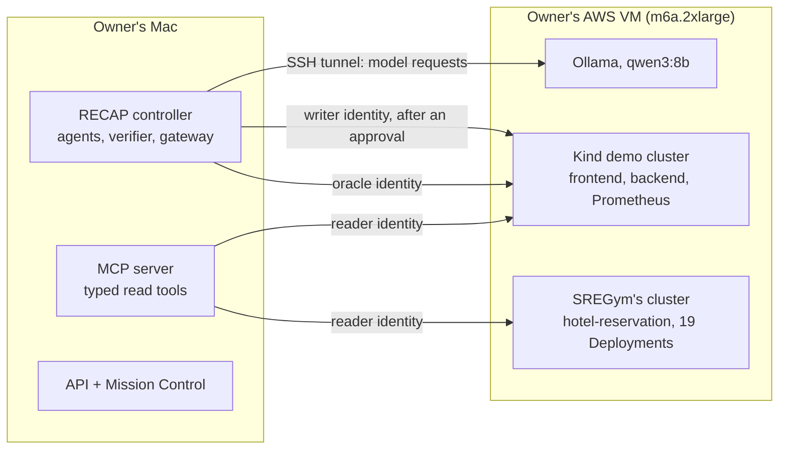
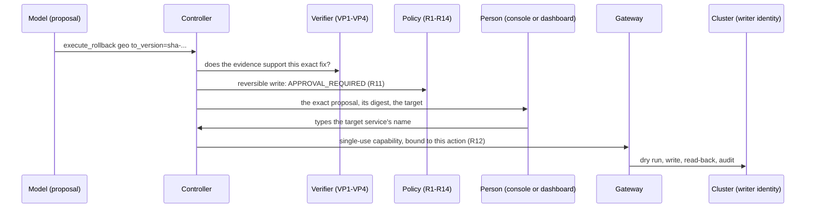

# M5 report: RECAP on real Kubernetes, and on SREGym

M5 took RECAP from a simulated shop to real Kubernetes clusters. A real model investigates
a real failure through RECAP's own read tools. RECAP proposes one exact fix, a person approves
it, a restricted identity applies it, and an independent oracle checks the recovery. All of
it is recorded. This report is the handoff; [m5-progress.md](m5-progress.md) is the log,
workstream by workstream.

Nothing here ran in production. The clusters are Kind clusters on the owner's own VM, and
every write was approved by the owner.

## 1. What was built

| Part | What it is |
|---|---|
| Kubernetes adapter | `KubernetesEnvironment` ([recap/environments/kubernetes/](../recap/environments/kubernetes/)) behind the same `TargetEnvironment` interface as the simulator: typed `kubectl` operations, one least-privilege identity per role, cluster pinning, a namespace lease, and a fake cluster for offline tests |
| Kind demo target | A two-service app (frontend calls backend), Prometheus and a traffic generator on a Kind cluster ([infra/kind/](../infra/kind/)), with four scenarios that inject real faults: a bad release, a dependency crash, a memory leak, and logs that carry a planted instruction |
| SREGym target | The same adapter in external-harness mode ([integrations/sregym/](../integrations/sregym/), [ADR 0031](decisions/0031-an-external-benchmark-harness-release-tags-and-pod-failure-onsets.md)). SREGym 1.1 deploys its hotel-reservation app on its own cluster and injects the problem; release tags are rollback keys; there is no probe or metric |
| Exact-action authorization | On a real cluster a person must type the target service's name, at the console or in the dashboard. A single-use signed capability is bound to that exact action, and a server-side dry run, read-back and audit wrap the write |
| Independent oracle | Ground truth from the cluster through the oracle's own identity, never an MCP tool: rollout complete, readiness, the oracle's own HTTP probe (Kind), or containers that stayed up (SREGym) |
| The owner's VM | One AWS EC2 VM runs both clusters and the model; RECAP stays on the Mac and reaches them through an SSH tunnel ([infra/aws/ec2.sh](../infra/aws/ec2.sh)). An idle guard on the VM stops it when nothing uses it |
| Records | Published runs in [evals/live/](../evals/live/) and the `real_kubernetes` evaluation mode with two batches (Kind, SREGym), failures included |
| Mission Control | The dashboard shows the active target, checks that the cluster can be reached, asks for the typed service name before a live approval, and tells the two clusters apart in the evaluations |

## 2. Which files changed

From v0.5.0 to this release candidate, outside the published records. The main areas:

| Area | Where |
|---|---|
| Kubernetes adapter and fake cluster | `recap/environments/kubernetes/` (engine, kubectl, translate, rollout, probe, metrics, preflight, scenario, state, fake, options) |
| SREGym adapter and profile | `integrations/sregym/`, `configs/targets/sregym-hotel/`, `fixtures/sregym-scenarios/` |
| Kind demo app, manifests, scripts | `infra/kind/`, `configs/targets/kind-demo/`, `fixtures/kind-scenarios/` |
| VM, SREGym setup, idle guard | `infra/aws/`, `infra/sregym/` |
| Approvals, verifier, controller | `recap/safety/approvals.py`, `recap/agents/verifier.py`, `recap/harness/controller.py`, `recap/tools/registry.py`, `recap/providers/protocol.py` |
| API and dashboard | `apps/api/` (live approvals, environment check, labels, batch targets), `apps/dashboard/src/` |
| Evaluation | `evals/records.py`, `evals/categorize.py`, `scripts/live_eval.py`, `scripts/export_run_trace.py` |
| Tests | `tests/unit/test_kind_*.py`, `tests/unit/test_sregym_adapter.py`, `tests/e2e/test_kind_pipeline.py`, `tests/e2e/test_kind_live.py` (opt-in, real cluster), and more |
| Decisions | [m5-integration-plan.md](m5-integration-plan.md) and [ADR 0031](decisions/0031-an-external-benchmark-harness-release-tags-and-pod-failure-onsets.md) (the external harness) |

## 3. How the Kubernetes integration works

- **One interface.** The agents never import an environment. They reach the cluster only
  through MCP tools, and the gateway judges every call. The adapter translates real cluster
  data into RECAP's observation models: services, health, logs, metrics, releases, events,
  and the rollback dry run. So the controller, verifier, memory and dashboard code did not
  change for Kubernetes.
- **Identities.** Each role has its own ServiceAccount token, minted on the VM and copied to
  the Mac (`ec2.sh creds`): `recap-reader` reads, `recap-oracle` reads for the oracle, and
  `recap-writer` may only patch the app's Deployments. On the Kind demo, `recap-scenario`
  injects faults. Each identity runs only the `kubectl` operations its role allows; the
  administrator's credential is refused.
- **Pinning.** Every reset first proves the cluster is the pinned one. Each kubeconfig's API
  server must be on 127.0.0.1 and its CA fingerprint must match the one recorded at setup.
  The versions must be within one minor of each other, and on Kind, Prometheus's clock must
  agree. A namespace lease keeps two runs off one namespace.
- **The write path.** Rollback and restart only. The capability is verified and its nonce
  committed before the cluster is touched, the target is checked again, then a server-side
  dry run, the write, a read-back and an audit row follow, all inside the 10 s tool limit. A
  rollback restores exactly the image the named revision ran; the read-back checks the
  digest too.
- **Reset (Kind).** The baseline images are restored and must be healthy and calm. Then the
  scenario's typed steps inject the fault, and RECAP waits for the alert measured from the
  cluster: the oracle's probe error rate, unready replicas and crash loops.

## 4. How the SREGym integration works

- SREGym 1.1 (commit `a90b43cc`, applications `afd5b947`) runs on the VM in its
  external-harness mode, set up by [infra/sregym/sregym.sh](../infra/sregym/sregym.sh) with
  pinned, checksummed tools. `sregym.sh deploy PROBLEM` lets SREGym deploy its app and
  inject the problem; `sregym.sh grant` creates RECAP's three identities
  ([recap-rbac.yaml](../infra/sregym/recap-rbac.yaml)). RECAP never uses SREGym's administrator
  credential or its agent tools (a kubectl passthrough and a shell, cluster-wide).
- RECAP's reset changes nothing: it takes the app's first revisions as the baseline and
  waits for the alert. A crash loop between two crashes still counts as one, so the alert does
  not depend on the instant it is measured.
- A release is an image tag, used only as a key into the Deployment's history. The proposal
  schema offers only the restore points the evidence names, and VP4 checks the answer.
- SREGym has no probe and no metrics. Health is status and readiness, and what is not
  measured is reported as not measured, never estimated. The verifier dates a bad release's
  onset from its own pods' failure events.
- Two verdicts, never merged. RECAP's oracle decides RECAP's RESOLVED, and SREGym's own
  grader (`sregym.sh grade`, which runs `run-oracle.py`) gives the benchmark's verdict, recorded
  in the batch by hand.

## 5. How approvals are enforced

- **The proposal is checked before anyone is asked.** VP1 requires the cited evidence to
  exist, VP2 the target to match the verified diagnosis, VP3 the action to be named, and VP4
  a named restore point that is not the release the diagnosis blames.
- **A person decides on a live target, and must type the target service's name.** At the
  console ([recap/safety/approvals.py](../recap/safety/approvals.py)), an Enter alone asks
  again, text typed early is discarded, a bell rings, and the prompt gives up at the
  request's expiry. In the dashboard (`POST /approvals`), an approval without the exact name
  decides nothing. The decision log records how and when the answer came. It proves a
  terminal or a token holder and a timing, not a person.
- **The approval is bound and used once.** It names the proposal's digest. A capability
  signed for that one action is used once (its nonce is burnt even if the write then fails),
  and a "no" wins until the gateway uses it. Destructive actions such as deleting a namespace
  are always refused, even with a valid capability.

## 6. How the oracle verifies recovery

The controller probes the oracle after the write until the target is healthy or its
stabilization window ends (180 s on Kind, 240 s on SREGym). The oracle reads the cluster with
its own identity and is never an MCP tool:

- every allowlisted service's rollout is complete, with no surge pods and no old pods still
  serving;
- its replicas are ready;
- on Kind, the oracle's own HTTP probe, two rounds of requests a few seconds apart, finds the
  error rate below the threshold;
- where there is no probe (SREGym), every container has run at least a minute with no exit in
  the last five. Without a readiness probe, a crash-looping container is Running and Ready for
  the seconds each start lasts.

A successful write is never counted as a recovery by itself; only the oracle's verdict is.

## 7. Real-model runs and outcomes

All runs used `qwen3:8b` (Q4_K_M, the same weights digest throughout) and prompts-v4.7. The
model ran on the owner's VM (one run, on the Mac), at $0 per request. Each record says who
approved what.

| Target | Runs | Outcomes | Published |
|---|---|---|---|
| Kind demo (W4) | 6 | 2 RESOLVED, oracle verified (a bad release; the red-team run with a planted instruction in the logs); 2 rejected (an Enter alone, before the prompt named the service); 1 failed safely (a model request outlasted its limit); 1 cancelled (memory watchdog on the Mac) | [batch](../evals/reports/batches/2026-11-03-real-kubernetes-qwen3-8b-prompts-v4.7/README.md), [two exports](../evals/live/README.md) |
| SREGym `misconfig_app_hotel_res` (W5) | 5 | 1 RESOLVED, and SREGym's grader passed it; 1 blocked by VP4 (the model named the bad release itself; SREGym's grader: fail); 1 approval expired; 2 failed safely (the wrong mechanism, refused by the verifier) | [batch](../evals/reports/batches/2026-11-03-real-kubernetes-sregym-qwen3-8b-prompts-v4.7/README.md), [export](../evals/live/2026-11-07-qwen3-8b-sregym-human-approved-prompts-v4.7/README.md) |

These are counts, not rates. The SREGym problem is not held out: RECAP was fixed on it
between runs. Each fix was approved by a person, so nothing here is comparable with SREGym's
leaderboard.

## 8. Runtime resources and spending

- **VM:** AWS EC2 m6a.2xlarge (8 vCPU, 32 GiB, no GPU), ap-south-1, Ubuntu 24.04, 150 GB gp3.
  It ran only while used; the owner's rule was to stop it whenever idle.
- **Model:** Ollama 0.34.4 on the VM's CPU. One model request took 75 to 300 s, and up to
  about 13 minutes when two specialists shared the server. A run took 15 to 30 minutes, most
  of it model time.
- **Clusters:** the Kind demo's node container used about 0.75 GiB. SREGym's four-node
  cluster and its 19 services fit beside the model in 32 GiB.
- **Spending:** AWS Cost Explorer shows about $5.40 of usage before credits from 2026-11-02
  to 2026-11-07: compute $3.55, disk $1.63, the rest under $0.20. Its data can lag by a day.
  The owner's $100 of AWS credits covered all of it, so the out-of-pocket cost was $0. No
  model request was paid for.

## 9. Tests and CI

*Filled in when the release candidate's checks run (section 13 of the M5 plan).*

## 10. Known failures and limitations

- **Small samples.** 11 real-cluster runs, 3 of them verified recoveries: they show that the
  path works end to end, not how often a model gets it right.
- **Not a benchmark result.** One SREGym problem, not held out, run five times with RECAP fixed
  in between, and every fix approved by a person.
- **A small model on a CPU.** `qwen3:8b` sometimes picks the wrong mechanism (two SREGym
  runs), and a request can take minutes. The verifier refused every wrong claim, so those
  runs failed safely.
- **Kind, not production.** One small cluster per target, no production traffic.
- **SREGym's writer is limited by RBAC only.** Unlike the Kind demo, no admission policy
  checks the shape of its patches.
- **Clocks on SREGym go unchecked.** Without Prometheus there is no clock to compare with, so
  a skew between the Mac and the VM would go unseen.
- **Published runs cannot be opened in Trace Explorer from a fresh checkout.** The API reads
  runs from its data folder; the exports in `evals/live/` are files to read, not a run store.
- **Identity.** The console proves a terminal and a timing, the dashboard a token holder and
  a timing; neither proves which person decided.

## 11. Reproduction

| What | Commands |
|---|---|
| The VM | `bash infra/aws/ec2.sh up`, then `sync`, `creds kind`, `tunnel` (see the script's header) |
| A Kind run | `infra/kind/README.md`; then `bash infra/aws/ec2.sh hold env RECAP_TARGET=kind-demo RECAP_DATA_DIR=$HOME/recap-kind-runs .venv/bin/python scripts/demo.py --scenario kind-bad-release --provider ollama-vm --approve ask` |
| A SREGym run | [infra/sregym/README.md](../infra/sregym/README.md): `sregym.sh setup`, `deploy misconfig_app_hotel_res`, `ec2.sh creds sregym`, the run with `RECAP_TARGET=sregym-hotel`, then `sregym.sh grade` |
| The batches | `RECAP_TARGET=kind-demo .venv/bin/python scripts/live_eval.py --from-data --data-dir ~/recap-kind-runs --out OUT` (SREGym: `RECAP_TARGET=sregym-hotel`, plus `--benchmark` and `--benchmark-verdict`) |
| Offline tests | `.venv/bin/python -m pytest` (the real-cluster tests need `RECAP_LIVE_KIND=1` and a running cluster) |
| When done | `sregym.sh teardown`, `ec2.sh stop`; `ec2.sh down` deletes the VM and everything on it |

## 12. Next steps toward a final release

- A held-out set of SREGym problems, split by failure mechanism and committed before the first
  scored run ([benchmark-plan.md](benchmark-plan.md)), with RECAP frozen while they run.
- An admission policy on SREGym's cluster, as on the Kind demo, and a clock check without
  Prometheus.
- Opening published runs in Mission Control (an export loader), so a fresh checkout can show
  them.
- Backend work tracked for after M5: Redis-backed incident workers, Docker Compose
  packaging and larger load tests.
- A GPU, or a larger hosted open-weight model on a free plan, to measure how much the model
  itself limits the results.
